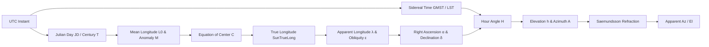
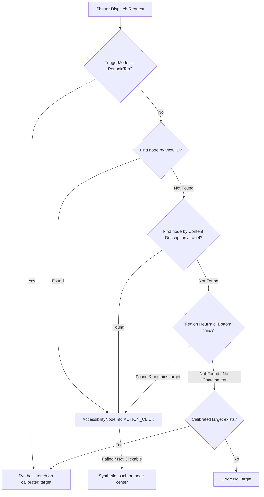

# Comprehensive Technical & Architectural Summary of CAELIS

This document provides an exhaustive technical specification of **CAELIS** — its architecture, core functionality, utilized technologies, component lifecycles, and detailed mathematical/astronomical algorithms.

---

## 1. Overview and Core Purpose

**CAELIS** is an open-source (GPLv3), fully local Android intervalometer designed for automated time-lapse photography and periodic screen tapping.

### Core Operating Principle
Rather than implementing a simplified custom camera pipeline via Camera2/CameraX APIs, the application **triggers the shutter directly inside the device's native camera application** (such as Google Camera / GCam ports, Samsung Camera, Open Camera, etc.). 
Consequently, every captured time-lapse frame retains the native camera's complete computational photography pipeline — including **HDR+, Night Sight, Astrophotography, multi-frame noise reduction, and RAW/JPEG processing**.

### Security and Privacy
- The app requests `android.permission.INTERNET` exclusively for downloading digital elevation model (DEM) terrain tiles in AR modules after explicit user consent. All network calls are strictly isolated to [`DemTileDownloader.kt`](app/src/main/java/com/dazix/caelis/data/horizon/DemTileDownloader.kt), which is continuously enforced by the `NetworkIsolationTest` architectural gate. Removing the `INTERNET` permission from the manifest is a supported source build mode (the app falls back seamlessly to manual HGT file imports).
- No telemetry, analytics, user identifiers, or location data ever leave the device.
- Uses Android's Accessibility Service framework (`AccessibilityService`). The codebase is designed to be easily auditable and built directly from source.

### Two Operational Trigger Modes
1. **Time-lapse Mode:**
   - Automatically brings the selected camera app to the foreground.
   - Dispatches shutter taps on a drift-free schedule.
   - Monitors foreground application state: if the user switches away or the screen turns off, the session automatically pauses (`autoPause`) and resumes safely upon return.
2. **Periodic Tap Mode:**
   - Functions as a universal metronome and auto-clicker for any foreground application.
   - Dispatches taps at a calibrated coordinate or randomly within a calibrated bounding box (with optional spatial jitter).
   - Operates with zero camera latency constraints (minimum interval floor is just the 70 ms touch gesture duration).

### Integrated Augmented Reality (AR) Modules
- **Sun & Moon AR (Solar & Lunar Planner):** 3D perspective projection of solar and lunar trajectory arcs, hourly celestial positions, Moon phases, time markers, sunrise/sunset, golden hour, twilight phases (Civil, Nautical, Astronomical), and real terrain horizon onto the live camera viewfinder. Includes True-North magnetic declination correction, dynamic lens FOV calculation, fullscreen Immersive Mode, and 28dp edge exclusion zones for system predictive back gestures.
- **Night Sky AR (60 FPS Planetarium & Astrophotography):** 3D celestial sphere projection, 60 FPS zero-allocation star field rendering directly from a binary FlatBuffers catalog (`catalog.bin`), 88 IAU constellations with stick-figure asterisms and 4-point homography artwork illustrations, 110 Messier Deep Sky Objects (galaxies, nebulae, clusters) with hybrid rendering (WebP textures via `Matrix.setPolyToPoly` vs vector glyphs), meteor shower radiants with velocity vectors, dynamic Solar System planetary ephemeris (dual-state point light vs 3D photorealistic textures), Virtual Clock time scrubber ($\pm 12\,\text{h}$) with Date/Time pickers, terrain-aware celestial visibility schedules (Rise, Transit, Set) with an isolated local date override, adaptive brightness/distance hit-testing (`StarHitTester`) with disambiguation popup, smooth 60/120 Hz gesture navigation, global celestial search with smart camera routing, real terrain horizon silhouette, procedural GPU AGSL shaders (Milky Way, atmosphere, landscape), and fullscreen Immersive Mode.

---

## 2. Architecture and Project Structure

The project strictly follows Clean Architecture principles, isolating pure domain mathematics from the Android framework.

```
com.dazix.caelis
├── domain/                  # Pure Kotlin (zero Android imports) – scheduling, ramping math, stop conditions
│   ├── horizon/             # Terrain horizon: .hgt decoder, ray-marching, HorizonProfile, SkylineMatcher
│   ├── solar/               # Solar & lunar ephemeris, PSA/Meeus algorithms, day times, trajectories, terrain rise/set
│   └── nightsky/            # Celestial astronomy (J2000.0 RA/Dec -> Alt/Az), Frustum Culling, star optics,
│                            # planetary ephemeris, constellations, Messier DSOs, meteor showers,
│                            # visibility schedules (CelestialVisibilityCalculator), search index
├── ar/                      # AR projection (R^T matrix), measured FOV calculator, sensors, GPS, SkylineAligner, SkyDomeRenderer
├── data/                    # Preferences DataStore (SettingsStore), SessionRepository, AdvancedSettings
│   ├── horizon/             # Network tile download (DemTileDownloader), manual import, mmap tile cache, HorizonRepository
│   └── nightsky/            # FlatBuffers schemas and accessors (NightSkyCatalog, Star, Constellation, Dso, MeteorShower)
├── service/                 # Core engine: ShutterAccessibilityService, SessionEngine, ShutterDispatcher,
│                            # CameraProfiles, RunStateStore, SessionAlarmReceiver, DisplayGeometry
├── overlay/                 # Floating control panel (OverlayController, PanelPlacement, OverlayPolicy)
│                            # and calibration overlay (CalibrationOverlay, CalibrationMath)
├── notify/                  # System notifications: SessionNotifications (session progress) and TerrainNotifications (download/compute)
├── verify/                  # MediaStore image write detection and validation (CaptureVerifier)
├── monitor/                 # Battery level and available storage monitoring (BatteryMonitor, StorageMonitor)
└── ui/                      # Jetpack Compose UI (Material 3 Expressive), ViewModels, screens
    ├── solar/               # Sun AR screen, ViewModel, and 60 FPS celestial canvas renderer
    └── nightsky/            # Night Sky AR screen, ViewModel, NightSkyRenderer, Virtual Clock, search, bottom sheets, AGSL shaders
```

### Layer Interaction Overview


---

## 3. Technologies, Libraries, and Tooling

| Domain | Technology / Library | Version | Description & Usage |
| :--- | :--- | :--- | :--- |
| **Language & Runtime** | **Kotlin** | `2.3.20` | Modern type-safe language, Coroutines, StateFlow |
| | **Java / JVM Target** | `17` | Standard Java 17 bytecode target |
| | **Android SDK** | `compileSdk 37` (Platform 37.1) | `minSdk 30` (Android 11+), `targetSdk 37` (Android 17) |
| **Build System** | **Android Gradle Plugin (AGP)** | `9.3.1` | Built-in Kotlin support in AGP 9 |
| | **Gradle** | `9.5.0` | Build system with Version Catalogs (`libs.versions.toml`) |
| **User Interface** | **Jetpack Compose BOM** | `2026.08.00` | Declarative UI toolkit |
| | **Compose Material 3** | `1.5.0-alpha26` | *Pinned ahead of BOM*: unlocks full Material 3 Expressive components (`LoadingIndicator`, `ButtonGroup`, `FloatingToolbar`, `MotionScheme.expressive()`, `MaterialShapes`) |
| | **Activity / Lifecycle Compose** | `1.13.0` / `2.11.0` | Seamless Compose integration with Activity and ViewModel lifecycles |
| **Asynchrony & State** | **Kotlinx Coroutines** | `1.11.0` | Asynchronous execution, `StateFlow`, `SupervisorJob` |
| | **AndroidX DataStore Preferences** | `1.2.1` | Reactive persistent storage for settings and calibrations |
| **Camera & Sensors** | **AndroidX CameraX** | `1.4.1` | `camera-core`, `camera-camera2`, `camera-lifecycle`, `camera-view` for live AR viewfinder |
| | **Android SensorManager** | Framework | `TYPE_ROTATION_VECTOR`, `TYPE_GEOMAGNETIC_ROTATION_VECTOR` |
| | **Android GeomagneticField** | Framework | True-North geomagnetic declination computation |
| **Serialization & Data** | **Google FlatBuffers Java** | `24.3.25` | Zero-copy direct memory reading of binary star/DSO catalogs in $\mathcal{O}(1)$ without GC allocations |
| **Testing Framework** | **JUnit 4** / **Coroutines Test** | `4.13.2` / `1.11.0` | JVM unit tests for domain math, schedules, and policies |
| | **AndroidX Test / Espresso / UIAutomator** | `1.3.0` / `3.7.0` / `2.4.0` | Instrumented on-device testing and fake camera integration |

---

## 4. In-Depth Mathematical Models and Astronomical Computations

This section provides complete mathematical formulations, physical transformations, and algorithms implemented in the application.

---

### 4.1. Drift-Free Timing and Scheduling (`IntervalSchedule`)

Naïve intervalometer implementations typically rely on relative delays like `delay(interval)` or `target = now + interval`. If any frame experiences latency (e.g. 50 ms camera processing load), the entire schedule shifts forward, accumulating significant timing error over hundreds of shots.

#### 1. Absolute Timeline Anchoring (`IntervalSchedule`)
Each shot index $i$ ($i \ge 0$) has an invariant target execution timestamp anchored to the session origin:

$$T_{\text{target}}(i) = T_{\text{start\_origin}} + T_{\text{start\_delay}} + \text{offset}(i)$$

For a constant interval $\Delta t$:
$$\text{offset}(i) = i \cdot \Delta t$$

#### 2. Interval Ramping Curves
The application supports dynamic interval modulation over time (e.g. slowing down or accelerating capture cadence during sunset).
The normalized ramp progress $p \in [0.0, 1.0]$ is computed based on the selected domain:
- **By Shot Count:**
  $$p = \operatorname{clamp}\left(\frac{i}{N_{\text{shots}}}, 0.0, 1.0\right)$$
- **By Elapsed Duration:**
  $$p = \operatorname{clamp}\left(\frac{t_{\text{elapsed}}}{T_{\text{duration}}}, 0.0, 1.0\right)$$

The interval for a given progress $p$ is calculated according to the curve type:
- **Linear Ramp:**
  $$\Delta t(p) = \Delta t_{\text{start}} + (\Delta t_{\text{end}} - \Delta t_{\text{start}}) \cdot p$$
- **Exponential Ramp:**
  $$\Delta t(p) = \exp\left(\ln(\Delta t_{\text{start}}) + \left(\ln(\Delta t_{\text{end}}) - \ln(\Delta t_{\text{start}})\right) \cdot p\right)$$

During ramping, the cumulative offset $\text{offset}(i)$ is iteratively accumulated:
$$\text{offset}(i) = \sum_{k=0}^{i-1} \Delta t(k, \text{offset}(k))$$

#### 3. Dynamic Delay Absorption (`resolveTarget`)
If a shot is delayed beyond the allowed tolerance (e.g. $LATE\_TOLERANCE\_MS = 250\,\text{ms}$) due to long exposure times or manual pausing:
$$\Delta t_{\text{late}} = T_{\text{now}} - T_{\text{target}}(i)$$
$$T_{\text{schedule\_anchor}} \leftarrow T_{\text{schedule\_anchor}} + \Delta t_{\text{late}}$$
This re-anchors the timeline exactly once, preventing rapid burst firing to "catch up".

#### 4. Dual Waiting Mechanism
- **Short Intervals ($< 60\,\text{s}$):** Uses `Handler.postAtTime` with `SystemClock.uptimeMillis()` and a continuously held `PowerManager.PARTIAL_WAKE_LOCK`.
- **Long Intervals ($\ge 60\,\text{s}$):** Uses `AlarmManager.setExactAndAllowWhileIdle` based on `ELAPSED_REALTIME_WAKEUP`. The wake lock is released between shots to conserve battery on multi-hour time-lapses.

---

### 4.2. Solar and Lunar Ephemeris Computations

Implemented in [`SolarPositionCalculator.kt`](app/src/main/java/com/dazix/caelis/domain/solar/SolarPositionCalculator.kt) using NOAA solar positioning standards and Jean Meeus astronomical algorithms (accuracy $< 0.01^\circ$).



#### 1. Time Conversion to Julian Centuries ($T$)
For a given UTC timestamp $t$ (in seconds since epoch):
$$\text{JD} = 2440587.5 + \frac{t}{86400.0}$$
$$T = \frac{\text{JD} - 2451545.0}{36525.0}$$

#### 2. Solar Equatorial Coordinates
- **Geometric Mean Longitude ($L_0$ in degrees):**
  $$L_0 = 280.46646 + 36000.76983 \cdot T + 0.0003032 \cdot T^2 \pmod{360^\circ}$$
- **Mean Anomaly ($M$ in radians):**
  $$M = 357.52911 + 35999.05029 \cdot T - 0.0001537 \cdot T^2 \pmod{360^\circ}$$
- **Equation of Center ($C$ in degrees):**
  $$C = (1.914602 - 0.004817 T - 0.000014 T^2) \sin(M) + (0.019993 - 0.000101 T) \sin(2M) + 0.000289 \sin(3M)$$
- **True Longitude:** $\text{sunTrueLong} = L_0 + C$
- **Apparent Longitude ($\lambda$):**
  $$\Omega = 125.04 - 1934.136 \cdot T$$
  $$\lambda = \text{sunTrueLong} - 0.00569 - 0.00478 \sin(\Omega)$$
- **Obliquity of the Ecliptic ($\epsilon$):**
  $$\epsilon_0 = 23^\circ 26' 21.448'' - (46.8150 T + 0.00059 T^2 - 0.001813 T^3)''$$
  $$\epsilon = \epsilon_0 + 0.00256 \cos(\Omega)$$
- **Declination ($\delta$) and Right Ascension ($\alpha$):**
  $$\delta = \arcsin(\sin\epsilon \sin\lambda)$$
  $$\alpha = \operatorname{atan2}(\cos\epsilon \sin\lambda, \cos\lambda)$$

#### 3. Horizontal Coordinate Conversion (Azimuth & Elevation)
- **Greenwich Mean Sidereal Time (GMST):**
  $$\text{GMST} = 280.46061837 + 360.98564736629 \cdot (\text{JD} - 2451545.0) + 0.000387933 T^2 - \frac{T^3}{38710000} \pmod{360^\circ}$$
- **Local Sidereal Time (LST) and Hour Angle ($H$):**
  $$\text{LST} = \text{GMST} + \text{longitude}$$
  $$H = \text{LST} - \alpha \quad (\text{normalized to } [-180^\circ, +180^\circ])$$
- **Geometric Altitude/Elevation ($h$):**
  $$\sin h = \sin\phi \sin\delta + \cos\phi \cos\delta \cos H \implies h = \arcsin(\sin h)$$
- **Azimuth ($A$ measured clockwise from True North):**
  $$A = \operatorname{atan2}(-\sin H \cos\delta, \cos\phi \sin\delta - \sin\phi \cos\delta \cos H) \pmod{360^\circ}$$

#### 4. Atmospheric Refraction (Saemundsson 1986)
For celestial bodies near the horizon ($h \ge -0.8333^\circ$):
$$R_{\text{arcmin}} = \frac{1.02}{\tan\left(\left(h + \frac{10.3}{h + 5.11}\right) \cdot \frac{\pi}{180}\right)}$$
$$h_{\text{apparent}} = h + \frac{R_{\text{arcmin}}}{60}$$

#### 5. Solar Day Events and Lunar Ephemeris
In [`SolarDayTimes.kt`](app/src/main/java/com/dazix/caelis/domain/solar/SolarDayTimes.kt), [`LunarPositionCalculator.kt`](app/src/main/java/com/dazix/caelis/domain/solar/LunarPositionCalculator.kt), and [`LunarDayTimes.kt`](app/src/main/java/com/dazix/caelis/domain/solar/LunarDayTimes.kt):
- **Solar Noon (Meridian Transit):** Coarse 5-minute sampling across $\pm 2$ hours followed by ternary search down to 1-second precision.
- **Sunrise and Sunset:** Bisection search crossing $h_{\text{target}} = -0.8333^\circ$ ($34'$ refraction $+ 16'$ solar disk semidiameter) with 1-second precision.
- **Twilight Phases:** Civil ($h = -6^\circ$), Nautical ($h = -12^\circ$), and Astronomical ($h = -18^\circ$).
- **Golden Hour:** Horizon transitions between $-4.0^\circ$ and $+6.0^\circ$.
- **Lunar Ephemeris:** Geocentric coordinates, illumination fraction ($0.0 \dots 1.0$), angular diameter, and trajectory arcs using Meeus lunar theory ($< 0.1^\circ$).

---

### 4.3. Equatorial Astronomy, Star Optics, and Night Sky AR

Implemented in [`EquatorialCoordinates.kt`](app/src/main/java/com/dazix/caelis/domain/nightsky/EquatorialCoordinates.kt), [`StarFrustumCulling.kt`](app/src/main/java/com/dazix/caelis/domain/nightsky/StarFrustumCulling.kt), [`StarOptics.kt`](app/src/main/java/com/dazix/caelis/domain/nightsky/StarOptics.kt), and [`NightSkyCatalogLoader.kt`](app/src/main/java/com/dazix/caelis/domain/nightsky/NightSkyCatalogLoader.kt).

#### 1. Converting Equatorial Coordinates (RA $\alpha$, Dec $\delta$) to 3D ENU Vectors
Direct zero-allocation transformation without intermediate spherical conversions:
$$H = \text{LST} - \alpha$$
$$\mathbf{V}_{\text{world}} = \begin{bmatrix} V_{\text{East}} \\ V_{\text{North}} \\ V_{\text{Up}} \end{bmatrix} = \begin{bmatrix} -\cos\delta \sin H \\ \cos\phi \sin\delta - \sin\phi \cos\delta \cos H \\ \sin\phi \sin\delta + \cos\phi \cos\delta \cos H \end{bmatrix}$$

#### 2. Vector Frustum Culling on the Celestial Sphere
Fast 3D space culling using dot-product evaluation against the camera optical axis.
Camera optical axis in ENU coordinates:
$$\mathbf{V}_{\text{cam}} = \begin{bmatrix} -R[2] \\ -R[6] \\ -R[10] \end{bmatrix}$$

Diagonal half-angle field of view:
$$\tan(\theta_H) = \tan\left(\frac{\text{FOV}_H}{2}\right), \quad \tan(\theta_V) = \tan(\theta_H) \cdot \frac{\text{Height}}{\text{Width}}$$
$$\theta_{\text{max}} = \arctan\left(\sqrt{\tan^2\theta_H + \tan^2\theta_V}\right) + \theta_{\text{margin}} \quad (\theta_{\text{margin}} = 12^\circ)$$
$$\text{Threshold} = \cos(\theta_{\text{max}})$$

A star lies within the frustum if and only if:
$$\mathbf{V}_{\text{cam}} \cdot \mathbf{V}_{\text{star}} = (V_{\text{cam},x} V_{\text{star},x} + V_{\text{cam},y} V_{\text{star},y} + V_{\text{cam},z} V_{\text{star},z}) \ge \text{Threshold}$$

#### 3. Star Physical Optics and Johnson $B-V$ Index
- **Visual Magnitude Power Curve Radius Scaling:**
  $$r_{\text{star}} = r_{\text{min}} + (r_{\text{max}} - r_{\text{min}}) \cdot \left(1.0 - \frac{m - m_{\text{min}}}{m_{\text{max}} - m_{\text{min}}}\right)^{1.85}$$
- **Color Temperature Mapping from $B-V$:** Blackbody radiation color temperature ($1\,500\,\text{K}$ to $35\,000\,\text{K}$) mapped to sRGB for spectral classes O, B, A, F, G, K, M.
- **Atmospheric Scintillation (Twinkle):** Deterministic time-and-star-ID hash modulating intensity by $\pm 15\,\%$ with zero runtime allocations.

---

### 4.4. Constellations, Asterisms, and Perspective Homography

Implemented in [`NightSkyRenderer.kt`](app/src/main/java/com/dazix/caelis/ui/nightsky/NightSkyRenderer.kt) and [`Constellation.java`](app/src/main/java/com/dazix/caelis/data/nightsky/Constellation.java).

#### 1. Batch Line Rendering with Meet-in-the-Middle Animation
- Star links are stored as index pairs in FlatBuffers binary schema.
- Projected screen points are written directly into a pre-allocated `constellationLinesBuffer: FloatArray` and drawn with a single `nativeCanvas.drawLines()` call.
- Focused constellations animate their line segments inward from endpoints to center (meet-in-the-middle).

#### 2. Spatial Focus Hysteresis
Prevents flicker caused by hand tremor at viewport boundaries:
- Inner focus acquisition radius: $R_{\text{in}} = 0.45 \cdot W_{\text{viewport}}$
- Outer focus release radius: $R_{\text{out}} = 0.55 \cdot W_{\text{viewport}}$
- Within $R_{\text{in}} < d \le R_{\text{out}}$, state remains locked.

#### 3. 4-Corner Homography Perspective Mapping (`Matrix.setPolyToPoly`)
Each constellation holds 4 equatorial anchor points $(\alpha_k, \delta_k)_{k=0}^3$ for its mythological artwork. These corners are projected to viewport space $(x_k, y_k)_{k=0}^3$ and mapped via `Matrix.setPolyToPoly()` to achieve perspective-correct rendering.

#### 4. Adaptive Hit-Testing and Disambiguation (`StarHitTester`)
Targets are evaluated using a weighted score combining proximity and visual magnitude:
$$\text{Score} = w_d \cdot \left(1.0 - \frac{d}{R_{\text{max}}}\right) + w_m \cdot \left(1.0 - \frac{m - m_{\text{min}}}{m_{\text{max}} - m_{\text{min}}}\right)$$
where $w_d = 0.55$, $w_m = 0.45$. Prominent navigation stars are prioritized over faint background stars slightly closer to the touch coordinate.
- **Disambiguation Dialog:** When multiple candidate bodies have close scores, an interactive card lets the user pick the intended object.
- **Configurable Tap Radius:** $16 \dots 120\,\text{dp}$ with optional animated touch indicator circle.

---

### 4.5. Dynamic Solar System Bodies (Planetary Ephemeris)

Implemented in [`PlanetaryEphemerisCalculator.kt`](app/src/main/java/com/dazix/caelis/domain/nightsky/PlanetaryEphemerisCalculator.kt).

#### 1. Keplerian Elements and Perturbation Theory
Computes geocentric positions for 8 planets and the Moon from JPL Standish orbital elements:
- Semimajor axis $a$, eccentricity $e$, inclination $I$, mean longitude $L$, longitude of perihelion $\varpi$, longitude of ascending node $\Omega$.
- Newton-Raphson solution of Kepler's Equation $M = E - e \sin E$.
- Heliocentric to geocentric transformation $\implies$ apparent RA/Dec and distance in AU.

#### 2. Dual-State Rendering
- **State A (Wide View, Zoom $\le 12\times$):** Optical point light with core and soft `RadialGradient` corona in the planet's characteristic color.
- **State B (Deep Zoom, Zoom $> 12\times$):** Photorealistic 3D WebP texture with $40\times$ angular exaggeration for observing surface details and planetary rings.

---

### 4.6. Messier Deep Sky Objects (DSO) and Hybrid Homography

Implemented in [`Dso.java`](app/src/main/java/com/dazix/caelis/data/nightsky/Dso.java), [`DsoType.java`](app/src/main/java/com/dazix/caelis/data/nightsky/DsoType.java), [`NightSkyRenderer.kt`](app/src/main/java/com/dazix/caelis/ui/nightsky/NightSkyRenderer.kt), and [`DsoSymbolLegendSheet.kt`](app/src/main/java/com/dazix/caelis/ui/nightsky/DsoSymbolLegendSheet.kt).

#### 1. Binary FlatBuffers Catalog
Contains all 110 Messier catalog objects (galaxies, emission/diffuse nebulae, planetary nebulae, open clusters, globular clusters, supernova remnants) read in $\mathcal{O}(1)$ without allocations:
- J2000.0 equatorial coordinates $(\alpha, \delta)$, visual magnitude, angular dimensions (major and minor axes in arcminutes), position angle, and `DsoType`.

#### 2. Hybrid Rendering (WebP Homography vs. Vector Glyphs)
- **Wide View (Zoom $\le 4\times$):** Renders optimized vector glyphs for each object type (e.g. oriented ellipse for galaxies, dashed circles for clusters, square target for nebulae) scaled to angular size.
- **Deep Zoom (Zoom $> 4\times$):** Transitions to high-resolution WebP textures mapped via 4-corner perspective homography `Matrix.setPolyToPoly()`, oriented to celestial position angles.
- **Horizon Occlusion:** Objects below the physical terrain skyline are clipped or dimmed.
- **Symbol Legend:** Interactive bottom sheet explaining astronomical symbols for each DSO class.

---

### 4.7. Meteor Shower Radiants

Implemented in [`MeteorShower.java`](app/src/main/java/com/dazix/caelis/data/nightsky/MeteorShower.java), [`MeteorShowerDetailSheet.kt`](app/src/main/java/com/dazix/caelis/ui/nightsky/MeteorShowerDetailSheet.kt), and [`NightSkyRenderer.kt`](app/src/main/java/com/dazix/caelis/ui/nightsky/NightSkyRenderer.kt).

- **Shower Dynamics:** Major annual meteor showers (Perseids, Geminids, Quadrantids, Lyrids, Orionids, Leonids, Taurids, Eta/Delta Aquariids, Ursids) with radiant coordinates $(\alpha, \delta)$, atmospheric entry velocity ($v_{\infty}$ in $\text{km/s}$), and Zenithal Hourly Rate (ZHR).
- **Visual Display:** Radiant position with animated velocity vectors and active shower highlighting during peak date windows.
- **Search Integration:** Direct search routing and camera guidance to any shower radiant.

---

### 4.8. Virtual Clock & Time Travel Scrubber

Implemented in [`TimeScrubber.kt`](app/src/main/java/com/dazix/caelis/ui/nightsky/TimeScrubber.kt), [`TimeState.kt`](app/src/main/java/com/dazix/caelis/domain/nightsky/TimeState.kt), and [`NightSkyArViewModel.kt`](app/src/main/java/com/dazix/caelis/ui/nightsky/NightSkyArViewModel.kt).

- **Continuous Scrubber ($\pm 12\,\text{h}$):** Real-time timeline slider enabling smooth night sky simulation forward or backward in time without latency.
- **Zero Layout Shift:** Bottom container maintains invariant height so switching between Live, Paused, and Scrubber modes never shifts UI bounds.
- **Date & Time Pickers:** Jump to arbitrary dates and times via `DatePickerDialog` and `TimePickerDialog`.
- **Frame-Tied LST Rotation:** Local sidereal time is locked to frame timestamps, preventing star jitter during manual panning or scrubbing.

---

### 4.9. Celestial Body Visibility Schedule with Local Date Override

Implemented in [`CelestialVisibilityCalculator.kt`](app/src/main/java/com/dazix/caelis/domain/nightsky/CelestialVisibilityCalculator.kt) and [`CelestialDetailBottomSheet.kt`](app/src/main/java/com/dazix/caelis/ui/nightsky/CelestialDetailBottomSheet.kt).

#### 1. Visibility Calculation Model (Rise, Culmination, Set)
For equatorial coordinates $(\alpha, \delta)$, observer location $(\phi, \lambda)$, and target day:
- **Meridian Culmination:** Occurs when $\text{LST}(t) = \alpha$.
  - Maximum elevation: $h_{\text{culm}} = 90^\circ - |\phi - \delta|$
  - Circumpolar bodies ($h_{\text{min}} > 0^\circ$): object never sets.
  - Never visible bodies ($h_{\text{culm}} < 0^\circ$): object never rises.
- **Terrain Intersection:**
  - Evaluates against the 1440-sample `HorizonProfile` using bisection search across $\pm 6\,\text{h}$ around geometric rise/set times.
  - Rise and set occur at timestamp $t$ when body altitude $h(t)$ crosses terrain altitude $h_{\text{terrain}}(A(t))$ at azimuth $A(t)$.

#### 2. Isolated Local Date Override
- Users can step through days ($\pm 1\,\text{day}$) or select arbitrary calendar dates inside the detail sheet.
- **Strict Isolation:** Calculated asynchronously in bottom sheet Coroutine scope without altering global AR simulation time or allocating objects on the 60 FPS render loop.
- **Red Vision Theming:** Full dark-red night preservation for all controls and date dialogs.

---

### 4.10. Global Search System and Camera Routing Kinematics

Implemented in [`CelestialSearchIndex.kt`](app/src/main/java/com/dazix/caelis/domain/nightsky/CelestialSearchIndex.kt) and [`NightSkyArViewModel.kt`](app/src/main/java/com/dazix/caelis/ui/nightsky/NightSkyArViewModel.kt).

- **Priority Match Ranking:** Prefix match in primary Czech name (Priority 0), Latin name (Priority 1), substring match (Priority 2).
- **Search History:** Persisted in DataStore via `SearchHistoryCodec`.
- **AR Camera Re-calibration:** In sensor mode, freezes the live sensor matrix and rotates $R_{\text{user}}$ over 800 ms using `AccelerateDecelerateInterpolator` along the shortest angular path modulo $360^\circ$ (pitch clamped to $\pm 85^\circ$).
- **Manual Virtual Mode:** Animates virtual camera equatorial angles $(\alpha, \delta)$ along a `FastOutSlowIn` S-curve across the celestial sphere.

---

### 4.11. Procedural GPU AGSL Shaders & Planetarium Mode

Implemented in [`MilkyWayShader.kt`](app/src/main/java/com/dazix/caelis/ui/nightsky/MilkyWayShader.kt), [`AtmosphereShader.kt`](app/src/main/java/com/dazix/caelis/ui/nightsky/AtmosphereShader.kt), and [`LandscapeShader.kt`](app/src/main/java/com/dazix/caelis/ui/nightsky/LandscapeShader.kt).

- **Procedural Milky Way (`MilkyWayShader`):** AGSL fragment shader computing real-time galactic coordinates $(l, b)$ from the $R^T$ matrix. Renders galactic core, spiral arms, and dust lanes via volumetric fractional Brownian motion (FBM).
- **Planetarium Mode State Management:** Enabling the opaque background (Planetarium mode) temporarily disables the procedural Milky Way for high-contrast star chart clarity; returning to transparent AR restores user preferences.
- **Atmospheric Scattering (`AtmosphereShader`):** Rayleigh and Mie scattering simulation with horizon color gradients.
- **Landscape Silhouette (`LandscapeShader`):** Renders terrain skyline by sampling the 1440-sample profile strip via NEAREST filtering with shader-level interpolation.

---

### 4.12. 3D Augmented Reality Camera Projection

Implemented in [`CameraProjection.kt`](app/src/main/java/com/dazix/caelis/ar/CameraProjection.kt) and [`CameraFovCalculator.kt`](app/src/main/java/com/dazix/caelis/ar/CameraFovCalculator.kt).

#### 1. World to Device Coordinate Transformation ($R^T$)
Android `SensorManager` rotation matrix $R$ maps device vectors to world ENU coordinates ($\mathbf{V}_{\text{world}} = R \cdot \mathbf{V}_{\text{dev}}$).
Projecting celestial points onto the camera viewport requires the **orthogonal inverse (transpose $R^T$)**:

$$\mathbf{V}_{\text{dev}} = R^T \cdot \mathbf{V}_{\text{world}}$$

$$\begin{bmatrix} X_{\text{dev}} \\ Y_{\text{dev}} \\ Z_{\text{dev}} \end{bmatrix} = \begin{bmatrix} R_{0} & R_{4} & R_{8} \\ R_{1} & R_{5} & R_{9} \\ R_{2} & R_{6} & R_{10} \end{bmatrix} \begin{bmatrix} V_{\text{East}} \\ V_{\text{North}} \\ V_{\text{Up}} \end{bmatrix}$$

#### 2. Display Rotation Remapping
According to screen orientation (`Surface.ROTATION_0`, `ROTATION_90`, `ROTATION_180`, `ROTATION_270`):
$$\text{ROTATION\_0 (Portrait): } X_s = X_{\text{dev}}, \quad Y_s = Y_{\text{dev}}, \quad Z_s = -Z_{\text{dev}}$$
$$\text{ROTATION\_90 (Landscape): } X_s = Y_{\text{dev}}, \quad Y_s = -X_{\text{dev}}, \quad Z_s = -Z_{\text{dev}}$$
A point is in front of the camera when $Z_s > 0.001$.

#### 3. 2D Screen Perspective Projection
Focal length in pixels:
$$f_{\text{pixels}} = \frac{W_{\text{viewport}} / 2}{\tan\left(\frac{\text{FOV}_H}{2}\right)}$$

Viewport coordinates:
$$X_{\text{screen}} = \frac{W_{\text{viewport}}}{2} + f_{\text{pixels}} \cdot \frac{X_s}{Z_s}$$
$$Y_{\text{screen}} = \frac{H_{\text{viewport}}}{2} - f_{\text{pixels}} \cdot \frac{Y_s}{Z_s}$$

#### 4. Off-Screen Bearing Radar
When a point is outside viewport bounds or behind the observer ($Z_s \le 0$):
$$\theta_{\text{bearing}} = \operatorname{atan2}(X_s, Y_s) \pmod{360^\circ}$$
Guides the user via directional radar chevrons toward the target celestial body.

#### 5. Effective FOV with Viewfinder Aspect Crop (`CameraFovCalculator`)
Camera sensors typically have a 4:3 aspect ratio, while modern smartphone displays use tall ratios (19.5:9, 20:9). CameraX `ScaleType.FILL_CENTER` fills screen height and crops the sensor sides, reducing effective horizontal FOV:

$$\text{rawFov}_H = 2 \cdot \arctan\left(\frac{\text{sensorWidth}}{2 \cdot \text{focalLength}}\right)$$
$$\text{sensorAspect} = \frac{\text{sensorWidth}}{\text{sensorHeight}}, \quad \text{viewportAspect} = \frac{\text{viewportWidth}}{\text{viewportHeight}}$$
$$\text{cropRatio} = \frac{\text{viewportAspect}}{\text{sensorAspect}}$$
$$\text{effectiveFov}_H = 2 \cdot \arctan\left(\tan\left(\frac{\text{rawFov}_H}{2}\right) \cdot \text{cropRatio}\right)$$

#### 6. Sensor Stabilization & True-North Correction (`OrientationTracker`)
- **Adaptive Quaternion SLERP Smoothing:**
  $$\alpha = 0.30 + \operatorname{clamp}\left(\frac{\Delta\theta - 0.002\,\text{rad}}{0.025\,\text{rad} - 0.002\,\text{rad}}, 0, 1\right) \cdot (0.85 - 0.30)$$
  $$\mathbf{q}_{\text{smooth}} \leftarrow \mathbf{q}_{\text{smooth}} + \alpha (\operatorname{sgn}(\mathbf{q} \cdot \mathbf{q}_{\text{smooth}})\mathbf{q} - \mathbf{q}_{\text{smooth}})$$
  $$\mathbf{q}_{\text{smooth}} \leftarrow \frac{\mathbf{q}_{\text{smooth}}}{\|\mathbf{q}_{\text{smooth}}\|}$$
- **Pre-multiplied Magnetic Declination and User Calibration:**
  $$D = \text{declination}_{\text{geomagnetic}} + \text{offset}_{\text{user}}$$
  $$R_{\text{true}} = R_z(D) \cdot R_{\text{sensor}}$$

---

### 4.13. Display Geometry and Rotation-Independent Calibration (`DisplayGeometry`)

Calibrated shutter targets are stored as normalized screen fractions $[0.0, 1.0]$ in **Natural Display Space (`Surface.ROTATION_0`)**.


Transforming fractions across $k$ quarter turns:
$$k = (\text{rotation}_{\text{target}} - \text{rotation}_{\text{source}} + 4) \pmod 4$$
$$(x, y) \xrightarrow{k=1} (y, 1-x) \xrightarrow{k=2} (1-x, 1-y) \xrightarrow{k=3} (1-y, x)$$

With active spatial jitter (region targeting):
$$X = \text{rect.left} + \text{rand} \cdot \text{rect.width}$$
$$Y = \text{rect.top} + \text{rand} \cdot \text{rect.height}$$

---

### 4.14. Floating Panel Placement Optimization (`PanelPlacement`)

The floating overlay panel must never overlap regions where synthetic shutter taps might land.

#### Exhaustive Candidate Lattice Optimization
For each forbidden rectangular region $A_i$ (calibrated point with margin + node search bounds) and panel dimensions $(W, H)$:
$$X_{\text{candidates}} = \{ X_{\text{desired}}, X_{\text{min}}, X_{\text{max}} \} \cup \bigcup_i \{ A_i.\text{left} - W, A_i.\text{right} \}$$
$$Y_{\text{candidates}} = \{ Y_{\text{desired}}, Y_{\text{min}}, Y_{\text{max}} \} \cup \bigcup_i \{ A_i.\text{top} - H, A_i.\text{bottom} \}$$

For every lattice point $(x, y) \in X_{\text{candidates}} \times Y_{\text{candidates}}$, a cost function is evaluated:
$$\text{Cost}(x, y) = M \cdot \sum_i \text{OverlapArea}(\text{Panel}(x, y), A_i) + \left((x - X_{\text{desired}})^2 + (y - Y_{\text{desired}})^2\right)$$
where $M \gg 0$ heavily penalizes overlap. The algorithm identifies the global optimum closest to user preference with guaranteed zero overlap.

---

### 4.15. Exposure Verification Rules (`CaptureVerifier` & `CameraImageRule`)

Capture verification validates new photo records written to `MediaStore.Images`:
1. **Pre-shutter:** Captures a token containing baseline timestamp $T_{\text{window\_start}}$ and last existing media ID.
2. **Post-shutter:** Queries MediaStore across a time window:
   $$T_{\text{window\_start}} - 3\,\text{s} \le \text{date\_added} \le T_{\text{now}} + 3\,\text{s}$$
3. **Acceptance Rule (`CameraImageRule`):**
   - Media row owner (`OWNER_PACKAGE_NAME`) matches target camera package, OR
   - Path starts with `DCIM/` and is not inside excluded directories (`screenshots`, `screen_recordings`, `restored`, `download`).

---

### 4.16. Terrain Horizon Profile Computation

Implemented in [`HgtTile.kt`](app/src/main/java/com/dazix/caelis/domain/horizon/HgtTile.kt), [`HorizonProfileCalculator.kt`](app/src/main/java/com/dazix/caelis/domain/horizon/HorizonProfileCalculator.kt), [`SkylineMatcher.kt`](app/src/main/java/com/dazix/caelis/domain/horizon/SkylineMatcher.kt), and [`TerrainRiseSetCalculator.kt`](app/src/main/java/com/dazix/caelis/domain/solar/TerrainRiseSetCalculator.kt).

#### 1. Decoding Binary SRTM HGT Elevation Models
- 1 arc-second grid ($3601 \times 3601$ 16-bit big-endian signed short samples per $1^\circ \times 1^\circ$ tile).
- Void samples ($-32768$) are strictly mapped to `null` (not $0\,\text{m}$), preventing spurious horizon dips in valleys and glaciers.

#### 2. Ray-Marching with Earth Curvature and Refraction
- Profile consists of 1440 equidistant azimuth samples ($0.25^\circ$ step).
- Effective Earth radius scaled by atmospheric refraction ($R_{\text{eff}} = R / (1 - k), k = 0.13$).
- Observer elevation derived from DEM ground surface $+$ eye height (`eyeHeightMeters`), avoiding GPS altitude inaccuracies.
- Automatic range estimation (`HorizonRangeEstimator`) bounds tile downloads to the physical horizon boundary.

#### 3. Automatic Skyline Alignment (`SkylineExtractor` & `SkylineMatcher`)
- Detects sky/terrain boundary in camera preview and fits against the 1440-sample profile.
- Rejects ambiguous fits (demands relief contrast, low residual variance $< 0.5^\circ$, and low quantile differences to avoid tree/building offsets).

---

## 5. Key Components and Lifecycles

### 5.1. SessionEngine (State Machine)

`SessionEngine` is the core execution controller hosted inside `ShutterAccessibilityService`.


#### Guard Rails
Before any synthetic gesture is dispatched, three invariants are strictly checked:
1. `PowerManager.isInteractive == true` (screen is on).
2. `KeyguardManager.isKeyguardLocked == false` (device is unlocked).
3. `foregroundApplicationPackage == targetPackage` (target camera is in foreground).
If any condition fails, the session triggers `autoPause` and starts a `guardTick` (every 5 s) to resume as soon as the state recovers.

### 5.2. ShutterDispatcher (Hybrid Shutter Mechanism)

Combines accessibility tree inspection with fallback synthetic touch gestures:



### 5.3. Floating Overlay, Notifications, and Permissions

- **Floating Overlay Panel (`OverlayController`):**
  - Implemented using pure Android Views (`WindowManager.addView` with `TYPE_APPLICATION_OVERLAY`).
  - Dark theme (`OverlayPalette`) to preserve night adaptation.
  - **Cloaking:** Momentarily applies `FLAG_NOT_TOUCHABLE` during shutter clicks so gestures pass through.
  - **Suppression:** Automatically hides when Caelis's own activity is in the foreground.
- **Ongoing Session Notification (`SessionNotifications`):**
  - Persistent ongoing notification (`IMPORTANCE_LOW`) with live countdown, shot counter, and Pause/Stop actions.
  - Avoids calling `startForeground` on `AccessibilityService`, preventing Android 14+ background start exceptions.
- **Terrain Progress Notification (`TerrainNotifications`):**
  - Shows tile download and computation progress (`Downloading`, `Computing`, `Ready`, `Failed`).
  - Uses `NotificationManager.IMPORTANCE_DEFAULT` with muted sound and vibration (`sound = null`, `enableVibration = false`) for status bar visibility without acoustic disruption.
- **One-Shot Notification Permission Prompt (`POST_NOTIFICATIONS`):**
  - On Android 13+, prompted once on first launch and remembered in DataStore (`notification_permission_prompted`).

### 5.4. Fullscreen Immersive Mode & Gesture Exclusion

- **Immersive Mode (`ImmersiveModeEffect`):**
  - In AR screens, hides status and navigation bars via `WindowInsetsControllerCompat.BEHAVIOR_SHOW_TRANSIENT_BARS_BY_SWIPE`.
- **Edge-Safe Back Gestures (28 dp exclusion margin):**
  - Left and right 28dp screen margins bypass AR touch gesture handlers, passing predictive back swipes directly to the OS.
- **Contextual BackHandler:**
  - AR back gesture handler first dismisses open bottom sheets (layers, details), search, or disambiguation dialogs before exiting the AR screen.

---

## 6. Testing Architecture, Verification, and CI/CD

The project maintains comprehensive automated test coverage:

- **677 JVM Unit Tests (100% pass, 0 failures, 0 skipped):**
  - `scripts/run_tests.sh caelis` (295 tests): Intervalometer engine, state machine, schedule planner, ramping math, overlay placement, DataStore settings, localization, `TerrainNotificationsTest`, and `NetworkIsolationTest`.
  - `scripts/run_tests.sh solar` (232 tests): Solar & lunar ephemeris, PSA/Meeus algorithms, AR projection, FOV calculator, terrain horizon (`HorizonProfile`, `HgtTile`, `DemTileCache`, `DemTileDownloader`, `SkylineMatcher`, `TerrainRiseSetCalculator`), AR stabilization (`SensorTimestampRingBuffer`, `QuaternionSlerp`, `DynamicMatrixCalculator`, `HorizonViewModel`).
  - `scripts/run_tests.sh nightsky` (129 tests): Equatorial celestial astronomy, FlatBuffers binary catalog, Frustum Culling, star optics, Messier DSOs, meteor showers, Virtual Clock `TimeStateTest`, visibility schedules `CelestialVisibilityCalculatorTest`, adaptive hit-testing (`StarHitTesterTest`), search index, zero-allocation renderer (`NightSkyRendererZeroAllocTest`), screenshot tests.
  - plus documentation and screenshot tests (21 tests).
- **31 Instrumented Tests on Device / ART:**
  - Validates drift-free timing, screen-off auto-pause (`ScreenOffTest`), foreground package protection (`ForegroundGuardTest`), FlatBuffers runtime parsing (`StarCatalogDeviceTest`), horizon pipeline (`HorizonPipelineDeviceTest`), and horizon shader orientation (`NightSkyHorizonOrientationTest`).
- **End-to-End Validation (`scripts/e2e_pixel_camera.sh`):**
  - Launches native Google Camera on dedicated development profile, executes time-lapse session, verifies MediaStore image creation, and cleans up captured photos.
- **CI/CD & Google Play Deployment:**
  - GitHub Actions workflow (`.github/workflows/deploy.yml`), one stage per Google Play track; each build is a signed `.aab` with incremented `versionCode` (`github.run_number`):
    1. Push to the `internal` branch uploads to **Internal testing** (`internal`).
    2. Push to `main` uploads to **Closed testing** (`alpha`), the track counted for the 12-testers rule.
    3. Publishing a GitHub pre-release builds the tag and uploads it to **Open testing** (`beta`).
    4. Publishing a full GitHub release (or turning a pre-release into one) promotes the `beta` release to `production` via `scripts/promote_release.py` without recompilation.
  - `scripts/promote_release.py` manages Google Play Developer API track promotions.
  - `scripts/build_release_bundle.sh` enables secure local signing without plaintext credentials.
  - Gradle Configuration Cache enabled for fast builds.
