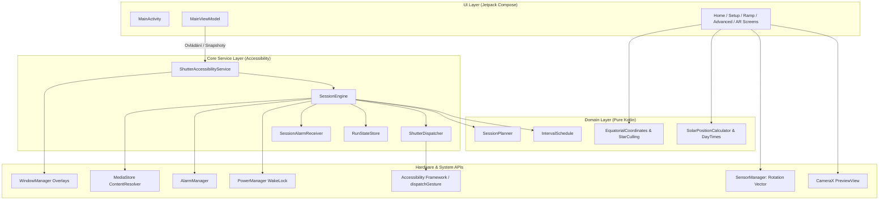
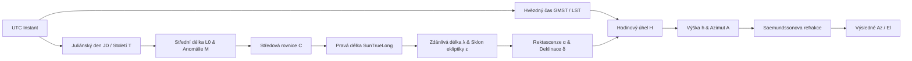
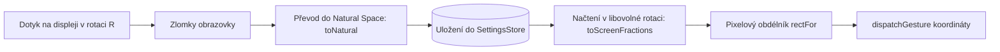
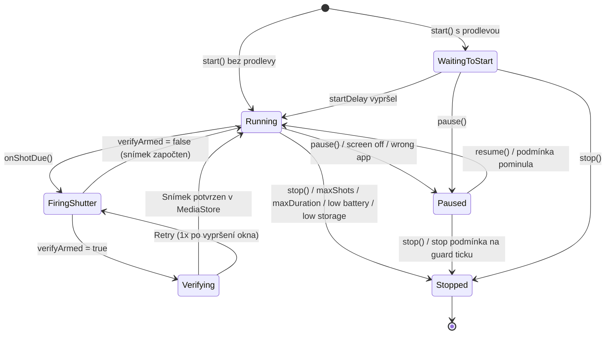
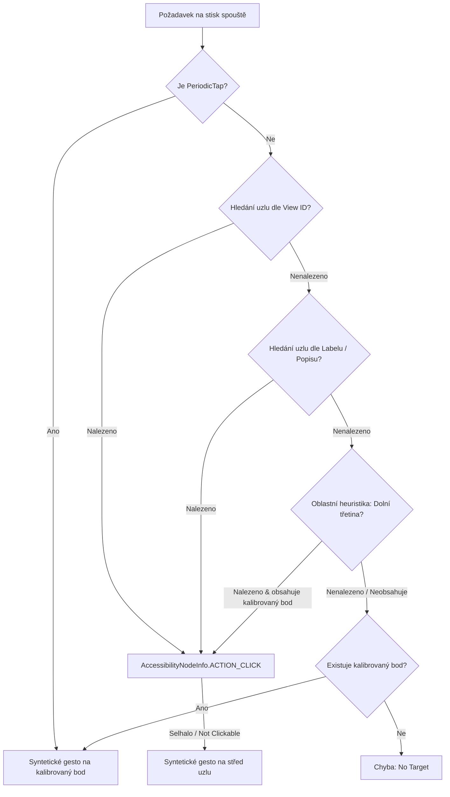

# Podrobný technický a architektonický souhrn aplikace Intervalometer

Tento dokument poskytuje vyčerpávající technický popis aplikace **Intervalometer** – její architektury, funkcionality, použitých technologií, knihoven, stavových automatů a detailních matematických/astronomických výpočtů.

---

## 1. Přehled a hlavní účel aplikace

**Intervalometer** je open-source (GPLv3), plně lokální Android aplikace určená k automatizovanému snímání časosběrných fotografií (time-lapse) a periodickému klikání na obrazovku. 

### Hlavní princip fungování
Namísto vytváření vlastního zjednodušeného fotoaparátu přes Camera2/CameraX API aplikace **stiskne spoušť přímo uvnitř nativní aplikace fotoaparátu** (např. Google Camera / GCam porty, Samsung Camera, Open Camera atd.). 
Díky tomu si každý jednotlivý snímek časosběru zachovává kompletní výpočetní pipeline daného fotoaparátu – včetně **HDR+, Night Sight, Astrofotografie, pokročilého odšumování a zpracování RAW/JPEG**.

### Bezpečnost a soukromí
- Aplikace **nemá žádné síťové oprávnění** (`android.permission.INTERNET` není v manifestu).
- Žádná data, telemetrie ani poloha neopouštějí zařízení.
- Využívá systémovou službu přístupnosti (`AccessibilityService`), což je jedno z nejvyšších oprávnění v systému Android. Kód je koncipován tak, aby byl jednoduše auditovatelný a sestavitelný přímo ze zdrojových kódů.

### Dva základní provozní režimy
1. **Time-lapse (Časosběr):**
   - Automaticky přenese zvolenou aplikaci fotoaparátu do popředí.
   - Spouští závěrku v přesných intervalech bez kumulativního driftu.
   - Hlídá, zda je fotoaparát v popředí; pokud uživatel přepne jinam nebo se vypne obrazovka, session se bezpečně pozastaví (auto-pause) a po návratu automaticky naváže.
2. **Periodic Tap (Periodické klikání):**
   - Funguje jako univerzální metronom / auto-clicker pro jakoukoliv aplikaci na obrazovce.
   - Kliká na kalibrovaný bod nebo náhodně v kalibrované oblasti (s volitelným jitterem).
   - Nemá žádnou minimální prodlevu fotoaparátu (podlaha je pouze 70 ms délka dotykového gesta).

### Integrované moduly Rozšířené Reality (AR)
- **Sun AR (Solární plánovač):** 3D projekce sluneční trajektorie, poloh slunce v průběhu dne, časových značek, východu, západu a zlaté hodinky na živý obraz kamery s kompenzací True-North a zorného pole (FOV).
- **Night Sky AR (Noční obloha):** 3D projekce nebeské sféry, hvězd z katalogu (J2000.0) a souhvězdí v reálném čase při 60 FPS s nulovými alokacemi paměti (zero-allocation) přes Google FlatBuffers.

---

## 2. Architektura a struktura projektu

Aplikace striktně dodržuje principy čisté architektury s oddělením doménové logiky od Android frameworku.

```
com.dazix.intervalometer
├── domain/                  # Čistý Kotlin (žádné Android importy) – plánování, křivky, stop podmínky
│   ├── solar/               # Sluneční efemeridy, PSA/Meeus algoritmy, denní časy, trajektorie
│   └── nightsky/            # Hvězdná astronomie (J2000.0 RA/Dec -> Alt/Az), Frustum Culling, katalogy
├── ar/                      # AR projekce (R^T matice), FOV kalkulátor, senzory, GPS, SkyDomeRenderer
├── service/                 # Jádro: ShutterAccessibilityService, SessionEngine, ShutterDispatcher,
│                            # CameraProfiles, RunStateStore, SessionAlarmReceiver, DisplayGeometry
├── overlay/                 # Plovoucí ovládací panel (OverlayController, PanelPlacement, OverlayPolicy)
│                            # a kalibrační overlay (CalibrationOverlay, CalibrationMath)
├── notify/                  # Průběžná systémová notifikace (SessionNotifications)
├── verify/                  # Detekce a validace zápisu snímků do MediaStore (CaptureVerifier)
├── monitor/                 # Sledování stavu baterie a volného úložiště (BatteryMonitor, StorageMonitor)
├── data/                    # Preferences DataStore (SettingsStore), SessionRepository, FlatBuffers
└── ui/                      # Jetpack Compose UI (Material 3 Expressive), ViewModel, obrazovky
    ├── solar/               # Sun AR obrazovka a ViewModel
    └── nightsky/            # Night Sky AR obrazovka, ViewModel a NightSkyRenderer
```

### Přehled vrstev a jejich zodpovědností



---

## 3. Použité technologie, knihovny a nástroje

| Oblast | Technologie / Knihovna | Verze | Účel a detaily použití |
| :--- | :--- | :--- | :--- |
| **Jazyk & Platforma** | **Kotlin** | `2.3.20` | Moderní typově bezpečný jazyk, Coroutines, Flow |
| | **Java / JVM Target** | `17` | Kompatibilita s moderními Android toolchains |
| | **Android SDK** | `compileSdk 37` (Platform 37.1) | `minSdk 33` (Android 13+), `targetSdk 37` (Android 17) |
| **Build Systém** | **Android Gradle Plugin (AGP)** | `9.3.1` | Integrovaná podpora Kotlinu v AGP 9 |
| | **Gradle** | `9.5.0` | Sestavovací systém s Version Catalog (`libs.versions.toml`) |
| **Uživatelské rozhraní** | **Jetpack Compose BOM** | `2026.08.00` | Deklarativní UI framework |
| | **Compose Material 3** | `1.5.0-alpha26` | *Pinned ahead of BOM*: zpřístupňuje plné Material 3 Expressive tokeny a komponenty (`LoadingIndicator`, `ButtonGroup`, `FloatingToolbar`, `MotionScheme.expressive()`, `MaterialShapes`) |
| | **Activity / Lifecycle Compose** | `1.13.0` / `2.11.0` | Propojení Compose s životním cyklem aktivit a ViewModelů |
| **Asynchronie & Stav** | **Kotlinx Coroutines** | `1.11.0` | Asynchronní zpracování, `StateFlow`, `SupervisorJob` |
| | **AndroidX DataStore Preferences** | `1.2.1` | Reaktívne perzistentní ukládání konfigurací a kalibrací |
| **Kamera & Senzory** | **AndroidX CameraX** | `1.4.1` | `camera-core`, `camera-camera2`, `camera-lifecycle`, `camera-view` pro živý AR náhled |
| | **Android SensorManager** | Framework | `TYPE_ROTATION_VECTOR`, `TYPE_GEOMAGNETIC_ROTATION_VECTOR` |
| | **Android GeomagneticField** | Framework | Přepočet magnetického severu na skutečný zeměpisný sever (True North) |
| **Serializace & Data** | **Google FlatBuffers Java** | `24.3.25` | Přímé čtení binárních katalogů hvězd z paměti v $\mathcal{O}(1)$ bez GC alokací |
| **Testování** | **JUnit 4** / **Coroutines Test** | `4.13.2` / `1.11.0` | Jednotkové testy pro doménovou matematiku a politiky |
| | **AndroidX Test / Espresso / UIAutomator** | `1.3.0` / `3.7.0` / `2.4.0` | Instrumentované testy na reálném zařízení / Fake Camera |

---

## 4. Podrobný rozbor matematických modelů a výpočtů

Tato sekce detailně popisuje veškeré matematické výpočty, fyzikální transformace a algoritmy implementované v aplikaci.

---

### 4.1. Časování a plánování bez akumulace driftu (Drift-Free Timing)

Tradiční naivní implementace intervalometrů používají cyklus typu `delay(interval)` nebo `target = now + interval`. Pokud se libovolný snímek zdrží (např. o 50 ms kvůli vytížení CPU fotoaparátem), celá řada se posune a v průběhu stovek snímků naroste masivní časová odchylka.

#### 1. Absolutní kotvení časové osy (`IntervalSchedule`)
Každý snímek $i$ (indexováno od 0) má přesně definovaný absolutní čas spuštění vztažený k počátku session:

$$T_{\text{target}}(i) = T_{\text{start\_origin}} + T_{\text{start\_delay}} + \text{offset}(i)$$

Pro konstantní interval $\Delta t$:
$$\text{offset}(i) = i \cdot \Delta t$$

#### 2. Křivky rampování intervalu (Interval Ramping)
Aplikace podporuje změnu intervalu v čase (např. zrychlení/zpomalení snímání při západu slunce).
Normalizovaný průběh rampy $p \in [0.0, 1.0]$ se počítá podle zvolené domény:
- **Dle počtu snímků (Shot Index):**
  $$p = \operatorname{clamp}\left(\frac{i}{N_{\text{shots}}}, 0.0, 1.0\right)$$
- **Dle uplynulého času (Elapsed Time):**
  $$p = \operatorname{clamp}\left(\frac{t_{\text{elapsed}}}{T_{\text{duration}}}, 0.0, 1.0\right)$$

Samotný interval pro daný krok se vypočte podle typu křivky:
- **Lineární rampa:**
  $$\Delta t(p) = \Delta t_{\text{start}} + (\Delta t_{\text{end}} - \Delta t_{\text{start}}) \cdot p$$
- **Exponenciální rampa:**
  $$\Delta t(p) = \exp\left(\ln(\Delta t_{\text{start}}) + \left(\ln(\Delta t_{\text{end}}) - \ln(\Delta t_{\text{start}})\right) \cdot p\right)$$

Při rampování se kumulativní offset $\text{offset}(i)$ dynamicky akumuluje:
$$\text{offset}(i) = \sum_{k=0}^{i-1} \Delta t(k, \text{offset}(k))$$

#### 3. Dynamická absorpce zpoždění (`resolveTarget`)
Pokud snímek překročí plánovaný čas o více než toleranci (např. $LATE\_TOLERANCE\_MS = 250\,\text{ms}$) z důvodu dlouhé expozice nebo pauzy:
$$\Delta t_{\text{late}} = T_{\text{now}} - T_{\text{target}}(i)$$
$$T_{\text{schedule\_anchor}} \leftarrow T_{\text{schedule\_anchor}} + \Delta t_{\text{late}}$$
Tím se časová osa re-ukotví přesně jednou a zamezí se vzniku nechtěné sekvence "doháněcích" snímků (burst firing).

#### 4. Duální mechanismus čekání
- **Krátké intervaly ($< 60\,\text{s}$):** Využívají `Handler.postAtTime` s `SystemClock.uptimeMillis()` a permanentně drženým `PowerManager.PARTIAL_WAKE_LOCK`.
- **Dlouhé intervaly ($\ge 60\,\text{s}$):** Využívají `AlarmManager.setExactAndAllowWhileIdle` na bázi `ELAPSED_REALTIME_WAKEUP`. `WakeLock` se mezi snímky uvolní, což šetří baterii při vícelitých časosběrech.

---

### 4.2. Astronomické výpočty pozice Slunce (Solar Ephemeris)

Implementováno v [`SolarPositionCalculator.kt`](file:///home/dazix/projects/intervalometer/app/src/main/java/com/dazix/intervalometer/domain/solar/SolarPositionCalculator.kt) na základě standardu NOAA Solar Position a algoritmů Jeana Meeuse (přesnost $< 0.01^\circ$).



#### 1. Převod času na Juliánská století ($T$)
Pro zadaný UTC čas $t$ (v sekundách od epochy):
$$\text{JD} = 2440587.5 + \frac{t}{86400.0}$$
$$T = \frac{\text{JD} - 2451545.0}{36525.0}$$

#### 2. Rovníkové souřadnice Slunce
- **Geometrická střední délka Slunce ($L_0$ v stupních):**
  $$L_0 = 280.46646 + 36000.76983 \cdot T + 0.0003032 \cdot T^2 \pmod{360^\circ}$$
- **Střední anomálie Slunce ($M$ v radiánech):**
  $$M = 357.52911 + 35999.05029 \cdot T - 0.0001537 \cdot T^2 \pmod{360^\circ}$$
- **Středová rovnice Slunce ($C$ v stupních):**
  $$C = (1.914602 - 0.004817 T - 0.000014 T^2) \sin(M) + (0.019993 - 0.000101 T) \sin(2M) + 0.000289 \sin(3M)$$
- **Pravá délka Slunce:** $\text{sunTrueLong} = L_0 + C$
- **Zdánlivá délka Slunce ($\lambda$):**
  $$\Omega = 125.04 - 1934.136 \cdot T$$
  $$\lambda = \text{sunTrueLong} - 0.00569 - 0.00478 \sin(\Omega)$$
- **Sklon ekliptiky ($\epsilon$):**
  $$\epsilon_0 = 23^\circ 26' 21.448'' - (46.8150 T + 0.00059 T^2 - 0.001813 T^3)''$$
  $$\epsilon = \epsilon_0 + 0.00256 \cos(\Omega)$$
- **Deklinace ($\delta$) a Rektascenze ($\alpha$):**
  $$\delta = \arcsin(\sin\epsilon \sin\lambda)$$
  $$\alpha = \operatorname{atan2}(\cos\epsilon \sin\lambda, \cos\lambda)$$

#### 3. Převod na horizontální souřadnice (Azimut a Elevace)
- **Greenwichský střední hvězdný čas (GMST):**
  $$\text{GMST} = 280.46061837 + 360.98564736629 \cdot (\text{JD} - 2451545.0) + 0.000387933 T^2 - \frac{T^3}{38710000} \pmod{360^\circ}$$
- **Místní hvězdný čas (LST) a Hodinový úhel ($H$):**
  $$\text{LST} = \text{GMST} + \text{zeměpisná\_délka}$$
  $$H = \text{LST} - \alpha \quad (\text{normalizováno do } [-180^\circ, +180^\circ])$$
- **Geometrická výška/elevace ($h$):**
  $$\sin h = \sin\phi \sin\delta + \cos\phi \cos\delta \cos H \implies h = \arcsin(\sin h)$$
- **Azimut ($A$ od severu ve směru hodinových ručiček):**
  $$A = \operatorname{atan2}(-\sin H \cos\delta, \cos\phi \sin\delta - \sin\phi \cos\delta \cos H) \pmod{360^\circ}$$

#### 4. Atmosférická refrakce (Saemundsson 1986)
Pro zdánlivou výšku Slunce blízko horizontu ($h \ge -0.8333^\circ$):
$$R_{\text{arcmin}} = \frac{1.02}{\tan\left(\left(h + \frac{10.3}{h + 5.11}\right) \cdot \frac{\pi}{180}\right)}$$
$$h_{\text{apparent}} = h + \frac{R_{\text{arcmin}}}{60}$$

#### 5. Vyhledávání solárních událostí (Východ, Západ, Zlatá hodinka)
V [`SolarDayTimes.kt`](file:///home/dazix/projects/intervalometer/app/src/main/java/com/dazix/intervalometer/domain/solar/SolarDayTimes.kt):
- **Pravé poledne (Meridian Transit):** Hrubé vzorkování po 5 minutách $\pm 2$ hodiny kolem aproximovaného poledne, následované ternárním vyhledáváním s přesností na 1 sekundu.
- **Východ a západ slunce:** Detekce průchodu výšky $h_{\text{target}} = -0.8333^\circ$ (zohledňuje $34'$ refrakci a $16'$ poloměr disku) pomocí 5minutového scanu a binárního vyhledávání (bisekce) s přesností na 1 sekundu.
- **Zlatá hodinka (Golden Hour):** Průchod elevacemi od $-4.0^\circ$ do $+6.0^\circ$.

---

### 4.3. Rovníková astronomie a Noční obloha (Night Sky AR)

Implementováno v [`EquatorialCoordinates.kt`](file:///home/dazix/projects/intervalometer/app/src/main/java/com/dazix/intervalometer/domain/nightsky/EquatorialCoordinates.kt) a [`StarFrustumCulling.kt`](file:///home/dazix/projects/intervalometer/app/src/main/java/com/dazix/intervalometer/domain/nightsky/StarFrustumCulling.kt).

#### 1. Převod rovníkových souřadnic (RA $\alpha$, Dec $\delta$) na 3D ENU vektor
Přímo bez mezikroků v sférických úhlech pro nulové alokace:
$$H = \text{LST} - \alpha$$
$$\mathbf{V}_{\text{world}} = \begin{bmatrix} V_{\text{East}} \\ V_{\text{North}} \\ V_{\text{Up}} \end{bmatrix} = \begin{bmatrix} -\cos\delta \sin H \\ \cos\phi \sin\delta - \sin\phi \cos\delta \cos H \\ \sin\phi \sin\delta + \cos\phi \cos\delta \cos H \end{bmatrix}$$

#### 2. Vektorový Frustum Culling na nebeské sféře
Místo náročné projekce tisíců hvězd na obrazovku se provádí rychlé oříznutí v 3D prostoru pomocí skalárního součinu (dot-product).
Optická osa kamery v ENU souřadnicích je dána:
$$\mathbf{V}_{\text{cam}} = \begin{bmatrix} -R_{13} \\ -R_{23} \\ -R_{33} \end{bmatrix} = \begin{bmatrix} -R[2] \\ -R[6] \\ -R[10] \end{bmatrix}$$

Maximální úhlopříčný poloviční úhel záběru kamery:
$$\tan(\theta_H) = \tan\left(\frac{\text{FOV}_H}{2}\right), \quad \tan(\theta_V) = \tan(\theta_H) \cdot \frac{\text{Height}}{\text{Width}}$$
$$\theta_{\text{max}} = \arctan\left(\sqrt{\tan^2\theta_H + \tan^2\theta_V}\right) + \theta_{\text{margin}} \quad (\theta_{\text{margin}} = 12^\circ)$$
$$\text{Threshold} = \cos(\theta_{\text{max}})$$

Hvězda je ve frustumu právě tehdy, když:
$$\mathbf{V}_{\text{cam}} \cdot \mathbf{V}_{\text{star}} = (V_{\text{cam},x} V_{\text{star},x} + V_{\text{cam},y} V_{\text{star},y} + V_{\text{cam},z} V_{\text{star},z}) \ge \text{Threshold}$$

---

### 4.4. 3D projekce rozšířené reality (AR Camera Projection)

Implementováno v [`CameraProjection.kt`](file:///home/dazix/projects/intervalometer/app/src/main/java/com/dazix/intervalometer/ar/CameraProjection.kt) a [`CameraFovCalculator.kt`](file:///home/dazix/projects/intervalometer/app/src/main/java/com/dazix/intervalometer/ar/CameraFovCalculator.kt).

#### 1. Transformace souřadnic Svět $\to$ Zařízení ($R^T$)
Matice $R$ ze systémového `SensorManager` mapuje vektory ze souřadnic zařízení do světových ENU souřadnic ($\mathbf{V}_{\text{world}} = R \cdot \mathbf{V}_{\text{dev}}$).
Pro zobrazení nebeských objektů na displeji fotoaparátu je nutná **ortogonální inverze (transpozice $R^T$)**:

$$\mathbf{V}_{\text{dev}} = R^T \cdot \mathbf{V}_{\text{world}}$$

$$\begin{bmatrix} X_{\text{dev}} \\ Y_{\text{dev}} \\ Z_{\text{dev}} \end{bmatrix} = \begin{bmatrix} R_{0} & R_{4} & R_{8} \\ R_{1} & R_{5} & R_{9} \\ R_{2} & R_{6} & R_{10} \end{bmatrix} \begin{bmatrix} V_{\text{East}} \\ V_{\text{North}} \\ V_{\text{Up}} \end{bmatrix}$$

#### 2. Mapování rotace displeje na kamerové souřadnice
Podle orientace zařízení (`Surface.ROTATION_0`, `ROTATION_90`, `ROTATION_180`, `ROTATION_270`):
$$\text{ROTATION\_0 (Portrait): } X_s = X_{\text{dev}}, \quad Y_s = Y_{\text{dev}}, \quad Z_s = -Z_{\text{dev}}$$
$$\text{ROTATION\_90 (Landscape): } X_s = Y_{\text{dev}}, \quad Y_s = -X_{\text{dev}}, \quad Z_s = -Z_{\text{dev}}$$
Bod se nachází před kamerou, pokud $Z_s > 0.001$.

#### 3. Perspektivní projekce na 2D obrazovku
Ohnisková vzdálenost v pixelech:
$$f_{\text{pixels}} = \frac{W_{\text{viewport}} / 2}{\tan\left(\frac{\text{FOV}_H}{2}\right)}$$

Souřadnice na displeji:
$$X_{\text{screen}} = \frac{W_{\text{viewport}}}{2} + f_{\text{pixels}} \cdot \frac{X_s}{Z_s}$$
$$Y_{\text{screen}} = \frac{H_{\text{viewport}}}{2} - f_{\text{pixels}} \cdot \frac{Y_s}{Z_s}$$

#### 4. Směrový radar pro objekty mimo záběr (Off-screen Bearing)
Pokud bod leží mimo viditelnou plochu obrazovky nebo za pozorovatelem ($Z_s \le 0$):
$$\theta_{\text{bearing}} = \operatorname{atan2}(X_s, Y_s) \pmod{360^\circ}$$
Tento úhel naviguje uživatele pomocí směrové šipky a kompasu přímo k hledanému objektu (např. Slunci v noci).

#### 5. Efektivní FOV s korekcí ořezu hledáčku (`CameraFovCalculator`)
Snímače fotoaparátu mívají poměr stran 4:3, zatímco moderní displeje telefonů jsou protáhlé (19.5:9, 20:9). CameraX náhled s `ScaleType.FILL_CENTER` vyplní výšku a ořízne strany snímače, čímž zmenší efektivní horizontální zorné pole:

$$\text{rawFov}_H = 2 \cdot \arctan\left(\frac{\text{sensorWidth}}{2 \cdot \text{focalLength}}\right)$$
$$\text{sensorAspect} = \frac{\text{sensorWidth}}{\text{sensorHeight}}, \quad \text{viewportAspect} = \frac{\text{viewportWidth}}{\text{viewportHeight}}$$
$$\text{cropRatio} = \frac{\text{viewportAspect}}{\text{sensorAspect}}$$
$$\text{effectiveFov}_H = 2 \cdot \arctan\left(\tan\left(\frac{\text{rawFov}_H}{2}\right) \cdot \text{cropRatio}\right)$$

#### 6. Stabilizace senzorů a korekce True-North (`OrientationTracker`)
- **SLERP/LERP vyhlazování kvaterniónů:**
  $$\mathbf{q}_{\text{smooth}} \leftarrow \mathbf{q}_{\text{smooth}} + \alpha (\operatorname{sgn}(\mathbf{q} \cdot \mathbf{q}_{\text{smooth}})\mathbf{q} - \mathbf{q}_{\text{smooth}}), \quad \alpha = 0.22$$
  $$\mathbf{q}_{\text{smooth}} \leftarrow \frac{\mathbf{q}_{\text{smooth}}}{\|\mathbf{q}_{\text{smooth}}\|}$$
- **Premultiplikace magnetické deklinace a uživatelského posunu:**
  $$D = \text{declination}_{\text{geomagnetic}} + \text{offset}_{\text{user}}$$
  $$R_{\text{true}} = R_z(D) \cdot R_{\text{sensor}}$$

---

### 4.5. Geometrie displeje a kalibrace nezávislá na otočení (`DisplayGeometry`)

Kalibrovaný bod spouště je uložen jako normalizované zlomky obrazovky $[0.0, 1.0]$ v **přirozeném prostoru (Natural Space, `Surface.ROTATION_0`)**.



Transformace zlomků o $k$ čtvrtinových otoček:
$$k = (\text{rotation}_{\text{target}} - \text{rotation}_{\text{source}} + 4) \pmod 4$$
$$(x, y) \xrightarrow{k=1} (y, 1-x) \xrightarrow{k=2} (1-x, 1-y) \xrightarrow{k=3} (1-y, x)$$

Při aktivním jitteru (oblastní spoušť):
$$X = \text{rect.left} + \text{rand} \cdot \text{rect.width}$$
$$Y = \text{rect.top} + \text{rand} \cdot \text{rect.height}$$

---

### 4.6. Matematický algoritmus umístění plovoucího panelu (`PanelPlacement`)

Plovoucí panel s tlačítky Pause/Stop nesmí nikdy překrýt oblast, na kterou dopadá syntetický dotyk spouště.

#### Diskrétní mřížka kandidátů (Exhaustive Lattice Optimization)
Pro každou zakázanou obdélníkovou oblast $A_i$ (kalibrovaná spoušť s okrajem + oblast vyhledávání uzlů) a rozměry panelu $(W, H)$:
$$X_{\text{candidates}} = \{ X_{\text{desired}}, X_{\text{min}}, X_{\text{max}} \} \cup \bigcup_i \{ A_i.\text{left} - W, A_i.\text{right} \}$$
$$Y_{\text{candidates}} = \{ Y_{\text{desired}}, Y_{\text{min}}, Y_{\text{max}} \} \cup \bigcup_i \{ A_i.\text{top} - H, A_i.\text{bottom} \}$$

Pro každý bod mřížky $(x, y) \in X_{\text{candidates}} \times Y_{\text{candidates}}$ se vyhodnotí penalizační funkce:
$$\text{Cost}(x, y) = M \cdot \sum_i \text{OverlapArea}(\text{Panel}(x, y), A_i) + \left((x - X_{\text{desired}})^2 + (y - Y_{\text{desired}})^2\right)$$
kde $M \gg 0$ je vysoká váha penalizující jakýkoliv průnik. Algoritmus v desítkách kroků nalezne globální optimum nejbližší pozici zvolené uživatelem, které garantuje nulový překryv.

---

### 4.7. Pravidla verifikace expozice (`CaptureVerifier` & `CameraImageRule`)

Verifikace kontroluje zápis nových fotografií do `MediaStore.Images`:
1. **Před stiskem spouště:** Získá se token obsahující aktuální časové razítko $T_{\text{window\_start}}$ a identitu posledního existujícího snímku.
2. **Po stisku spouště:** Zahájí se dotazování s oknem:
   $$T_{\text{window\_start}} - 3\,\text{s} \le \text{date\_added} \le T_{\text{now}} + 3\,\text{s}$$
3. **Pravidlo akceptace řádku (`CameraImageRule`):**
   - Vlastník řádku (`OWNER_PACKAGE_NAME`) odpovídá balíčku fotoaparátu, NEBO
   - Cesta začíná v `DCIM/` a nepatří mezi vyloučené složky (`screenshots`, `screen_recordings`, `restored`, `download`).
4. **Stavový automat verifikace (`VerifyStep`):**
   - `RESOLVED`: Snímek nalezen $\implies$ započítat snímek a naplánovat další.
   - `KEEP_POLLING`: Okno ještě nevypršelo $\implies$ další dotaz za 500 ms.
   - `RETRY`: Okno vypršelo při prvním pokusu $\implies$ provést přesně jeden opravný stisk spouště.
   - `GIVE_UP`: Okno vypršelo i po opravném stisku $\implies$ zobrazit varování "Capture unverified", ale neukončovat session.

---

## 5. Klíčové komponenty a životní cyklus

### 5.1. SessionEngine (Stavový automat)

`SessionEngine` je hlavní řídicí jednotka session běžící uvnitř `ShutterAccessibilityService`.



#### Guard Rails (Ochranné mechanismy)
Před každým odesláním dotykového gesta se striktně ověřují tři podmínky:
1. `PowerManager.isInteractive == true` (obrazovka je zapnutá).
2. `KeyguardManager.isKeyguardLocked == false` (zařízení není zamčené).
3. `foregroundApplicationPackage == targetPackage` (cílová aplikace je skutečně v popředí).
Při selhání jakékoliv podmínky dojde k okamžitému `autoPause` a spuštění `guardTick` (každých 5 s), který stav automaticky obnoví ihned po nápravě.

### 5.2. ShutterDispatcher (Hybridní spoušť)

Kombinuje přístupnostní strom prvků a syntetická dotyková gesta:



### 5.3. Plovoucí panel (Overlay) a Notifikace

- **Plovoucí panel (`OverlayController`):**
  - Implementován pomocí čistých Android Views (`WindowManager.addView` s typem `TYPE_APPLICATION_OVERLAY`).
  - Vždy tmavé schéma (`OverlayPalette`), aby neoslňovalo při nočním fotografování.
  - Funkce **Cloaking**: Během okamžiku stisku spouště panel dočasně nastaví příznak `FLAG_NOT_TOUCHABLE`, aby nemohl pohltit vyslané syntetické gesto.
  - Funkce **Suppression**: Automaticky se skryje, pokud je v popředí hlavní aktivita Intervalometru.
- **Systémová notifikace (`SessionNotifications`):**
  - Trvalá (ongoing) notifikace s nízkou důležitostí (`IMPORTANCE_LOW`), živým odpočtem, počtem snímků a akcemi Pause/Resume a Stop.
  - Záměrně nepoužívá `startForeground` na `AccessibilityService`, což předchází výjimkám `ForegroundServiceStartNotAllowedException` na Androidu 14+.

---

## 6. Souhrnný přehled vlastností

- **Drift-Free přesnost:** Absolutní časování eliminující kumulaci chyb.
- **Plná kvalita snímků:** Využití originálního post-processingu fotoaparátu (GCam HDR+, Night Sight).
- **Rampování expozice:** Lineární i exponenciální přechody intervalů.
- **Inteligentní ochrana:** Automatické pozastavení při zhasnutí obrazovky či přepnutí aplikace.
- **Bezpečnostní limity (Auto-Stop):** Hlídání baterie, volného místa na disku, max. trvání a počtu snímků.
- **AR Solární & Hvězdné plánování:** Precizní astronomické modely NOAA/Meeus a 60 FPS FlatBuffers vykreslování.
- **100% Soukromí:** Žádná síťová komunikace, lokální open-source zpracování.
