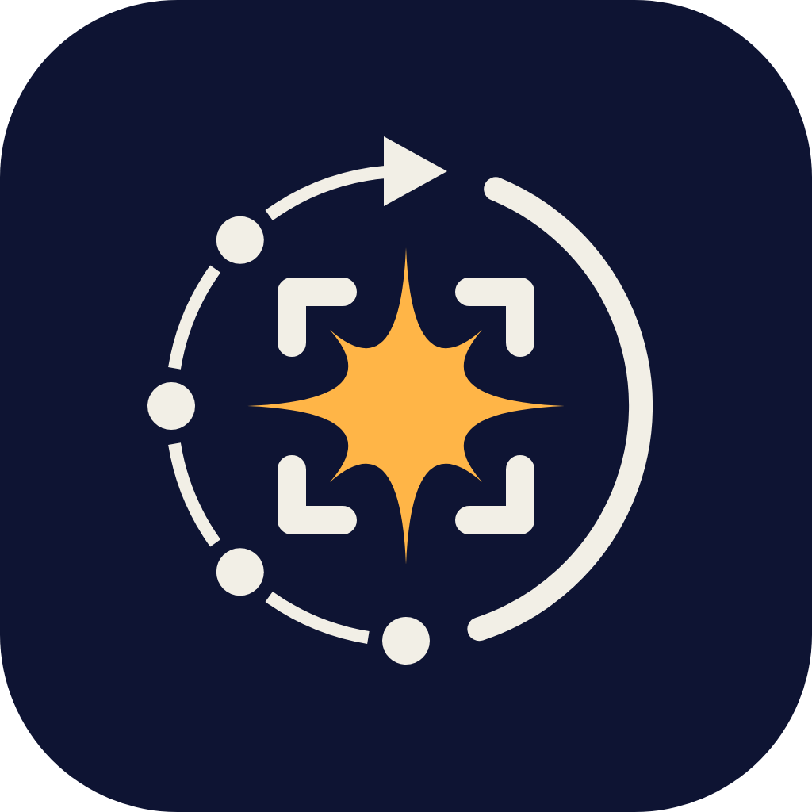
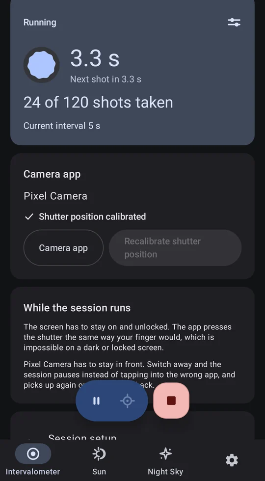
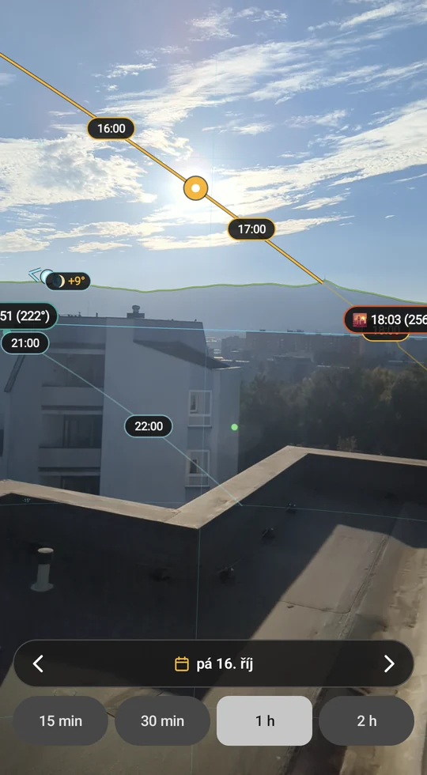
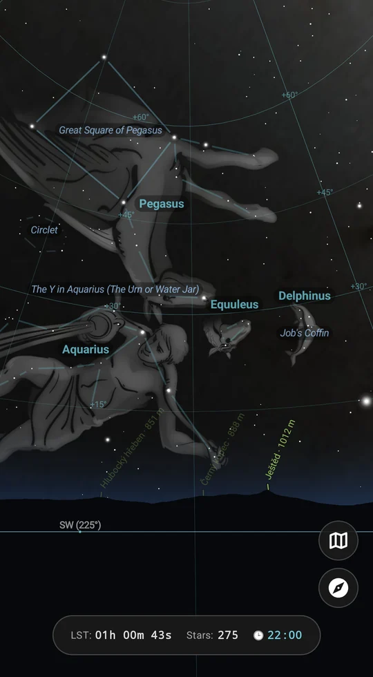
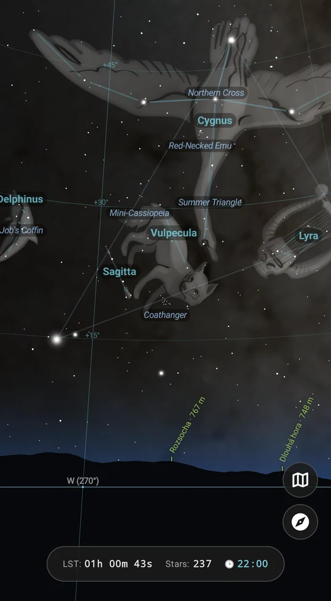

<div align="center">
  

  <h1>CAELIS</h1>

  <p><b>Time-lapse through the camera app you already use, and a sky planner that knows your horizon.</b></p>

  <p>
    <a href="https://caelis-app.com/"></a>
    <a href="https://play.google.com/store/apps/details?id=com.dazix.caelis"></a>
    <a href="https://github.com/Dazix/caelis-app-android/actions/workflows/ci.yml"></a>
    <a href="LICENSE"></a>
    
  </p>

  <a href="https://play.google.com/store/apps/details?id=com.dazix.caelis"></a>
</div>

## What is CAELIS

CAELIS is an Android intervalometer. It presses the shutter **inside your own camera app** on an exact
schedule, so every frame of a time-lapse keeps that app's full picture quality — HDR+, Night Sight and all.

It also helps you plan the shot. Point the phone at the landscape and see where the **Sun and Moon** will
rise and set **behind the real hills**, with the peaks named. At night, the **Night Sky** view shows stars,
planets and constellations over the camera picture.

No ads, no analytics, no account. Open source under GPL-3.0.

<p align="center">
  
  
  
  
</p>

## Features

**Time-lapse**
- Shoots through Google Camera or any other camera app; can also tap any point in any app at a fixed rate.
- Exact timing: a late shot never shifts the rest of the series.
- Ramping: the interval slowly changes, e.g. a sunset that slows down as the light goes.
- Stops on shot count, duration, low battery or full storage.
- Floating panel and notification with countdown, pause and stop.
- Optional check that each shot really produced a photo.

**Sun & Moon AR**
- Sun and Moon paths, hours, golden hour and twilight over the camera picture.
- Real horizon from terrain data: the time the Sun actually disappears behind the ridge.
- Peak names on the skyline (OpenStreetMap).
- Plan from anywhere with saved places, in that place's time zone.
- Red night mode that keeps your eyes dark-adapted.

**Night Sky AR**
- Stars, planets, the Moon, 88 constellations, Messier objects and meteor showers.
- Search, tap for details, rise and set times against your real horizon.
- Time travel ±12 h or to any date.

**Languages:** English, Czech, Slovak, Polish, German.

## Privacy

- The app needs the **accessibility permission** to press the shutter. It uses it for nothing else.
- The only download is terrain elevation and peak names, and only after you agree. All that is sent is
  the name of a 1°×1° map square — no position, no identifiers.
- All network code lives in [one file](app/src/main/java/com/dazix/caelis/data/horizon/DemTileDownloader.kt),
  and a test fails the build if a second one appears.
- You can delete the `INTERNET` permission and build without it; terrain then comes from a file you import.
- **Google ARCore is optional and off by default.** When you turn it on, Google Play Services for AR
  sends data to Google on its own terms, which this app cannot see or limit.

Full details: [Network and ARCore](docs/DEVELOPMENT.md#network-and-arcore).

## Install

- **[Google Play](https://play.google.com/store/apps/details?id=com.dazix.caelis)** — the easy way.
- **From source** — needs JDK 21 and an Android SDK with platform `android-37.1`:

  ```bash
  ./gradlew :app:assembleDebug
  adb install -r app/build/outputs/apk/debug/app-debug.apk
  ```

On first start the app walks you through the permissions it needs. Then pick a camera app, tap
**Calibrate**, and tap the shutter once.

## For developers

Building, testing, releasing, the architecture and the trade-offs are in
**[docs/DEVELOPMENT.md](docs/DEVELOPMENT.md)**. The device test harness is described in
[scripts/README.md](scripts/README.md), and [AGENTS.md](AGENTS.md) holds the rules for working on the code.

## Licence

Copyright © 2026 David Šanda. Released under the **GNU General Public License v3.0** or later, without any
warranty. See [`LICENSE`](LICENSE).
