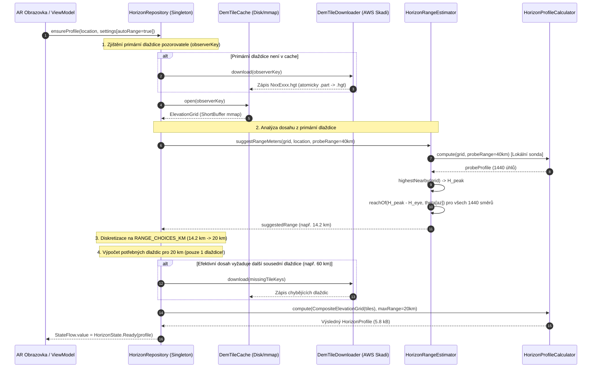
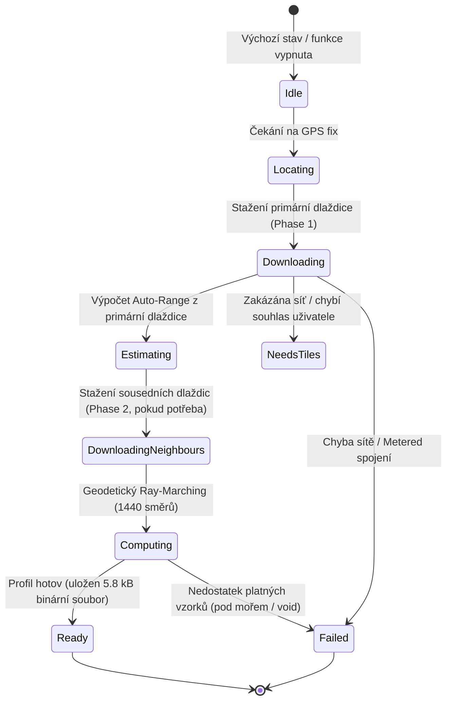

# Automatická volba dosahu výpočtu terénního horizontu a návaznost na stahování dat

Tento dokument poskytuje detailní technický a matematický rozbor subsystému pro **automatickou volbu dosahu výpočtu (Auto-Range Estimation)** a jeho přímou návaznost na **inteligentní stahování a správu výškových dat (DEM)** v aplikaci **Caelis**.

---

## Obsah

1. [Úvod a motivace problému](#1-úvod-a-motivace-problému)
2. [Architektura a integrační tok](#2-architektura-a-integrační-tok)
3. [Matematický aparát odhadu dosahu (`HorizonRangeEstimator`)](#3-matematický-aparát-odhadu-dosahu-horizonrangeestimator)
   - [Model zakřivení Země a atmosférické refrakce](#model-zakřivení-země-a-atmosférické-refrakce)
   - [Odvození analytického dosahu hřebene (`reachOf`)](#odvození-analytického-dosahu-hřebene-reachof)
   - [Subsampling reliéfu okolního terénu (`highestNearby`)](#subsampling-reliéfu-okolního-terénu-highestnearby)
   - [Sondážní profil a stanovení efektivního poloměru](#sondážní-profil-a-stanovení-efektivního-poloměru)
4. [Návaznost na stahování a mezipaměť dat (`HorizonRepository`)](#4-návaznost-na-stahování-a-mezipaměť-dat-horizonrepository)
   - [Dvoufázový proces řešení (Two-Phase Resolution)](#dvoufázový-proces-řešení-two-phase-resolution)
   - [Geometrický výpočet dotčených dlaždic (`DemTileKey.coveringBox`)](#geometrický-výpočet-dotčených-dlaždic-demtilekeycoveringbox)
   - [Síťová úspora a optimalizace přenosů](#síťová-úspora-a-optimalizace-přenosů)
   - [Ochrana aktivní pracovní sady (Working Set Protection)](#ochrana-aktivní-pracovní-sady-working-set-protection)
5. [Stavový automat a asynchronní životní cyklus](#5-stavový-automat-a-asynchronní-životní-cyklus)
6. [Ošetření hraničních a extrémních stavů](#6-ošetření-hraničních-a-extrémních-stavů)
7. [Shrnutí a klíčové invarianty](#7-shrnutí-a-klíčové-invarianty)

---

## 1. Úvod a motivace problému

Vykreslení přesné 360° siluety terénu pro rozšířenou realitu (Sun AR, Night Sky AR) a výpočet reálných východů a západů těles vyžaduje digitální model terénu (**DEM** – *Digital Elevation Model*). V aplikaci Caelis jsou využívány výškové dlaždice formátu SRTM-1 / Skadi pokrývající plochu $1^\circ \times 1^\circ$ zemského povrchu:

- **Velikost jedné nekomprimované dlaždice:** $3601 \times 3601$ vzorků $\times$ 2 bajty $\approx \mathbf{25.93\text{ MB}}$.
- **Velikost při stahování (GZIP):** přibližně $\mathbf{8\text{ až }15\text{ MB}}$ na dlaždici.
- **Geografický rozměr:** $1^\circ$ šířky odpovídá $\approx 111\text{ km}$, $1^\circ$ délky v mírném pásmu ($50^\circ\text{ N}$) odpovídá $\approx 71\text{ km}$.

### Problém manuální volby dosahu

Pokud by aplikace vyžadovala manuální volbu dosahu hledání horizontu (např. fixních 60 km nebo 100 km), narážela by na dva závažné extrémy:

```
┌─────────────────────────────────────────────────────────────────────────────┐
│                       DILEMA VOLBY DOSAHU TERÉNU                            │
├──────────────────────────────────────┬──────────────────────────────────────┤
│  Případ A: Pozorovatel v údolí       │  Případ B: Pozorovatel na rovině     │
│  (Hluboká kotlina, kaňon)            │  (Nížina pod vzdáleným pohořím)      │
│                                      │                                      │
│  - Blízký hřeben (2 km, +10° elevace)│  - Plochý horizont v okolí           │
│    zakryje vše za sebou.             │  - Vzdálený štít (70 km, 2000 m n.m.)│
│  - Fixní dosah 60 km stáhne          │    vystupuje nad geometrický obzor.  │
│    4 až 9 dlaždic (~100–230 MB).     │  - Nízký fixní dosah (např. 20 km)   │
│  - 8 sousedních dlaždic je staženo   │    vrchol zcela mine a horizont      │
│    zbytečně – nezmění ani pixel.     │    zobrazí jako chybně plochý.       │
└──────────────────────────────────────┴──────────────────────────────────────┘
```

### Cíl automatického odhadu

Funkce **Auto-Range** eliminuje nutnost uživatelského hádání:
1. **Záruka nulových zbytečných stahování:** Zjistí skutečný fyzikální dosah terénu **výhradně z primární dlaždice pozorovatele** dříve, než se zahájí stahování jakékoliv okolní dlaždice.
2. **Analytická přesnost:** Výpočet není heuristický odhad („plácnutí od oka“), nýbrž exaktní analytické řešení kvadratické rovnice zakřivení Země s refrakcí.

---

## 2. Architektura a integrační tok

Celý subsystém je rozdělen mezi čistou doménovou matematiku bez závislostí na Android frameworku ([`domain/horizon/`](../app/src/main/java/com/dazix/caelis/domain/horizon/)) a asynchronní reaktivní orchestrační vrstvu ([`data/horizon/`](../app/src/main/java/com/dazix/caelis/data/horizon/)).



---

## 3. Matematický aparát odhadu dosahu (`HorizonRangeEstimator`)

Modul [`HorizonRangeEstimator`](../app/src/main/java/com/dazix/caelis/domain/horizon/HorizonRangeEstimator.kt) implementuje analytický výpočet geometrického a refrakčního dosahu terénních překážek.

### Model zakřivení Země a atmosférické refrakce

Při šíření světla atmosférou dochází vlivem vertikálního gradientu hustoty vzduchu k lomu paprsků směrem k povrchu. V geodézii se tento vliv započítává zavedením **efektivního poloměru Země** $R_{\text{eff}}$ s refrakčním koeficientem $k = 0.13$:

$$R_{\text{earth}} = 6\,371\,000\text{ m}$$
$$R_{\text{eff}} = \frac{R_{\text{earth}}}{1 - k} = \frac{6\,371\,000}{1 - 0.13} \approx 7\,322\,988.5\text{ m}$$

Výškový pokles terénu $\text{drop}(d)$ vlivem zakřivení a refrakce ve vzdálenosti $d$ podél sféry je definován vztahem:

$$\text{drop}(d) = \frac{d^2}{2 \cdot R_{\text{eff}}}$$

---

### Odvození analytického dosahu hřebene (`reachOf`)

Předpokládejme, že v daném azimutu $\alpha$ již byl lokální sondou nalezen horizont s úhlem elevace $\theta$. Hledáme mezní vzdálenost $d$, ve které by i ten nejvyšší možný terénní vrchol v širším okolí ($H_{\text{peak}}$) s převýšením $h = H_{\text{peak}} - h_{\text{eye}}$ klesl vlivem zakřivení a refrakce přesně na úroveň stávajícího úhlu $\theta$.

```
                            Zdánlivá elevace hřebene θ
                                   ▲
                                  /│  
                                 / │  h = H_peak - h_eye
                                /  │
                               /   │
       Pozorovatel (h_eye) ────    │
           \                       │ drop(d) = d² / (2 R_eff)
            \                      │
             ──────────────────────▼
                Vzdálenost d podél sféry
```

Základní geometrická rovnice pro zdánlivou elevaci bodu ve vzdálenosti $d$:

$$\tan \theta = \frac{h - \text{drop}(d)}{d} = \frac{h - \frac{d^2}{2 R_{\text{eff}}}}{d}$$

Vynásobením jmenovatelem $d$ získáme:

$$d \cdot \tan \theta = h - \frac{d^2}{2 R_{\text{eff}}}$$

Převedením na standardní tvar kvadratické rovnice $a d^2 + b d + c = 0$:

$$\frac{1}{2 R_{\text{eff}}} \cdot d^2 + (\tan \theta) \cdot d - h = 0$$

Vynásobením celé rovnice faktorem $2 R_{\text{eff}}$:

$$d^2 + (2 R_{\text{eff}} \tan \theta) \cdot d - 2 R_{\text{eff}} h = 0$$

Diskriminant kvadratické rovnice:

$$D = b^2 - 4ac = (2 R_{\text{eff}} \tan \theta)^2 - 4 \cdot 1 \cdot (-2 R_{\text{eff}} h) = 4 R_{\text{eff}}^2 \tan^2 \theta + 8 R_{\text{eff}} h$$

Kladný kořen kvadratické rovnice (představující reálnou kladnou vzdálenost $d > 0$):

$$d = \frac{-b + \sqrt{D}}{2a} = \frac{-2 R_{\text{eff}} \tan \theta + \sqrt{4 R_{\text{eff}}^2 \tan^2 \theta + 8 R_{\text{eff}} h}}{2}$$

Vytknutím faktoru 2 z odmocniny a krácením získáme výsledný vzorec implementovaný v funkci `reachOf`:

$$\mathbf{d = R_{\text{eff}} \left( \sqrt{\tan^2 \theta + \frac{2 h}{R_{\text{eff}}}} - \tan \theta \right)}$$

```kotlin
// Implementace v HorizonRangeEstimator.kt
internal fun reachOf(heightAboveEye: Double, skylineDegrees: Double): Double {
    if (heightAboveEye <= 0.0) return 0.0
    val radius = HorizonProfileCalculator.EFFECTIVE_EARTH_RADIUS_METERS
    val slope = tan(skylineDegrees * Math.PI / 180.0)
    return radius * (sqrt(slope * slope + 2.0 * heightAboveEye / radius) - slope)
}
```

#### Fyzikální interpretace mezních případů vzorce:

1. **Rovný nebo nulový horizont ($\theta = 0^\circ \implies \tan \theta = 0$):**
   $$d = R_{\text{eff}} \cdot \sqrt{\frac{2 h}{R_{\text{eff}}}} = \sqrt{2 R_{\text{eff}} h}$$
   Vzorec přesně přechází v klasickou geodetickou rovnici pro vzdálenost geometrického obzoru tělesa o výšce $h$.
2. **Pozorovatel v údolí ($\theta > 0^\circ$, např. $\theta = +5^\circ$):**
   Člen $-\tan \theta$ výrazně snižuje výslednou hodnotu $d$. Převýšení blízkého svahu efektivně stíní veškeré vzdálené vrcholy, takže $d$ dramaticky klesá na jednotky kilometrů.
3. **Pozorovatel na vrcholu hory ($\theta < 0^\circ$):**
   Člen $-\tan \theta$ je kladný, což posouvá dosah dále za geometrický obzor úpatí hory.

---

### Směrově orientovaný subsampling reliéfu (`highestNearbyPerAzimuth`)

Pokud by se pro celou oblast $0.9^\circ \times 0.9^\circ$ hledal pouze jeden globální vrchol $H_{\text{peak}}$, vedlo by to k fatální chybě v místech s asymetrickým terénem (např. město Liberec s horou Ještěd na jihozápadě). Pokud by se $1\,012\text{ m}$ vysoký vrchol Ještědu testoval proti plochému horizontu ($0^\circ$) na severu, rovnice by spočetla dosah $\sim 94\text{ km}$ a zbytečně stáhla až 9 dlaždic.

Proto modul rozděluje okolí do **72 směrových sektorů po $5^\circ$**:

- **Oblast prohledávání (`RELIEF_SPAN_DEGREES`):** $0.9^\circ \times 0.9^\circ$ symetricky centrovaná na pozici pozorovatele.
- **Počet vzorků (`RELIEF_SAMPLES`):** $96 \times 96 = 9\,216$ vzorků.
- **Sektorování podle azimutu:** Pro každý vzorek se spočítá azimut $\alpha = \operatorname{atan2}(\Delta \lambda \cos \varphi, \Delta \varphi)$ a index sektoru $s = \lfloor \alpha / 5^\circ \rfloor \in [0, 71]$.
- **Kruhové vyhlazení ($\pm 1$ sektor):** Na výsledné pole se aplikuje operace `max(raw[s-1], raw[s], raw[s+1])` s přechodem přes $360^\circ/0^\circ$. To zabraňuje artefaktům na hranicích sektorů, kdy vrchol leží např. na azimutu $4.9^\circ$ a ovlivňuje paprsek na $5.1^\circ$.

```
┌──────────────────────────────────────────────┐
│  Dlaždice pozorovatele (1.0° x 1.0°)          │
│                                              │
│      ┌────────────────────────────────┐      │
│      │  72 směrových sektorů (po 5°)  │      │
│      │  Mřížka 96 x 96 bodů           │      │
│      │               ▲ N (0°)         │      │
│      │               │                │      │
│      │        W ◄── [●] ──► E         │      │
│      │               │                │      │
│      │  H_sector[s] = max(vzorky v s) │      │
│      └────────────────────────────────┘      │
│                                              │
└──────────────────────────────────────────────┘
```

> [!NOTE]
> Horský vrchol nebo masiv má šířku stovek metrů až jednotek kilometrů. Krok vzorkování $\approx 1\text{ km}$ spolehlivě zachytí vrchol, přičemž výpočet 72 sektorů trvá v paměti méně než **1 milisekundu** a probíhá bez GC alokací.

---

### Sondážní profil a stanovení efektivního poloměru

Algoritmus `suggestRangeMeters` probíhá v následujících krocích:

```kotlin
fun suggestRangeMeters(
    grid: ElevationGrid,
    observer: GeoLocation,
    eyeHeightMeters: Double,
    probeRangeMeters: Double,  // 40 000 m (HorizonSettings.AUTO_PROBE_RANGE_KM)
    maxRangeMeters: Double,    // 100 000 m (horní limit nabízených voleb)
): Double {
    // 1. Spočtení rychlého lokálního profilu z existující dlaždice
    val probe = HorizonProfileCalculator.compute(
        grid = grid,
        observer = observer,
        eyeHeightMeters = eyeHeightMeters,
        maxRangeMeters = probeRangeMeters,
    )
    val eyeElevation = probe.observerGroundElevationMeters + eyeHeightMeters
    val sectorPeaks = highestNearbyPerAzimuth(grid, observer, eyeElevation)

    // 2. Nalezení maximálního dosahu přes všech 1440 azimutů (krok 0.25°)
    var furthest = 0.0
    for (index in 0 until HorizonProfile.SAMPLE_COUNT) {
        val skyline = probe.elevationsDegrees[index].toDouble()
        // Zero-clamping: zabrání záporným úhlům (údolí) uměle nafukovat dosah
        val clampedSkyline = max(0.0, skyline)
        val sector = index / SAMPLES_PER_SECTOR // index / 20
        val sectorPeak = sectorPeaks[sector]
        if (sectorPeak > eyeElevation) {
            furthest = max(furthest, reachOf(sectorPeak - eyeElevation, clampedSkyline))
        }
    }

    // 3. Omezení výsledku do platného intervalu [probeRange, maxRange]
    return furthest.coerceIn(probeRangeMeters.coerceAtMost(maxRangeMeters), maxRangeMeters)
}
```

---

## 4. Návaznost na stahování a mezipaměť dat (`HorizonRepository`)

Třída [`HorizonRepository`](../app/src/main/java/com/dazix/caelis/data/horizon/HorizonRepository.kt) je procesní singleton řídící celý životní cyklus požadavků na terénní profil.

### Dvoufázový proces řešení (Two-Phase Resolution)

Klíčový invariant architektury zní: **Okolní prstenec dlaždic se nikdy nestahuje dříve, než je znám efektivní dosah.**

```
FÁZE 1: Lokální vyhodnocení
┌────────────────────────────────────────────────────────┐
│ Stáhnout/otevřít POUZE primární dlaždici (observerKey) │
└──────────────────────────┬─────────────────────────────┘
                           │
                           ▼
┌────────────────────────────────────────────────────────┐
│ Spustit HorizonRangeEstimator.suggestRangeMeters(...)  │
│ Výsledek zaokrouhlit NAHORU na RANGE_CHOICES_KM        │
│ (např. 18.5 km -> 20 km, 43.1 km -> 60 km)             │
└──────────────────────────┬─────────────────────────────┘
                           │
                           ▼
FÁZE 2: Cílené stahování
┌────────────────────────────────────────────────────────┐
│ Spočítat DemTileKey.coveringBox pro efektivní dosah    │
│ Pokud dosah = 20 km: stahuje se 0 dalších dlaždic      │
│ Pokud dosah = 60 km: stáhnou se pouze chybějící sousedé│
└────────────────────────────────────────────────────────┘
```

Implementace v privátní metodě `withEffectiveRange`:

```kotlin
private suspend fun withEffectiveRange(
    location: GeoLocation,
    requested: HorizonSettings,
    observerKey: DemTileKey,
): HorizonSettings? {
    if (!requested.autoRange) return requested

    // Kontrola mezipaměti odhadů podle zaokrouhlené polohy (~110 m)
    val positionKey = roundPosition(location.latitude) to roundPosition(location.longitude)
    estimatedRangeKm[positionKey]?.let { return requested.copy(maxRangeKm = it) }

    // Zajištění přítomnosti POUZE primární dlaždice pozorovatele
    if (cache.partition(listOf(observerKey)).second.isNotEmpty()) {
        if (!fetchMissing(listOf(observerKey), requested)) return null
    }
    val observerTile = withContext(Dispatchers.IO) { cache.open(observerKey) }
        ?: return null.also { _state.value = HorizonState.NeedsTiles(listOf(observerKey)) }

    // Výpočet analytického odhadu
    val suggested = withContext(Dispatchers.Default) {
        HorizonRangeEstimator.suggestRangeMeters(
            grid = observerTile,
            observer = location,
            eyeHeightMeters = requested.eyeHeightMeters,
            probeRangeMeters = HorizonSettings.AUTO_PROBE_RANGE_KM * 1000.0,
            maxRangeMeters = HorizonSettings.RANGE_CHOICES_KM.last() * 1000.0,
        )
    }

    // Diskretizace: Zaokrouhlení nahoru na nejbližší volbu (20, 40, 60, 100 km)
    val km = HorizonSettings.RANGE_CHOICES_KM.firstOrNull { it * 1000.0 >= suggested }
        ?: HorizonSettings.RANGE_CHOICES_KM.last()

    estimatedRangeKm[positionKey] = km
    return requested.copy(maxRangeKm = km)
}
```

---

### Geometrický výpočet dotčených dlaždic (`DemTileKey.coveringBox`)

Jakmile je určen efektivní dosah `maxRangeKm` (např. 20 km nebo 60 km), metoda `tilesFor` spočítá bounding box v zeměpisných souřadnicích:

$$\Delta \varphi = \frac{\text{maxRangeMeters}}{R_{\text{earth}}} \cdot \frac{180^\circ}{\pi}$$
$$\Delta \lambda = \frac{\Delta \varphi}{\max(\cos \varphi, 0.05)}$$

Třída [`DemTileKey.coveringBox`](../app/src/main/java/com/dazix/caelis/domain/horizon/DemTileKey.kt) určí všechny celočíselné čtverce $1^\circ \times 1^\circ$, které tento obdélník protíná:

```
Při dosahu 20 km (údolí / blízký hřeben):
┌──────────────┐
│              │
│  [Pozorovatel│  => Pouze 1 dlaždice (N50E014)
│   r = 20 km] │     Staženo: 0 MB navíc!
│              │
└──────────────┘

Při dosahu 60 km (rovina / výhled na hory):
┌──────────────┬──────────────┬──────────────┐
│ N51E013      │ N51E014      │ N51E015      │
├──────────────┼──────────────┼──────────────┤
│ N50E013      │[Pozorovatel] │ N50E015      │  => 4 až 9 dlaždic
│              │ r = 60 km    │              │     Stahují se pouze chybějící
├──────────────┼──────────────┼──────────────┤
│ N49E013      │ N49E014      │ N49E015      │
└──────────────┴──────────────┴──────────────┘
```

---

### Síťová úspora a optimalizace přenosů

Vliv funkce Auto-Range na síťový provoz a využití úložiště je zásadní:

| Typ lokality | Skutečný terén | Auto-Range odhad | Počet dlaždic | Objem stahování (GZIP) | Úspora dat |
| :--- | :--- | :--- | :--- | :--- | :--- |
| **Krkonošské údolí** | Hřeben 3 km, $+12^\circ$ | **$20\text{ km}$** | **1 dlaždice** | $\approx 10\text{ MB}$ | **$75–88\,\%$** |
| **Kaňon Vltavy** | Skály 400 m, $+8^\circ$ | **$20\text{ km}$** | **1 dlaždice** | $\approx 10\text{ MB}$ | **$75–88\,\%$** |
| **Česká tabule** | Mírná pahorkatina | **$40\text{ km}$** | **2–4 dlaždice** | $\approx 20–40\text{ MB}$ | **$50\,\%$** |
| **Polabská nížina** | Výhled na Krkonoše | **$60–100\text{ km}$** | **4–9 dlaždic** | $\approx 40–90\text{ MB}$ | $0\,\%$ (nutno pro přesnost) |

---

### Ochrana aktivní pracovní sady (Working Set Protection)

Při práci s více dlaždicemi správce mezipaměti [`DemTileCache`](../app/src/main/java/com/dazix/caelis/data/horizon/DemTileCache.kt) udržuje diskový limit (standardně 512 MB).

> [!IMPORTANT]
> **Kritický invariant:** Metoda `DemTileCache.trim(protect: Set<DemTileKey>)` je volána až **po dokončení stahování všech chybějících dlaždic** a má striktně zakázáno smazat jakoukoliv dlaždici ze sady `protect = keys.toSet()`. Smazání dlaždice potřebné pro právě běžící výpočet by vedlo k neúplnému profilu nebo selhání výpočtu.

---

## 5. Stavový automat a asynchronní životní cyklus

Stav operace je reprezentován reaktivním proudem `StateFlow<HorizonState>` v [`HorizonRepository`](../app/src/main/java/com/dazix/caelis/data/horizon/HorizonRepository.kt):



### Přehled stavů `HorizonState`

- `HorizonState.Idle`: Vrstva je neaktivní nebo vypnuta v nastavení.
- `HorizonState.Locating`: Čekání na přesné souřadnice z GPS provideru.
- `HorizonState.Downloading(key, index, total, progress)`: Právě probíhá stahování konkrétní komprimované dlaždice ze serveru AWS Skadi s průběžným hlášením postupu (0.0 až 1.0).
- `HorizonState.NeedsTiles(keys)`: Dlaždice chybí, ale aplikace nesmí stahovat (uživatel neudělil souhlas se sítí, nebo byla aplikace sestavena bez oprávnění `INTERNET`). Uživatel může chybějící soubory `.hgt` naimportovat ručně přes systémový Storage Access Framework.
- `HorizonState.Computing(progress)`: Všechny potřebné dlaždice jsou namapovány v paměti a probíhá 1440-směrový ray-marching.
- `HorizonState.Ready(profile)`: Profil byl úspěšně vypočten a uložen do trvalého úložiště `filesDir/horizons/`.
- `HorizonState.Failed(reason, cause)`: Operace selhala (důvody: `NETWORK`, `METERED`, `STORAGE`, `NO_DATA`, `LOCATION`).

---

## 6. Ošetření hraničních a extrémních stavů

1. **Drift GPS souřadnic:**
   Mobilní GPS čip generuje aktualizace polohy každých několik sekund s drobným šumem (drift jednotek metrů). Metoda `roundPosition` zaokrouhluje zeměpisnou šířku a délku na 3 desetinná místa ($\approx 110\text{ m}$). Výsledek `suggestRangeMeters` je navíc cachován v mapě `estimatedRangeKm`, takže nepatrný pohyb pozorovatele na místě nevyvolává opakované sondování.
2. **Přechod přes 180. poledník (Antimeridián):**
   Metoda `DemTileKey.coveringBox` počítá kroky zeměpisné délky cyklicky s ošetřením přechodu z $+179^\circ$ na $-180^\circ$, což zabraňuje generování chybného 359stupňového pásu kolem celé planety.
3. **Póly a vysoké zeměpisné šířky:**
   Délkové stupně se směrem k pólům zužují úměrně $\cos(\varphi)$. Pro výpočet $\Delta \lambda$ je aplikována bezpečnostní pojistka `MIN_COS_LATITUDE = 0.05`, která zabraňuje dělení nulou a explozi počtu vyžadovaných dlaždic v polárních oblastech.
4. **Prázdné nebo poškozené DEM vzorky (Void Samples):**
   Hodnoty $-32768$ (`0x8000`) v DEM datech jsou striktně převáděny na `null` a renormalizovány v bilineární interpolaci (`blendCorners`). Nikdy nejsou interpretovány jako 0 m n.m.
5. **Diskretizace dosahu pro deterministické profily:**
   Výsledná doporučená hodnota je vždy zaokrouhlena nahoru na jednu z hodnot v `HorizonSettings.RANGE_CHOICES_KM` ($[20, 40, 60, 100]\text{ km}$). Díky tomu název uloženého souboru profilu (např. `N50.000E014.000_r60_e160.bin`) jednoznačně a deterministicky odpovídá konfiguraci, se kterou byl spočítán.

---

## 7. Shrnutí a klíčové invarianty

| Komponenta | Odpovědnost | Klíčový invariant |
| :--- | :--- | :--- |
| **`HorizonRangeEstimator`** | Analytický výpočet dosahu z primární dlaždice | $d = R_{\text{eff}} \left( \sqrt{\tan^2 \theta + \frac{2 h}{R_{\text{eff}}}} - \tan \theta \right)$, čistý Kotlin bez Android závislostí. |
| **`HorizonRepository`** | Dvoufázové řízení stahování a výpočtu | Sousední dlaždice se stahují **až po zjištění efektivního dosahu**. Primární dlaždice je povinná. |
| **`DemTileDownloader`** | Jediný síťový bod aplikace | Stahuje výhradně pojmenované dlaždice ze Skadi AWS, dynamicky ověřuje souhlas uživatele. |
| **`DemTileCache`** | Správa mezipaměti dlaždic | Atomický zápis přes `.part`, metoda `trim` **nikdy nesmí smazat dlaždice z aktivní pracovní sady**. |
| **`HorizonProfile`** | Výsledný artefakt | 1440 vzorků ($0.25^\circ$), 5.8 kB na disku, $100\,\%$ offline dostupnost pro AR a výpočty východů/západů. |
