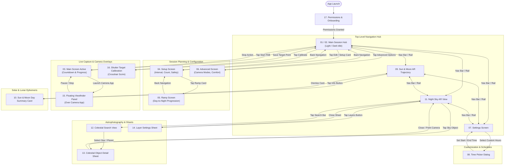
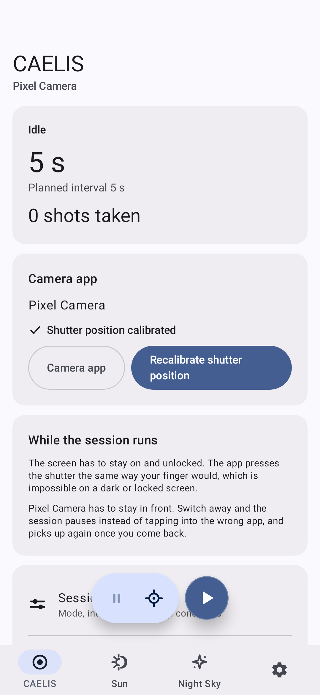
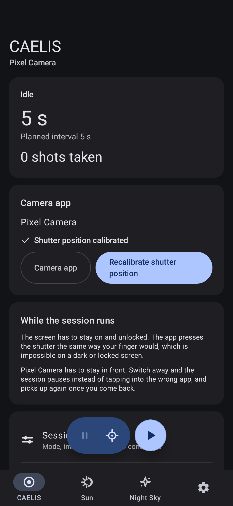
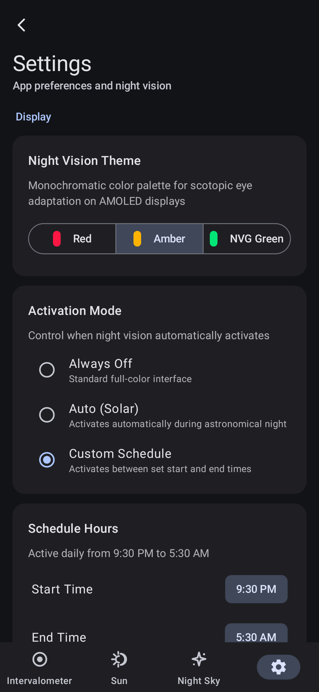
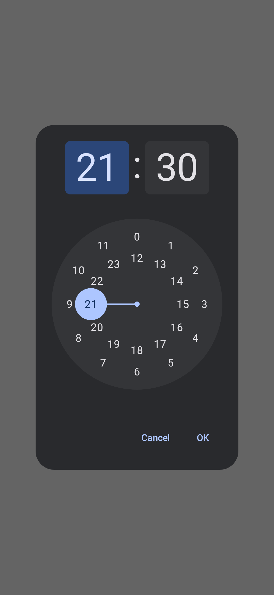
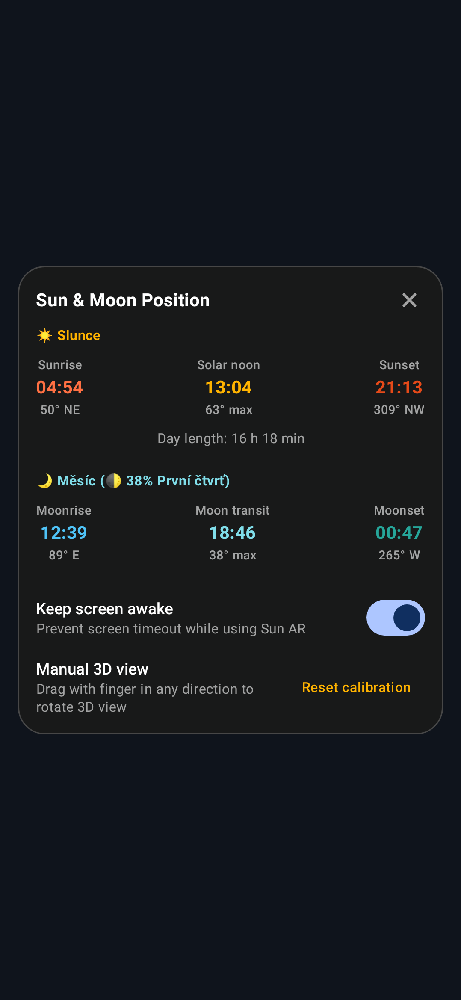
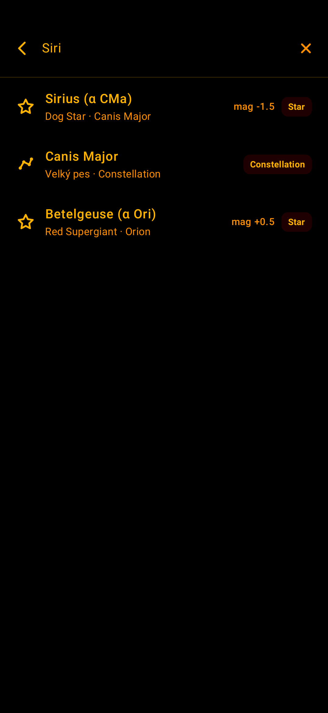
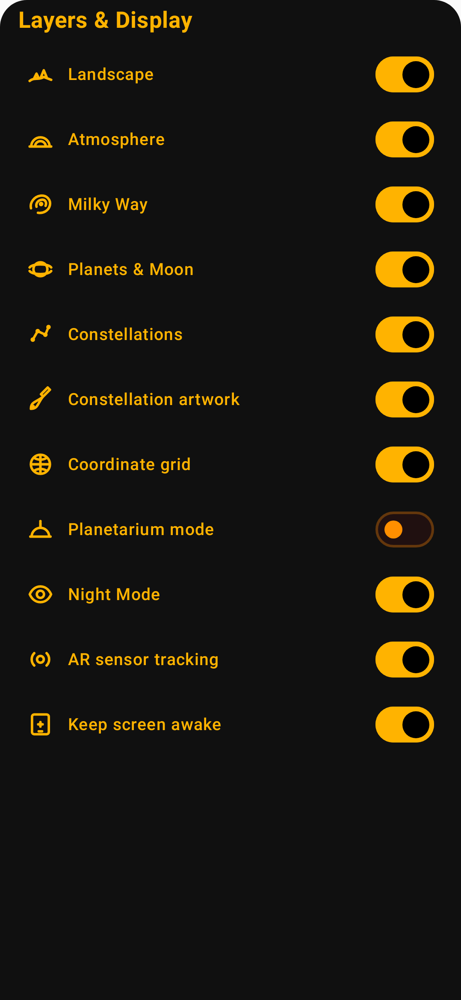
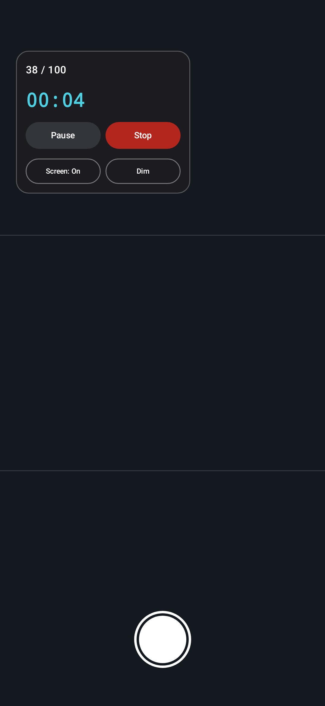
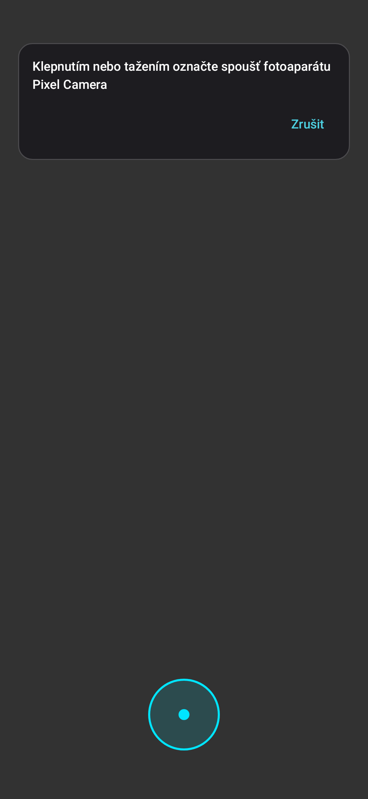

# Caelis — UI Design & User Experience

Caelis is designed as an elegant, precision-crafted companion for time-lapse photographers and astrophotographers. Every screen, control, and transition is built from the ground up around **field ergonomics**: whether operating a phone mounted on a tripod in bright sunlight, framing a sunset at dusk, or aligning a camera with the Milky Way in pitch darkness.

This document outlines the design philosophy, visual language, component hierarchy, navigation architecture, and interactive state transitions of Caelis, highlighting the complete integration of **Material Design 3 Expressive**.

---

## Table of Contents

1. [Design Philosophy & Core Pillars](#1-design-philosophy--core-pillars)
2. [Material Design 3 Expressive Integration](#2-material-design-3-expressive-integration)
   - [Expressive Motion & Spring Physics](#expressive-motion--spring-physics)
   - [Expressive Typography & Number Hierarchy](#expressive-typography--number-hierarchy)
   - [Expressive Shapes & Curvature Scale](#expressive-shapes--curvature-scale)
   - [Dynamic Color & Dark Adaptation Palettes](#dynamic-color--dark-adaptation-palettes)
3. [Component Anatomy & Design System](#3-component-anatomy--design-system)
4. [User Journeys & Navigation Architecture](#4-user-journeys--navigation-architecture)
   - [Interactive Architecture & State Diagram](#interactive-architecture--state-diagram)
   - [Core User Journeys](#core-user-journeys)
5. [Screen-by-Screen Walkthrough & State Transitions](#5-screen-by-screen-walkthrough--state-transitions)
   - [1. Session Hub (Intervalometer)](#1-session-hub-intervalometer)
   - [2. Session Configuration & Ramp Planning](#2-session-configuration--ramp-planning)
   - [3. Theme & Night Vision Settings](#3-theme--night-vision-settings)
   - [4. Sun & Moon AR Trajectory Planning](#4-sun--moon-ar-trajectory-planning)
   - [5. Night Sky AR Planetarium & Astrophotography](#5-night-sky-ar-planetarium--astrophotography)
   - [6. Camera Viewfinder Floating Overlay & Calibration](#6-camera-viewfinder-floating-overlay--calibration)
   - [7. First-Run Experience & Permissions](#7-first-run-experience--permissions)
6. [Screenshot Reference & Relationship Matrix](#6-screenshot-reference--relationship-matrix)

---

## 1. Design Philosophy & Core Pillars

Photographers using an intervalometer face very specific environmental challenges: tripod setups at awkward heights, outdoor glare, freezing night temperatures where gloves are required, and the need to preserve eye dark adaptation.

Caelis addresses these with four core design pillars:

```
┌────────────────────────────────────────────────────────────────────────┐
│                        CAELIS DESIGN PILLARS                           │
├──────────────────┬──────────────────┬─────────────────┬────────────────┤
│  Field Ergonomics│ Visual Hierarchy │ Dark Adaptation │ Confidence &   │
│                  │ & Legibility     │ & Night Vision  │ Reassurance    │
│  Large touch     │ Hero numbers     │ Deep red &      │ Live progress, │
│  targets (48dp+) │ visible at arm's │ amber palettes; │ clear blockers,│
│  and persistent  │ length; zero     │ true-black OLED │ auto-stop      │
│  floating hubs   │ visual clutter   │ backgrounds     │ safety metrics │
└──────────────────┴──────────────────┴─────────────────┴────────────────┘
```

- **Field Ergonomics**: Primary action buttons and navigation are anchored within easy thumb reach. Floating toolbars stay accessible above scrolling content.
- **Visual Hierarchy & Legibility**: Critical session numbers (remaining countdown, shots taken, planned interval) are presented in emphasized typographic scales that can be read effortlessly from several feet away.
- **Dark Adaptation**: In night shooting modes, bright white UI elements are replaced with pure-black OLED surfaces and specialized red/amber monochromatic themes that preserve the eye's rhodopsin pigment.
- **Confidence & Reassurance**: Users never have to guess what the app is doing. Live animated progress rings, clear status chips, and descriptive safety limits (battery and storage guards) provide continuous feedback.

---

## 2. Material Design 3 Expressive Integration

Caelis is built on the **Material Design 3 Expressive** design system, utilizing expressive tokens across motion, typography, shape, and color.

### Expressive Motion & Spring Physics

Instead of rigid linear durations and static easing curves, all interactive transitions in Caelis are driven by **physics-based springs** (`MotionScheme.expressive()`):

- **Spatial Springs (`defaultSpatialSpec`)**: Applied to all elements that change position, size, or shape (such as cards expanding, toggle buttons morphing, or the session indicator resetting). Spatial springs settle with a subtle, organic overshoot that feels responsive and physical.
- **Slow Spatial Springs (`slowSpatialSpec`)**: Reserved for deliberate, high-impact state transformations, such as the primary **Start** button morphing into the **Stop** action.
- **Effects Springs (`defaultEffectsSpec`)**: Applied to color, tint, and alpha transitions. These springs do not overshoot, preventing visual flickering during state changes.

### Expressive Typography & Number Hierarchy

Numbers are the heart of an intervalometer. Caelis defines distinct expressive typographic roles:

- **Hero Numbers (`ExpressiveType.hero`)**: Utilizes `displaySmallEmphasized` with tightened tracking and heavy stroke weight for the active countdown and total shot counts.
- **Secondary Figures (`ExpressiveType.figure`)**: Utilizes `headlineSmallEmphasized` for target interval times and planned sequence totals.
- **Figure Labels (`ExpressiveType.figureLabel`)**: Utilizes `labelLargeEmphasized` to anchor numerical values with clear, scannable units.

### Expressive Shapes & Curvature Scale

The app utilizes high-curvature expressive shapes (`largeIncreased`, `extraLargeIncreased`) to create friendly, tactile surfaces:

- **Shape Morphing Selection**: Selection in segmented buttons is communicated by shape change as well as color—unselected items feature rounded pill contours, while selected items smoothly morph into structured squircles.
- **Rounded Cards**: Primary content containers use 28dp+ corner radii (`MaterialTheme.shapes.large`), creating distinct visual islands.

### Dynamic Color & Dark Adaptation Palettes

- **Material You Dynamic Theming**: In standard day mode, Caelis extracts tonal palettes dynamically from the user's wallpaper, creating a harmonious system integration in both light and dark themes.
- **Night Vision Modes**:
  - **Deep Red (`#FFFF1744`)**: Monochromatic red light that prevents pupil dilation and preserves night vision during deep-sky astrophotography.
  - **Amber Gold (`#FFFFB300`)**: Warm amber spectrum providing high contrast and readability under moonlit skies.

---

## 3. Component Anatomy & Design System

Caelis establishes consistent design building blocks across all screens:

```
┌──────────────────────────────────────────────────────────────┐
│ MediumFlexibleTopAppBar (Collapses gracefully on scroll)     │
├──────────────────────────────────────────────────────────────┤
│ ┌──────────────────────────────────────────────────────────┐ │
│ │ SectionCard (Tonal container, large rounded corners)     │ │
│ │  - Hero metric / Title                                   │ │
│ │  - SwitchRow / ChoiceRow / SegmentedChoice               │ │
│ └──────────────────────────────────────────────────────────┘ │
│                                                              │
│ ┌──────────────────────────────────────────────────────────┐ │
│ │ SectionCard (Warning or Accent tone for safety limits)   │ │
│ └──────────────────────────────────────────────────────────┘ │
├──────────────────────────────────────────────────────────────┤
│ SessionToolbar (Vibrant floating toolbar + morphing FAB)     │
├──────────────────────────────────────────────────────────────┤
│ NavigationBar / NavigationRail (Adaptive system navigation)  │
└──────────────────────────────────────────────────────────────┘
```

- **`ScreenScaffold`**: Houses a two-row `MediumFlexibleTopAppBar` that provides generous space for titles and subtitles when expanded and smoothly collapses to a compact single row upon scrolling.
- **`SectionCard`**: Modular content cards with adaptive tonal styling (`NEUTRAL`, `WARNING`, `ACCENT`).
- **`SegmentedChoice`**: Connected groups of `FilledTonalToggleButton` elements providing tactile, single-tap switching between discrete modes and units.
- **`SessionToolbar`**: A vibrant floating bar (`HorizontalFloatingToolbar`) elevated above the content, ensuring primary start, pause, and stop actions are always within thumb reach.
- **`ProgressRing`**: A determinate circular indicator (`ContainedLoadingIndicator`) that visually fills as the interval timer elapses, resetting smoothly with each captured frame.

---

## 4. User Journeys & Navigation Architecture

Caelis is structured around an intuitive top-level navigation model (Bottom Navigation Bar on portrait phones, Wide Navigation Rail on landscape screens and tablets) with clear hierarchical pathways for session customization, AR field alignment, and in-capture monitoring.

### Interactive Architecture & State Diagram

The diagram below maps all 17 documented views, illustrating primary routes, sub-screen flows, modal sheets, and system overlay transitions:



---

### Core User Journeys

#### Journey 1: Onboarding & First-Time Activation (`17` ➔ `01`/`02`)
1. On first launch, the user is greeted by the **Permissions & Onboarding Screen** ([`17_onboarding_permissions.png`](screenshots/17_onboarding_permissions.png)).
2. Each required privilege (Accessibility Service, Floating Overlay, Notification posting, Battery exemption) is presented with human-first explanations and single-tap routing.
3. As the user enables permissions in system settings, live **Status Chips** turn from pending to granted checkmarks.
4. Once ready, the app smoothly transitions into the **Main Session Hub** ([`01_main_idle_light.png`](screenshots/01_main_idle_light.png) / [`02_main_idle_dark.png`](screenshots/02_main_idle_dark.png)).

#### Journey 2: Session Setup & Sunset Ramping (`01`/`02` ➔ `04` ➔ `05` ➔ `01`/`02`)
1. From the Main Hub, tapping the **Setup Card** opens the **Setup Screen** ([`04_setup_screen.png`](screenshots/04_setup_screen.png)).
2. The user configures base interval (`5s`), shot count (`120`), and enables auto-stop safety thresholds (minimum battery at `20%` and free storage limit).
3. To plan a smooth day-to-night sunset transition, the user taps into the **Ramp Screen** ([`05_ramp_screen.png`](screenshots/05_ramp_screen.png)) to set an ending interval (`30s`) over 100 frames.
4. Navigating back returns to the Main Hub with the updated plan immediately reflected in the hero summary cards.

#### Journey 3: Shutter Calibration & Live Capture (`01`/`02` ➔ `16` ➔ `03` ➔ `15`)
1. If configuring a custom third-party camera app, the user taps **Calibrate** to open the **Shutter Calibration Scrim** ([`16_overlay_calibration_target.png`](screenshots/16_overlay_calibration_target.png)).
2. The user drags the glowing cyan crosshair directly over the camera's shutter button and confirms.
3. Back on the Main Hub, the user taps the round **Start FAB**.
4. The screen transitions into the **Active State** ([`03_main_active_dark.png`](screenshots/03_main_active_dark.png)), displaying live interval progress and morphing the FAB into a bold red Stop action.
5. As the camera app takes the foreground, the **Floating Viewfinder Panel** ([`15_overlay_floating_panel.png`](screenshots/15_overlay_floating_panel.png)) appears non-intrusively in the corner with a live countdown and quick touch controls.

#### Journey 4: Solar & Lunar Trajectory Planning (`01`/`02` ➔ `09` ➔ `10`)
1. Switching to the **Sun tab** in the navigation bar opens the **Sun & Moon AR View** ([`09_sun_ar_trajectory.png`](screenshots/09_sun_ar_trajectory.png)).
2. The user points the phone towards the horizon to frame the 3D trajectory ribbons and check where the sun will set relative to terrain or buildings.
3. The bottom date stepper allows previewing solstices or future shooting dates.
4. Tapping the info button in the top HUD slides up the **Day Summary Card** ([`10_sun_ar_day_summary.png`](screenshots/10_sun_ar_day_summary.png)) with exact golden hour, blue hour, twilight, and moonrise times.

#### Journey 5: Astrophotography & Constellation Targeting (`01`/`02` ➔ `11` ➔ `12` ➔ `13` ➔ `14`)
1. Switching to the **Night Sky tab** opens the **Night Sky AR View** ([`11_night_sky_ar_view.png`](screenshots/11_night_sky_ar_view.png)) in night-adapted Amber or Red Vision.
2. Tapping the search icon opens the **Celestial Search Bar** ([`12_night_sky_search.png`](screenshots/12_night_sky_search.png)) to find target stars or constellations (e.g., *Sirius*).
3. Selecting a search result displays the **Celestial Detail Sheet** ([`13_night_sky_detail_sheet.png`](screenshots/13_night_sky_detail_sheet.png)) with distance, magnitude, and the **Point Camera** routing button.
4. Tapping the layers button opens the **Layer Settings Sheet** ([`14_night_sky_layer_settings.png`](screenshots/14_night_sky_layer_settings.png)) to toggle constellation artwork, planets, or atmospheric shaders.

#### Journey 6: Night Vision Customization & Scheduling (`01`/`02` ➔ `07` ➔ `08`)
1. Selecting **Settings** in the navigation bar opens the **Settings Screen** ([`07_settings_screen.png`](screenshots/07_settings_screen.png)).
2. The user chooses between Standard Dark, Deep Red, or Amber Gold themes.
3. Choosing *Custom Time Window* opens the **Material 3 Time Picker Dialog** ([`08_dialog_time_picker.png`](screenshots/08_dialog_time_picker.png)) to specify exact night-vision active hours (e.g., `21:30` to `05:30`).

---

## 5. Screen-by-Screen Walkthrough & State Transitions

### 1. Session Hub (Intervalometer)

The central operational hub of Caelis. It provides immediate status awareness and one-touch session activation.

| Light Theme Idle | Dark Theme Idle | Active Shooting State |
| :---: | :---: | :---: |
|  |  |  |
| [01_main_idle_light.png](screenshots/01_main_idle_light.png) | [02_main_idle_dark.png](screenshots/02_main_idle_dark.png) | [03_main_active_dark.png](screenshots/03_main_active_dark.png) |

#### Transitions & Navigation:
- **Inbound Routes**: App launch (after onboarding), Back navigation from Setup (`04`) or Advanced (`06`), Navigation Bar / Rail selection (`SESSION` tab).
- **Outbound Routes**:
  - Tapping **Setup Card** ➔ Opens Setup Screen ([`04_setup_screen.png`](screenshots/04_setup_screen.png)).
  - Tapping **Advanced Row** ➔ Opens Advanced Screen ([`06_advanced_screen.png`](screenshots/06_advanced_screen.png)).
  - Tapping **Calibrate** ➔ Opens Shutter Calibration ([`16_overlay_calibration_target.png`](screenshots/16_overlay_calibration_target.png)).
  - Tapping **Start FAB** ➔ Transitions to Active Shooting State ([`03_main_active_dark.png`](screenshots/03_main_active_dark.png)) and launches Camera Viewfinder Overlay ([`15_overlay_floating_panel.png`](screenshots/15_overlay_floating_panel.png)).
  - Navigation Bar / Rail ➔ Switches to Sun AR (`09`), Night Sky AR (`11`), or Settings (`07`).

#### Design Highlights:
- **Hero Metrics Card**: Dynamically alternates between static planned values (`5s`, `120 shots`) and live progress (`24 / 120`, `00:04` countdown).
- **Determinate Progress Ring**: The circular `ContainedLoadingIndicator` smoothly fills as time advances towards the next frame.
- **Morphing Action Button**: The primary FAB changes shape (32dp round pill ➔ 20dp squircle) and color (Primary ➔ Error Container) via expressive physics springs.

---

### 2. Session Configuration & Ramp Planning

A modular, card-based configuration suite designed for quick field adjustments without modal complexity.

| Session Setup | Interval Ramping | Advanced Camera Preferences |
| :---: | :---: | :---: |
|  |  |  |
| [04_setup_screen.png](screenshots/04_setup_screen.png) | [05_ramp_screen.png](screenshots/05_ramp_screen.png) | [06_advanced_screen.png](screenshots/06_advanced_screen.png) |

#### Transitions & Navigation:
- **Setup Screen (`04`)**:
  - *Inbound*: Tapped from Main Hub Setup Card (`01`/`02`).
  - *Outbound*: Tapping Ramp Card opens Ramp Screen (`05`); Top Bar Back arrow returns to Main Hub (`01`/`02`).
- **Ramp Screen (`05`)**:
  - *Inbound*: Tapped from Setup Screen (`04`).
  - *Outbound*: Top Bar Back arrow saves curve and returns to Setup Screen (`04`).
- **Advanced Screen (`06`)**:
  - *Inbound*: Tapped from Main Hub Advanced Options (`01`/`02`).
  - *Outbound*: Top Bar Back arrow returns to Main Hub (`01`/`02`).

#### Design Highlights:
- **Segmented Choice Groups**: Mutually exclusive toggles (Time-lapse vs Periodic Tap, Seconds/Minutes/Hours) built with tactile `FilledTonalToggleButton` elements.
- **Stacked Number Fields**: Numerical inputs and unit selectors are stacked vertically to prevent clipping on large display scales.
- **Proportional Sliders**: Ramping shot distributions and safety limits feature continuous slider controls with explicit text state descriptions.

---

### 3. Theme & Night Vision Settings

Personalization and astronomical night vision protection.

| Night Vision Settings | Expressive Time Picker Dialog |
| :---: | :---: |
|  |  |
| [07_settings_screen.png](screenshots/07_settings_screen.png) | [08_dialog_time_picker.png](screenshots/08_dialog_time_picker.png) |

#### Transitions & Navigation:
- **Settings Screen (`07`)**:
  - *Inbound*: Navigation Bar / Rail `SETTINGS` tab.
  - *Outbound*: Tapping Custom Time Start/End rows opens Time Picker Dialog (`08`); Nav Bar switches back to Main Hub (`01`/`02`) or AR views.
- **Time Picker Dialog (`08`)**:
  - *Inbound*: Triggered by clicking schedule time rows on Settings Screen (`07`).
  - *Outbound*: OK / Cancel buttons dismiss dialog and apply the selected window.

#### Design Highlights:
- **Visual Palette Previews**: Direct cards previewing Amber Gold (`#FFFFB300`) and Deep Red (`#FFFF1744`) themes.
- **M3 Clock Dial**: Expressive Material 3 time picker with radial touch selection for rapid hour/minute adjustments.

---

### 4. Sun & Moon AR Trajectory Planning

Augmented reality solar and lunar trajectory alignment for outdoor landscape photography.

| AR Trajectory Viewfinder | Solar & Lunar Day Summary |
| :---: | :---: |
|  |  |
| [09_sun_ar_trajectory.png](screenshots/09_sun_ar_trajectory.png) | [10_sun_ar_day_summary.png](screenshots/10_sun_ar_day_summary.png) |

#### Transitions & Navigation:
- **Sun AR Trajectory (`09`)**:
  - *Inbound*: Navigation Bar / Rail `SUN_AR` tab.
  - *Outbound*: Tapping Info icon in Top HUD opens Summary Card (`10`); Navigation Bar switches to Night Sky AR (`11`) or Main Hub (`01`/`02`).
- **Day Summary Card (`10`)**:
  - *Inbound*: Tapped from Sun AR Top Bar info button.
  - *Outbound*: Close button or background tap dismisses card back to AR View (`09`).

#### Design Highlights:
- **3D Celestial Ribbons**: Golden solar and cyan lunar trajectory arcs projected directly onto the physical horizon with hourly bubble markers.
- **Real Terrain Horizon Silhouette**: 1440-sample ray-marched skyline rendered directly against the landscape, dimming occluded solar arcs and calculating actual ridge sunset times.
- **Field Telemetry HUD**: Top bar floating HUD shows GPS fix, latitude/longitude, compass azimuth, lens FOV, and live terrain download/compute progress chips (`• ⛰ 45 %`).
- **Bottom Date Bar**: Segmented date stepping for planning upcoming shoots across solstices and moon phases.

---

### 5. Night Sky AR Planetarium & Astrophotography

A zero-clutter augmented reality planetarium tailored for deep-sky framing and constellation discovery.

| Night Sky Viewfinder | Celestial Search | Celestial Detail Sheet | Layer Settings Sheet |
| :---: | :---: | :---: | :---: |
|  |  |  |  |
| [11_night_sky_ar_view.png](screenshots/11_night_sky_ar_view.png) | [12_night_sky_search.png](screenshots/12_night_sky_search.png) | [13_night_sky_detail_sheet.png](screenshots/13_night_sky_detail_sheet.png) | [14_night_sky_layer_settings.png](screenshots/14_night_sky_layer_settings.png) |

#### Transitions & Navigation:
- **Night Sky AR View (`11`)**:
  - *Inbound*: Navigation Bar / Rail `NIGHT_SKY_AR` tab.
  - *Outbound*: Tapping search icon opens Search (`12`); Tapping layers icon opens Layers Sheet (`14`); Tapping a celestial body opens Detail Sheet (`13`).
- **Celestial Search (`12`)**:
  - *Inbound*: Search icon in Night Sky Top Bar.
  - *Outbound*: Selecting a result item opens Detail Sheet (`13`); Back arrow returns to AR View (`11`).
- **Celestial Detail Sheet (`13`)**:
  - *Inbound*: Tapping an object on the sky canvas or selecting a search result in Search (`12`).
  - *Outbound*: Tapping **Point Camera** animates the guide reticle towards target; Close button returns to AR View (`11`).
- **Layer Settings Sheet (`14`)**:
  - *Inbound*: Tapping layers icon in Night Sky Top Bar.
  - *Outbound*: Dismissing the sheet updates active rendered layers in real time.

#### Design Highlights:
- **True-Black OLED Background**: Pure black background with physical star color temperatures (Johnson B-V index) and procedural Milky Way atmosphere.
- **Astrophotography Telemetry**: Bottom HUD displaying Local Sidereal Time (LST) and visible star count badge (`4,820 stars`).
- **Instant Search with Dual Naming**: Ranked search across Latin IAU designations and localized names.

---

### 6. Camera Viewfinder Floating Overlay & Calibration

In-field execution layers providing full intervalometer control over third-party camera apps.

| Viewfinder Floating Panel | Shutter Target Calibration |
| :---: | :---: |
|  |  |
| [15_overlay_floating_panel.png](screenshots/15_overlay_floating_panel.png) | [16_overlay_calibration_target.png](screenshots/16_overlay_calibration_target.png) |

#### Transitions & Navigation:
- **Floating Panel (`15`)**:
  - *Inbound*: Appears automatically over the active camera app once a session is started (`03`).
  - *Outbound*: Tapping Pause/Stop controls session state and updates Main Hub (`03` ➔ `01`/`02`).
- **Calibration Target (`16`)**:
  - *Inbound*: Tapping **Calibrate Shutter** on Main Hub (`01`/`02`).
  - *Outbound*: Tapping Cancel or setting the crosshair saves target coordinates and returns to Main Hub (`01`/`02`).

#### Design Highlights:
- **Intelligent Placement**: Floating panel docks in the top corner away from camera shutter buttons and primary viewfinder controls.
- **High-Visibility Typography**: Monospace bold digits for countdowns (`00:04`) and shot ratios (`38 / 100`).
- **Cyan Alignment Crosshair**: Glowing high-contrast target (`#00E5FF`) with drag-and-drop reticle positioning.

---

### 7. First-Run Experience & Permissions

A transparent onboarding flow designed to establish user trust and grant essential capabilities.

| Permissions & Onboarding |
| :---: |
|  |
| [17_onboarding_permissions.png](screenshots/17_onboarding_permissions.png) |

#### Transitions & Navigation:
- **Inbound**: First launch of the application before required permissions are established.
- **Outbound**: Automatically transitions to the Main Session Hub ([`01_main_idle_light.png`](screenshots/01_main_idle_light.png) / [`02_main_idle_dark.png`](screenshots/02_main_idle_dark.png)) once core permissions are granted.

#### Design Highlights:
- **Transparent Cards**: Clear explanations detailing why each privilege is required.
- **Live Status Chips**: Checkmark status chips turn green dynamically as settings are configured.
- **One-Shot Notification Prompt**: Automatic, non-intrusive runtime notification permission dialog on first launch with permanent DataStore persistence ("ask once and done").

---

## 6. Screenshot Reference & Relationship Matrix

| ID | File | Feature / Screen | Inbound Trigger (Source) | Outbound Destinations | Key Design Highlight |
| :--- | :--- | :--- | :--- | :--- | :--- |
| **01** | [`01_main_idle_light.png`](screenshots/01_main_idle_light.png) | Main Hub (Light) | App launch / Onboarding (`17`) | Setup (`04`), Advanced (`06`), Active (`03`), AR (`09`/`11`) | Wallpaper dynamic color, hero cards |
| **02** | [`02_main_idle_dark.png`](screenshots/02_main_idle_dark.png) | Main Hub (Dark) | App launch / Onboarding (`17`) | Setup (`04`), Advanced (`06`), Active (`03`), AR (`09`/`11`) | High-contrast dark surfaces, floating bar |
| **03** | [`03_main_active_dark.png`](screenshots/03_main_active_dark.png) | Active Session | Start FAB tapped on Hub (`01`/`02`) | Camera App + Overlay (`15`), Stop action ➔ Hub (`02`) | Live countdown, progress ring, Stop FAB morph |
| **04** | [`04_setup_screen.png`](screenshots/04_setup_screen.png) | Session Setup | Setup Card tapped on Hub (`01`/`02`) | Ramp Screen (`05`), Back ➔ Hub (`01`/`02`) | Segmented mode toggles, duration pickers |
| **05** | [`05_ramp_screen.png`](screenshots/05_ramp_screen.png) | Interval Ramping | Ramp Card tapped on Setup (`04`) | Back ➔ Setup Screen (`04`) | Interval fields, linear/exponential curves |
| **06** | [`06_advanced_screen.png`](screenshots/06_advanced_screen.png) | Advanced Settings | Advanced Row tapped on Hub (`01`/`02`) | Back ➔ Hub (`01`/`02`) | Camera launch modes, exposure wait toggles |
| **07** | [`07_settings_screen.png`](screenshots/07_settings_screen.png) | Settings & Themes | Nav Bar / Rail `SETTINGS` tab | Time Picker (`08`), Nav Bar ➔ Hub / AR | Amber/Red theme preview, custom schedules |
| **08** | [`08_dialog_time_picker.png`](screenshots/08_dialog_time_picker.png) | Time Picker Dialog | Schedule row tapped in Settings (`07`) | OK / Cancel ➔ Settings Screen (`07`) | Expressive circular dial, precision pickers |
| **09** | [`09_sun_ar_trajectory.png`](screenshots/09_sun_ar_trajectory.png) | Sun & Moon AR | Nav Bar / Rail `SUN_AR` tab | Day Summary (`10`), Nav Bar ➔ Hub / Stars | 3D solar trajectory ribbons, date stepper |
| **10** | [`10_sun_ar_day_summary.png`](screenshots/10_sun_ar_day_summary.png) | Solar Day Summary | Top Bar info button in Sun AR (`09`) | Dismiss ➔ Sun AR View (`09`) | Glassmorphic card, golden hour, moon phases |
| **11** | [`11_night_sky_ar_view.png`](screenshots/11_night_sky_ar_view.png) | Night Sky AR View | Nav Bar / Rail `NIGHT_SKY_AR` tab | Search (`12`), Detail (`13`), Layers (`14`), Nav Bar | True-black star field, Sidereal time, B-V color |
| **12** | [`12_night_sky_search.png`](screenshots/12_night_sky_search.png) | Celestial Search | Top Bar search icon in Night Sky (`11`) | Item selection ➔ Detail (`13`), Back ➔ AR (`11`) | Instant search bar, star & constellation ranking |
| **13** | [`13_night_sky_detail_sheet.png`](screenshots/13_night_sky_detail_sheet.png) | Celestial Detail Sheet | Star tapped in AR (`11`) or Search (`12`) | Point Camera ➔ AR (`11`), Close ➔ AR (`11`) | Stellar magnitude, distance, camera targeting |
| **14** | [`14_night_sky_layer_settings.png`](screenshots/14_night_sky_layer_settings.png) | Layer Settings Sheet | Top Bar layers icon in Night Sky (`11`) | Dismiss ➔ Night Sky AR View (`11`) | Granular toggles for artwork, planets, grid |
| **15** | [`15_overlay_floating_panel.png`](screenshots/15_overlay_floating_panel.png) | Viewfinder Overlay | Active session running + Camera foreground | Pause / Stop ➔ Active Hub (`03`) / Idle (`02`) | Monospace countdown, pause/stop pills, auto-dim |
| **16** | [`16_overlay_calibration_target.png`](screenshots/16_overlay_calibration_target.png) | Shutter Calibration | Calibrate button tapped on Hub (`01`/`02`) | Save / Cancel ➔ Main Hub (`01`/`02`) | Cyan glowing reticle, 1-finger alignment |
| **17** | [`17_onboarding_permissions.png`](screenshots/17_onboarding_permissions.png) | Permissions Flow | First application launch | Permissions granted ➔ Main Hub (`01`/`02`) | Human-first permission cards, status chips |
