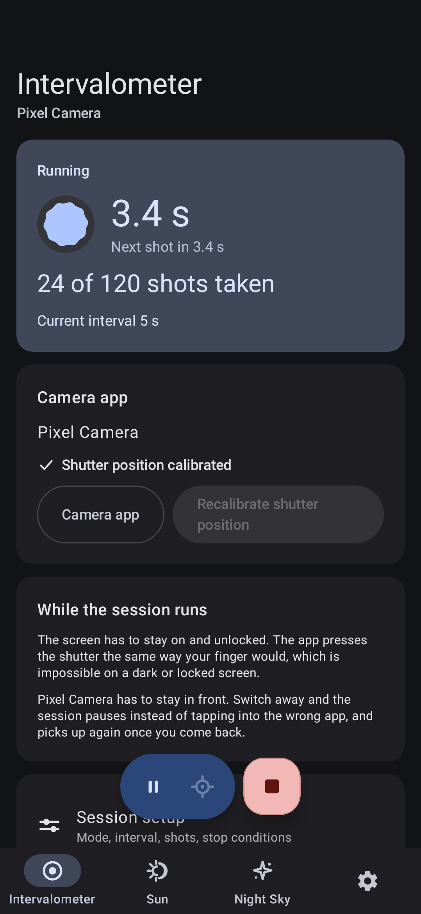
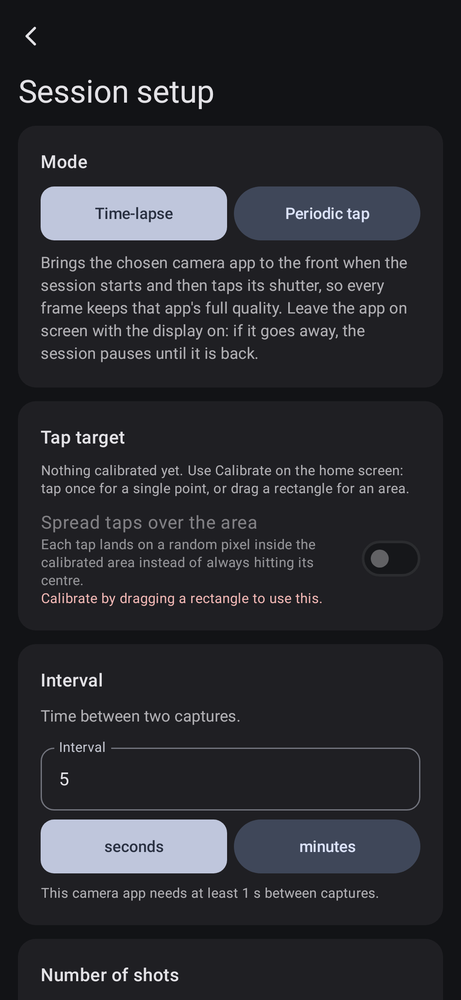
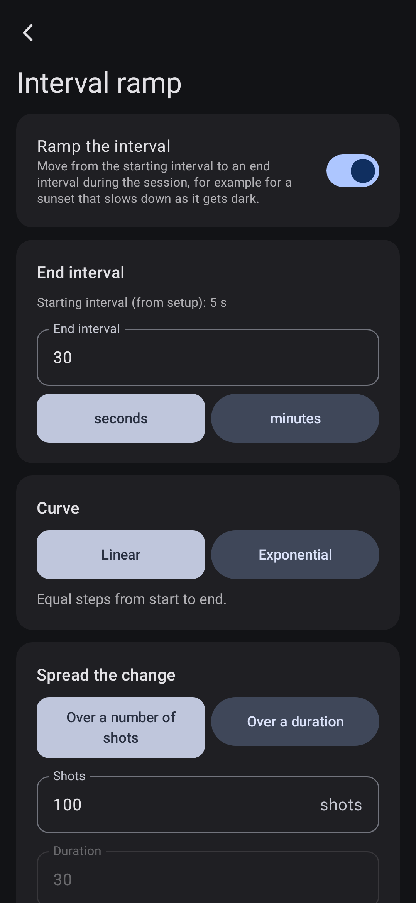
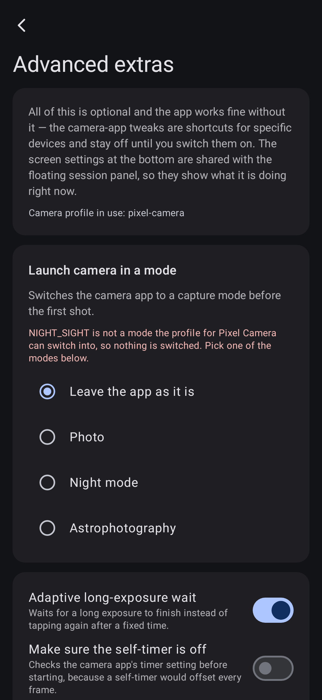
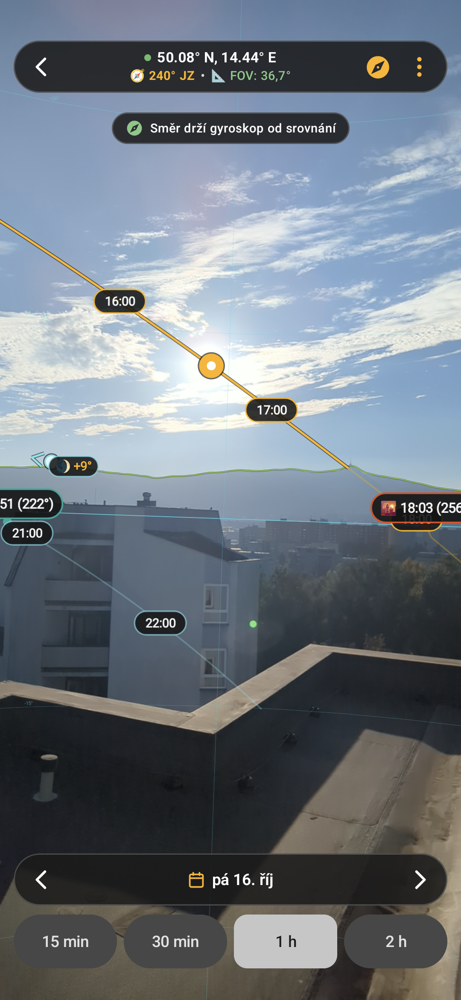
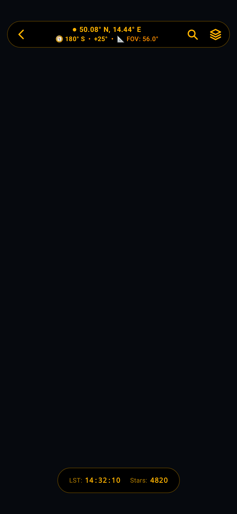
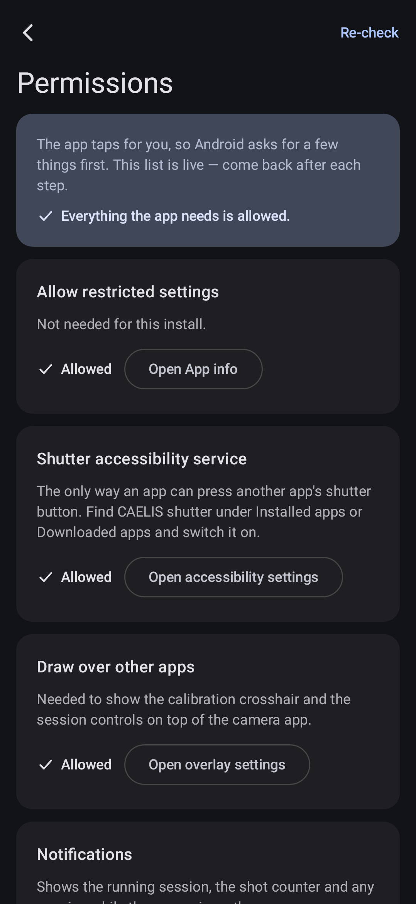

# Caelis — UI Design & User Experience

Caelis is designed as an elegant, precision-crafted companion for time-lapse photographers and astrophotographers. Every screen, control, and transition is built from the ground up around **field ergonomics**: whether operating a phone mounted on a tripod in bright sunlight, framing a sunset at dusk, or aligning a camera with the Milky Way in pitch darkness.

This document outlines the design philosophy, visual language, component hierarchy, and user experience flows of Caelis, highlighting the complete integration of **Material Design 3 Expressive**.

---

## Table of Contents

1. [Design Philosophy & Core Pillars](#1-design-philosophy--core-pillars)
2. [Material Design 3 Expressive Integration](#2-material-design-3-expressive-integration)
   - [Expressive Motion & Spring Physics](#expressive-motion--spring-physics)
   - [Expressive Typography & Number Hierarchy](#expressive-typography--number-hierarchy)
   - [Expressive Shapes & Curvature Scale](#expressive-shapes--curvature-scale)
   - [Dynamic Color & Dark Adaptation Palettes](#dynamic-color--dark-adaptation-palettes)
3. [Component Anatomy & Design System](#3-component-anatomy--design-system)
4. [Screen-by-Screen Walkthrough](#4-screen-by-screen-walkthrough)
   - [Session Hub (Intervalometer)](#session-hub-intervalometer)
   - [Session Setup & Ramp Planning](#session-setup--ramp-planning)
   - [Theme & Night Vision Settings](#theme--night-vision-settings)
   - [Sun & Moon AR Trajectory Planning](#sun--moon-ar-trajectory-planning)
   - [Night Sky AR Planetarium & Astrophotography](#night-sky-ar-planetarium--astrophotography)
   - [Camera Viewfinder Floating Overlay & Calibration](#camera-viewfinder-floating-overlay--calibration)
   - [First-Run Experience & Permissions](#first-run-experience--permissions)
5. [Screenshot Reference Matrix](#5-screenshot-reference-matrix)

---

## 1. Design Philosophy & Core Pillars

Photographers using an intervalometer face very specific environmental challenges: tripod setups at awkward heights, outdoor glare, freezing night temperatures where gloves are required, and the need to preserve eye dark adaptation.

Caelis addresses these with four core design pillars:

```
┌────────────────────────────────────────────────────────────────────────┐
│                        CAELIS DESIGN PILLARS                           │
├──────────────────┬──────────────────┬─────────────────┬────────────────┤
│  Field Ergonomics│ Visual Hierarchy │ Dark Adaptation │ Confidence &   │
│                  │ & Legibility     │ & Night Vision  │ Reassurance    │
│  Large touch     │ Hero numbers     │ Deep red &      │ Live progress, │
│  targets (48dp+) │ visible at arm's │ amber palettes; │ clear blockers,│
│  and persistent  │ length; zero     │ true-black OLED │ auto-stop      │
│  floating hubs   │ visual clutter   │ backgrounds     │ safety metrics │
└──────────────────┴──────────────────┴─────────────────┴────────────────┘
```

- **Field Ergonomics**: Primary action buttons and navigation are anchored within easy thumb reach. Floating toolbars stay accessible above scrolling content.
- **Visual Hierarchy & Legibility**: Critical session numbers (remaining countdown, shots taken, planned interval) are presented in emphasized typographic scales that can be read effortlessly from several feet away.
- **Dark Adaptation**: In night shooting modes, bright white UI elements are replaced with pure-black OLED surfaces and specialized red/amber monochromatic themes that preserve the eye's rhodopsin pigment.
- **Confidence & Reassurance**: Users never have to guess what the app is doing. Live animated progress rings, clear status chips, and descriptive safety limits (battery and storage guards) provide continuous feedback.

---

## 2. Material Design 3 Expressive Integration

Caelis is built on the **Material Design 3 Expressive** design system, utilizing expressive tokens across motion, typography, shape, and color.

### Expressive Motion & Spring Physics

Instead of rigid linear durations and static easing curves, all interactive transitions in Caelis are driven by **physics-based springs** (`MotionScheme.expressive()`):

- **Spatial Springs (`defaultSpatialSpec`)**: Applied to all elements that change position, size, or shape (such as cards expanding, toggle buttons morphing, or the session indicator resetting). Spatial springs settle with a subtle, organic overshoot that feels responsive and physical.
- **Slow Spatial Springs (`slowSpatialSpec`)**: Reserved for deliberate, high-impact state transformations, such as the primary **Start** button morphing into the **Stop** action.
- **Effects Springs (`defaultEffectsSpec`)**: Applied to color, tint, and alpha transitions. These springs do not overshoot, preventing visual flickering during state changes.

### Expressive Typography & Number Hierarchy

Numbers are the heart of an intervalometer. Caelis defines distinct expressive typographic roles:

- **Hero Numbers (`ExpressiveType.hero`)**: Utilizes `displaySmallEmphasized` with tightened tracking and heavy stroke weight for the active countdown and total shot counts.
- **Secondary Figures (`ExpressiveType.figure`)**: Utilizes `headlineSmallEmphasized` for target interval times and planned sequence totals.
- **Figure Labels (`ExpressiveType.figureLabel`)**: Utilizes `labelLargeEmphasized` to anchor numerical values with clear, scannable units.

### Expressive Shapes & Curvature Scale

The app utilizes high-curvature expressive shapes (`largeIncreased`, `extraLargeIncreased`) to create friendly, tactile surfaces:

- **Shape Morphing Selection**: Selection in segmented buttons is communicated by shape change as well as color—unselected items feature rounded pill contours, while selected items smoothly morph into structured squircles.
- **Rounded Cards**: Primary content containers use 28dp+ corner radii (`MaterialTheme.shapes.large`), creating distinct visual islands.

### Dynamic Color & Dark Adaptation Palettes

- **Material You Dynamic Theming**: In standard day mode, Caelis extracts tonal palettes dynamically from the user's wallpaper, creating a harmonious system integration in both light and dark themes.
- **Night Vision Modes**:
  - **Deep Red (`#FFFF1744`)**: Monochromatic red light that prevents pupil dilation and preserves night vision during deep-sky astrophotography.
  - **Amber Gold (`#FFFFB300`)**: Warm amber spectrum providing high contrast and readability under moonlit skies.

---

## 3. Component Anatomy & Design System

Caelis establishes consistent design building blocks across all screens:

```
┌──────────────────────────────────────────────────────────────┐
│ MediumFlexibleTopAppBar (Collapses gracefully on scroll)     │
├──────────────────────────────────────────────────────────────┤
│ ┌──────────────────────────────────────────────────────────┐ │
│ │ SectionCard (Tonal container, large rounded corners)     │ │
│ │  - Hero metric / Title                                   │ │
│ │  - SwitchRow / ChoiceRow / SegmentedChoice               │ │
│ └──────────────────────────────────────────────────────────┘ │
│                                                              │
│ ┌──────────────────────────────────────────────────────────┐ │
│ │ SectionCard (Warning or Accent tone for safety limits)   │ │
│ └──────────────────────────────────────────────────────────┘ │
├──────────────────────────────────────────────────────────────┤
│ SessionToolbar (Vibrant floating toolbar + morphing FAB)     │
├──────────────────────────────────────────────────────────────┤
│ NavigationBar / NavigationRail (Adaptive system navigation)  │
└──────────────────────────────────────────────────────────────┘
```

- **`ScreenScaffold`**: Houses a two-row `MediumFlexibleTopAppBar` that provides generous space for titles and subtitles when expanded and smoothly collapses to a compact single row upon scrolling.
- **`SectionCard`**: Modular content cards with adaptive tonal styling (`NEUTRAL`, `WARNING`, `ACCENT`).
- **`SegmentedChoice`**: Connected groups of `FilledTonalToggleButton` elements providing tactile, single-tap switching between discrete modes and units.
- **`SessionToolbar`**: A vibrant floating bar (`HorizontalFloatingToolbar`) elevated above the content, ensuring primary start, pause, and stop actions are always within thumb reach.
- **`ProgressRing`**: A determinate circular indicator (`ContainedLoadingIndicator`) that visually fills as the interval timer elapses, resetting smoothly with each captured frame.

---

## 4. Screen-by-Screen Walkthrough

### Session Hub (Intervalometer)

The main dashboard provides an instant overview of the current shooting session, camera profile, and quick configuration.

| Light Theme Idle | Dark Theme Idle | Active Shooting State |
| :---: | :---: | :---: |
|  |  |  |
| [01_main_idle_light.png](screenshots/01_main_idle_light.png) | [02_main_idle_dark.png](screenshots/02_main_idle_dark.png) | [03_main_active_dark.png](screenshots/03_main_active_dark.png) |

#### Design Highlights:
- **Hero State Card**: In idle mode, displays the configured interval (e.g., `5s`) and planned shot count (`120 shots`). When active, transforms into a live countdown (`00:04`) accompanied by the animated `ProgressRing` and current shot progress (`24 / 120`).
- **Camera Target Card**: Features the target camera application name (`Pixel Camera`), calibration status badge (`Calibrated`), and camera profile indicator.
- **Morphing Action Button**: The primary action button docked to the floating toolbar morphs from a round pill **Start** button into a square-cornered, bold red **Stop** button with an expressive spatial spring animation.

---

### Session Setup & Ramp Planning

Configuring a session is streamlined into structured, bite-sized cards that prevent cognitive overload.

| Session Setup | Interval Ramping | Advanced Camera Preferences |
| :---: | :---: | :---: |
|  |  |  |
| [04_setup_screen.png](screenshots/04_setup_screen.png) | [05_ramp_screen.png](screenshots/05_ramp_screen.png) | [06_advanced_screen.png](screenshots/06_advanced_screen.png) |

#### Design Highlights:
- **Mode Toggle (`04_setup_screen.png`)**: Segmented expressive buttons let users switch between **Time-lapse** mode and **Periodic tap** with clear visual feedback.
- **Duration & Unit Stacking**: Input fields are paired with dedicated segmented buttons for time units (`Seconds`, `Minutes`, `Hours`), avoiding clumsy dropdown menus.
- **Ramping Planner (`05_ramp_screen.png`)**: Designed for day-to-night transitions (holy grail time-lapses). Users configure starting and ending intervals, transition span, and choose between linear or exponential progression curves.
- **Safety Auto-Stop Guards**: Dedicated threshold cards allow setting automatic shutoff when battery drops below a chosen percentage (e.g. `20%`) or storage space falls below a limit (`1000 MB`).
- **Advanced Camera Integration (`06_advanced_screen.png`)**: Clean radio rows let users choose the camera launch mode (Photo, Night Sight, Astrophotography) and toggle comfort options like screen wake lock and overlay dimming.

---

### Theme & Night Vision Settings

Customizing the visual appearance and scheduling night vision modes.

| Night Vision Settings | Expressive Time Picker Dialog |
| :---: | :---: |
|  |  |
| [07_settings_screen.png](screenshots/07_settings_screen.png) | [08_dialog_time_picker.png](screenshots/08_dialog_time_picker.png) |

#### Design Highlights:
- **Night Vision Theme Cards (`07_settings_screen.png`)**: Visual theme selector featuring **Standard Dark**, **Deep Red**, and **Amber Gold** color options.
- **Activation Schedules**: Users can activate night vision manually, synchronize it with local sunset/sunrise, or specify custom hours.
- **Material 3 Time Picker (`08_dialog_time_picker.png`)**: An intuitive circular clock dial and input dialog for setting schedule windows with single-tap precision.

---

### Sun & Moon AR Trajectory Planning

An augmented reality viewfinder allowing photographers to visualize the path of the Sun and Moon against the real landscape.

| AR Trajectory Viewfinder | Solar & Lunar Day Summary |
| :---: | :---: |
|  |  |
| [09_sun_ar_trajectory.png](screenshots/09_sun_ar_trajectory.png) | [10_sun_ar_day_summary.png](screenshots/10_sun_ar_day_summary.png) |

#### Design Highlights:
- **3D Celestial Ribbons (`09_sun_ar_trajectory.png`)**: Renders smooth solar (golden) and lunar (cyan) trajectory curves anchored to the physical landscape. Hourly time bubbles show exact celestial positions throughout the day.
- **3D Celestial Grid**: Altitude parallels and azimuth meridians provide precise angular scale in degrees.
- **Two-Row Floating HUD**:
  - *Top HUD*: Displays live GPS fix, geographic coordinates (`50.08° N, 14.44° E`), compass heading, and camera field of view.
  - *Bottom Controls*: Features a date navigator with quick day-stepping and bubble interval selectors (`15m`, `30m`, `1h`, `2h`).
- **Ephemeris Summary Card (`10_sun_ar_day_summary.png`)**: A glassmorphic bottom card presenting civil, nautical, and astronomical twilight times, golden hour windows, solar noon, moon phases, and rise/set times.

---

### Night Sky AR Planetarium & Astrophotography

A real-time planetarium designed for framing night-sky photography, aligning constellations, and locating deep-sky objects.

| Night Sky Viewfinder | Celestial Search | Celestial Detail Sheet | Layer Settings Sheet |
| :---: | :---: | :---: | :---: |
|  |  |  |  |
| [11_night_sky_ar_view.png](screenshots/11_night_sky_ar_view.png) | [12_night_sky_search.png](screenshots/12_night_sky_search.png) | [13_night_sky_detail_sheet.png](screenshots/13_night_sky_detail_sheet.png) | [14_night_sky_layer_settings.png](screenshots/14_night_sky_layer_settings.png) |

#### Design Highlights:
- **True-Black Star Field (`11_night_sky_ar_view.png`)**: Renders thousands of stars with realistic optical color temperatures, magnitude-based sizing, and procedural Milky Way atmosphere.
- **Astrophotography Telemetry**: Top HUD tracks lens FOV and compass heading; Bottom HUD displays Local Sidereal Time (LST) and visible star count (`4,820 stars`).
- **Instant Search (`12_night_sky_search.png`)**: Full-screen search bar with instant query matching across stars, planets, and constellations in both local and IAU Latin names.
- **Celestial Detail Sheet (`13_night_sky_detail_sheet.png`)**: Bottom sheet displaying stellar magnitude, distance in light-years, parent constellation, and an animated **Point Camera** targeting button.
- **Layer Customization Sheet (`14_night_sky_layer_settings.png`)**: Granular toggles allowing users to enable or disable constellation lines, classical artwork, planetary bodies, coordinate grids, and the night vision red filter.

---

### Camera Viewfinder Floating Overlay & Calibration

When shooting a time-lapse, Caelis operates directly over the native camera application with an intelligent floating control panel.

| Viewfinder Floating Panel | Shutter Target Calibration |
| :---: | :---: |
|  |  |
| [15_overlay_floating_panel.png](screenshots/15_overlay_floating_panel.png) | [16_overlay_calibration_target.png](screenshots/16_overlay_calibration_target.png) |

#### Design Highlights:
- **Non-Obstructive Floating Panel (`15_overlay_floating_panel.png`)**: A compact, rounded card positioned away from camera shutter buttons and viewfinder controls. Features high-visibility monospace countdown (`00:04`), shot counter (`38 / 100`), quick Pause/Stop buttons, and screen dimming toggles.
- **Interactive Calibration Crosshair (`16_overlay_calibration_target.png`)**: A high-contrast cyan reticle (`#00E5FF`) with translucent backdrop that allows users to drag and pinpoint the exact shutter button location on any third-party camera app.

---

### First-Run Experience & Permissions

A transparent, reassuring onboarding process explaining why permissions are needed.

| Permissions & Onboarding |
| :---: |
|  |
| [17_onboarding_permissions.png](screenshots/17_onboarding_permissions.png) |

#### Design Highlights:
- **Trust & Clarity**: Clearly itemizes required system privileges (Accessibility, Overlay, Notifications, Battery Optimization exemption) with human-first explanations of how each is used.
- **Live Status Chips**: Real-time checkmarks and status badges reassure the user as each permission is granted.
- **One-Tap Routing**: Dedicated buttons navigate directly to the relevant system settings screen.

---

## 5. Screenshot Reference Matrix

| ID | File | Feature / Screen | Mode / Theme | Key Design Highlight |
| :--- | :--- | :--- | :--- | :--- |
| **01** | [`01_main_idle_light.png`](screenshots/01_main_idle_light.png) | Main Session Hub | Light Mode | Dynamic wallpaper theme, hero metric cards |
| **02** | [`02_main_idle_dark.png`](screenshots/02_main_idle_dark.png) | Main Session Hub | Dark Mode | High-contrast dark surfaces, floating action bar |
| **03** | [`03_main_active_dark.png`](screenshots/03_main_active_dark.png) | Main Session Hub | Active Shooting | Live countdown, progress ring, morphing Stop FAB |
| **04** | [`04_setup_screen.png`](screenshots/04_setup_screen.png) | Session Setup | Dark Mode | Segmented choice toggles, duration unit pickers |
| **05** | [`05_ramp_screen.png`](screenshots/05_ramp_screen.png) | Interval Ramping | Dark Mode | Starting/ending interval fields, curve selection |
| **06** | [`06_advanced_screen.png`](screenshots/06_advanced_screen.png) | Advanced Preferences | Dark Mode | Camera launch modes, exposure wait toggles |
| **07** | [`07_settings_screen.png`](screenshots/07_settings_screen.png) | Settings & Themes | Dark Mode | Amber theme preview, schedule configuration |
| **08** | [`08_dialog_time_picker.png`](screenshots/08_dialog_time_picker.png) | Time Picker Dialog | Dark Mode | Expressive circular dial, precision minute pickers |
| **09** | [`09_sun_ar_trajectory.png`](screenshots/09_sun_ar_trajectory.png) | Sun & Moon AR View | AR Overlay | 3D solar trajectory ribbons, hourly time bubbles |
| **10** | [`10_sun_ar_day_summary.png`](screenshots/10_sun_ar_day_summary.png) | Sun & Moon Summary | Glassmorphic Card | Twilight phases, golden hour, moon illumination |
| **11** | [`11_night_sky_ar_view.png`](screenshots/11_night_sky_ar_view.png) | Night Sky AR View | Amber Red Vision | True-black star field, Sidereal time, B-V color index |
| **12** | [`12_night_sky_search.png`](screenshots/12_night_sky_search.png) | Celestial Search | Dark Mode | Instant search bar, star & constellation ranking |
| **13** | [`13_night_sky_detail_sheet.png`](screenshots/13_night_sky_detail_sheet.png) | Celestial Body Sheet | Amber Red Vision | Stellar magnitude, light-year distance, targeting |
| **14** | [`14_night_sky_layer_settings.png`](screenshots/14_night_sky_layer_settings.png) | Layer Settings Sheet | Amber Red Vision | Granular toggles for artwork, planets, and grid |
| **15** | [`15_overlay_floating_panel.png`](screenshots/15_overlay_floating_panel.png) | Viewfinder Overlay | Floating HUD | Monospace countdown, pause/stop pills, auto-dim |
| **16** | [`16_overlay_calibration_target.png`](screenshots/16_overlay_calibration_target.png) | Shutter Calibration | Interactive Scrim | Cyan glowing reticle, 1-finger crosshair alignment |
| **17** | [`17_onboarding_permissions.png`](screenshots/17_onboarding_permissions.png) | Onboarding Checklist | Dark Mode | Human-first permission cards, status check chips |
