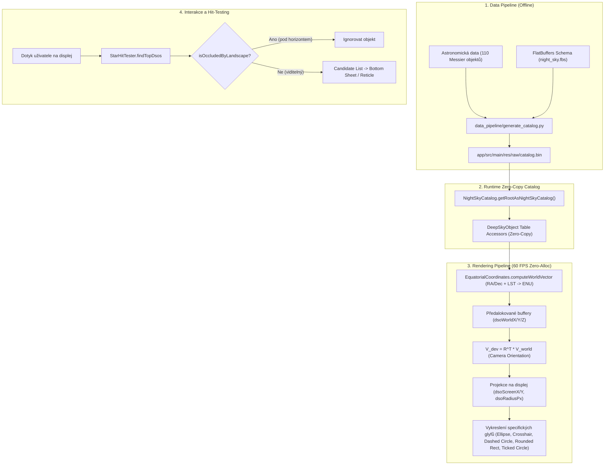
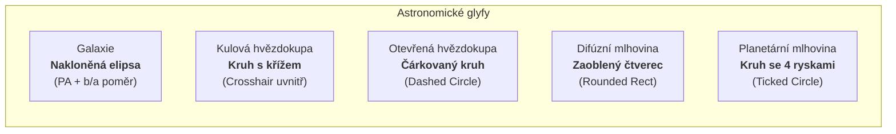
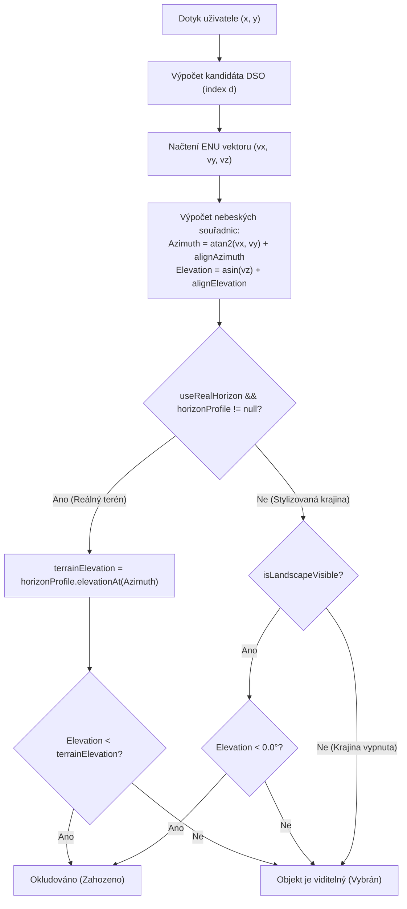

# Objekty hlubokého vesmíru (DSO) v AR: Katalog, Vykreslování, Legenda a Okluze terénem (Caelis)

Tento dokument poskytuje kompletní technickou, matematickou a implementační specifikaci integrace **Objektů hlubokého vesmíru (Deep Sky Objects – DSO)** v modulu **Noční obloha (Night Sky AR)** aplikace **Caelis**.

Dokument detailně rozebírá:
1. **Datový model a FlatBuffers binární pipeline** (schéma, generování katalogu 110 Messierových objektů, zero-copy čtení v paměti).
2. **Astronomickou projekci a transformace souřadnic** (přepočet rovníkových souřadnic J2000.0 na ENU světové vektory a jejich projekce na displej s nulovými alokacemi při 60 FPS).
3. **Typologii a vykreslování astronomických glyfů** (specifické symboly pro galaxie, kulové hvězdokupy, otevřené hvězdokupy, difúzní mlhoviny a planetární mlhoviny včetně nočního vidění).
4. **Filtrování dotyků a okluzi horizontem krajiny** (hit-testing bez alokací s kontrolou terénního profilu a stylizovaného panoramatu).
5. **Vícejazyčné vyhledávání a indexaci** (hledání podle kódů M/NGC i českých/anglických názvů).
6. **Uživatelské rozhraní a interaktivní legendu symbolů** (modální dialog `DsoLegendDialog`, nastavení vrstev, spodní detailní list).

---

## Obsah

1. [Přehled architektury a výkonnostní principy](#1-přehled-architektury-a-výkonnostní-principy)
2. [Datový model a FlatBuffers binární katalog](#2-datový-model-a-flatbuffers-binární-katalog)
   - [Schéma `night_sky.fbs`](#schéma-night_skyfbs)
   - [Generování datasetu (`generate_catalog.py`)](#generování-datasetu-generate_catalogpy)
   - [Zero-Copy paměťový přístup](#zero-copy-paměťový-přístup)
3. [Astronomická projekce a transformace souřadnic](#3-astronomická-projekce-a-transformace-souřadnic)
   - [Rovníkové souřadnice J2000.0 $\to$ ENU světový systém](#rovníkové-souřadnice-j20000-to-enu-světový-systém)
   - [Transformace do souřadnic zařízení ($V_{\text{dev}} = R^T \cdot V_{\text{world}}$)](#transformace-do-souřadnic-zařízení-v_textdev--rt-cdot-v_textworld)
   - [Projekce na obrazovku a korekce rotace displeje](#projekce-na-obrazovku-a-korekce-rotace-displeje)
4. [Vykreslovací pipeline a astronomické glyfy](#4-vykreslovací-pipeline-a-astronomické-glyfy)
   - [Předalokované buffery pro nulové GC alokace (60 FPS)](#předalokované-buffery-pro-nulové-gc-alokace-60-fps)
   - [Výpočet úhlového poloměru a měřítka při zoomu](#výpočet-úhlového-poloměru-a-měřítka-při-zoomu)
   - [Matematika a geometrie jednotlivých glyfů](#matematika-a-geometrie-jednotlivých-glyfů)
   - [Optické stylování a podpora nočního vidění (Night Vision)](#optické-stylování-a-podpora-nočního-vidění-night-vision)
5. [Výběr těles (Hit-Testing) a okluze krajinou](#5-výběr-těles-hit-testing-a-okluze-krajinou)
   - [Algoritmus `StarHitTester.findTopDsos`](#algoritmus-starhittesterfindtopdsos)
   - [Filtrování objektů skrytých za terénem (`isOccludedByLandscape`)](#filtrování-objektů-skrytých-za-terénem-isoccludedbylandscape)
   - [Disambiguace a výběr více překrývajících se těles](#disambiguace-a-výběr-více-překrývajících-se-těles)
6. [Vyhledávací index (`CelestialSearchIndex`)](#6-vyhledávací-index-celestialsearchindex)
7. [Uživatelské rozhraní a Legenda symbolů](#7-uživatelské-rozhraní-a-legenda-symbolů)
   - [Dialog legendy (`DsoLegendDialog`)](#dialog-legendy-dsolegenddialog)
   - [Ovládání v panelu vrstev a spodním detailním listu](#ovládání-v-panelu-vrstev-a-spodním-detailním-listu)
8. [Přehled klíčových souborů](#8-přehled-klíčových-souborů)

---

## 1. Přehled architektury a výkonnostní principy

Vykreslování objektů hlubokého vesmíru v reálném čase (60 FPS) vyžaduje integraci do stávajícího bezalokačního pipeline:
- **Žádné alokace na haldě (Heap)** během běhu smyčky `onDraw` / `render`.
- **Rychlé přepočty transformací**: Na rozdíl od planet (které vyžadují dynamickou orbitální mechaniku Keplera a teorie Měsíce) mají Messierovy objekty fixní rovníkové souřadnice J2000.0 ($\text{RA}, \text{Dec}$). Jejich světové ENU vektory se proto předpočítávají staticky jednou za snímek (při změně LST) v dávce za $< 0.05\text{ ms}$.
- **Geometrická přesnost**: Tvar a orientace galaxií na nebeské sféře odpovídá skutečnému pozičnímu úhlu v astronomických katalozích a poměru hlavní a vedlejší poloosy.



---

## 2. Datový model a FlatBuffers binární katalog

### Schéma `night_sky.fbs`
Pro efektivní reprezentaci objektů hlubokého vesmíru byl binární formát FlatBuffers rozšířen o výčtový typ `DsoType` a tabulku `DeepSkyObject`:

```protobuf
enum DsoType : ubyte {
    GALAXY = 0,
    GLOBULAR_CLUSTER = 1,
    OPEN_CLUSTER = 2,
    NEBULA = 3,
    PLANETARY_NEBULA = 4
}

table DeepSkyObject {
    messier_id: short;           // Číslo v Messierově katalogu (1..110)
    dso_type: DsoType;           // Typ tělesa
    ra: float;                   // Rektascenze v stupních J2000.0 [0.0, 360.0)
    dec: float;                  // Deklinace v stupních J2000.0 [-90.0, +90.0]
    magnitude: float;            // Vizuální magnituda (např. 3.44 pro M31)
    radius_arcmin: float;        // Úhlový poloměr v úhlových minutách
    position_angle_deg: float;   // Poziční úhel hlavní poloosy [0.0, 180.0)
    axis_ratio: float;           // Poměr vedlejší ku hlavní poloose b/a (0.1 .. 1.0)
    english_name: string;        // Např. "Andromeda Galaxy"
    localized_name: string;      // Např. "Galaxie v Andromedě"
    ngc_id: string;              // Např. "NGC 224"
    constellation_id: string;    // Zkratka souhvězdí (např. "And")
}

table NightSkyCatalog {
    stars: [Star];
    constellations: [Constellation];
    dsos: [DeepSkyObject];       // Vektor 110 Messierových objektů
}
```

### Generování datasetu (`generate_catalog.py`)
Skript `data_pipeline/generate_catalog.py` integruje přesná astrometrická data všech 110 Messierových objektů:
- Převod rektascenze z hodin, minut a sekund ($\text{RA}_{\text{rad}} = (\text{h} + \text{m}/60 + \text{s}/3600) \times 15^\circ$) do stupňů.
- Převod deklinace ze stupňů, minut a vteřin ($\text{Dec}_{\text{rad}} = \text{deg} + \text{arcmin}/60 + \text{arcsec}/3600$).
- Úhlové rozměry (např. $190' \times 60'$ pro M31 $\implies \text{radius} = 95'$, $\text{axis\_ratio} = 60/190 = 0.316$).
- NGC/IC křížové identifikátory a české astronomické názvy.

Výsledný binární soubor `catalog.bin` (velikost 1,084,200 bajtů) je uložen v `app/src/main/res/raw/catalog.bin`.

### Zero-Copy paměťový přístup
Aplikace mapuje `catalog.bin` přímo do paměti jako `ByteBuffer`. Java přístupové třídy [`DeepSkyObject`](file:///home/dazix/projects/caelis-mobile-app/app/src/main/java/com/dazix/caelis/data/nightsky/DeepSkyObject.java) fungují jako flyweight struktury – čtení jakéhokoliv atributu (např. `dso.ra()`, `dso.positionAngleDeg()`) je přímým posunem offsetu v bufferu bez alokace objektů.

---

## 3. Astronomická projekce a transformace souřadnic

### Rovníkové souřadnice J2000.0 $\to$ ENU světový systém
Poloha každého DSO na obloze je definována fixními souřadnicemi J2000.0 $(\alpha, \delta)$. V závislosti na lokálním hvězdném čase ($\text{LST}$) a zeměpisné šířce pozorovatele ($\phi$) se v čase snímku vypočte jednotkový vektor ve světovém souřadnicovém systému ENU (East-North-Up):

$$\text{HA} = \text{LST} - \alpha$$

$$\begin{aligned}
v_{\text{East}} &= -\cos(\delta) \cdot \sin(\text{HA}) \\
v_{\text{North}} &= \sin(\delta) \cdot \cos(\phi) - \cos(\delta) \cdot \sin(\phi) \cdot \cos(\text{HA}) \\
v_{\text{Up}} &= \sin(\delta) \cdot \sin(\phi) + \cos(\delta) \cdot \cos(\phi) \cdot \cos(\text{HA})
\end{aligned}$$

Tento výpočet provádí optimalizovaná funkce [`EquatorialCoordinates.computeWorldVector`](file:///home/dazix/projects/caelis-mobile-app/app/src/main/java/com/dazix/caelis/domain/nightsky/EquatorialCoordinates.kt) v rámci předvýpočtu `updateStarWorldVectorsTier1` za $< 0.05\text{ ms}$ pro všech 110 objektů.

### Transformace do souřadnic zařízení ($V_{\text{dev}} = R^T \cdot V_{\text{world}}$)
Světový vektor $V_{\text{world}} = (v_x, v_y, v_z)^T$ je transformován do souřadnic zařízení pomocí transponované matice orientace $R^T$:

$$\begin{bmatrix} x_{\text{dev}} \\ y_{\text{dev}} \\ z_{\text{dev}} \end{bmatrix} = \begin{bmatrix} R_{0} & R_{4} & R_{8} \\ R_{1} & R_{5} & R_{9} \\ R_{2} & R_{6} & R_{10} \end{bmatrix} \begin{bmatrix} v_x \\ v_y \\ v_z \end{bmatrix}$$

### Projekce na obrazovku a korekce rotace displeje
Po aplikaci rotace displeje (`Surface.ROTATION_0`, `ROTATION_90`, `ROTATION_180`, `ROTATION_270`):
$$z_s = -z_{\text{dev}}$$

Pokud $z_s \le 0.001$ (objekt je za zády pozorovatele), objekt se nepromítá. V opačném případě je promítnut na obrazovku podle ohniskové vzdálenosti $f_{\text{pixels}}$:

$$x_{\text{screen}} = \frac{W}{2} + f_{\text{pixels}} \cdot \frac{x_s}{z_s}, \quad y_{\text{screen}} = \frac{H}{2} - f_{\text{pixels}} \cdot \frac{y_s}{z_s}$$

---

## 4. Vykreslovací pipeline a astronomické glyfy

### Předalokované buffery pro nulové GC alokace (60 FPS)
V třídě [`NightSkyRenderer`](file:///home/dazix/projects/caelis-mobile-app/app/src/main/java/com/dazix/caelis/ui/nightsky/NightSkyRenderer.kt) jsou alokovány statické buffery pro maximální kapacitu 110 objektů:
- `dsoWorldX`, `dsoWorldY`, `dsoWorldZ`: `FloatArray(110)`
- `dsoScreenX`, `dsoScreenY`: `FloatArray(110)`
- `dsoRadiusPx`: `FloatArray(110)`
- `dsoInFront`: `BooleanArray(110)`
- `dsoMagnitudes`: `FloatArray(110)`

### Výpočet úhlového poloměru a měřítka při zoomu
Úhlový poloměr v obloukových minutách ($\theta_{\text{arcmin}}$) se promítá do pixelové velikosti na displeji:

$$\theta_{\text{deg}} = \text{clamp}\left(\frac{\theta_{\text{arcmin}}}{60.0},\, 0.05^\circ,\, 5.0^\circ\right)$$

$$R_{\text{px}} = \text{clamp}\left(f_{\text{pixels}} \cdot \tan\left(\theta_{\text{deg}} \cdot \frac{\pi}{180}\right) \cdot \text{zoomFactor},\, 8.0 \cdot \text{density},\, 250.0 \cdot \text{density}\right)$$

### Matematika a geometrie jednotlivých glyfů

Pro každý z 5 typů DSO se používá specializovaný astronomický glyf vykreslený přes Android `Canvas`:



#### 1. Galaxie (`DsoType.GALAXY`)
- **Tvar**: Nakloněná elipsa reprezentující skutečný tvar a sklon galaxie na obloze.
- **Hlavní poloměr**: $a = R_{\text{px}}$
- **Vedlejší poloměr**: $b = R_{\text{px}} \cdot \text{axisRatio}$
- **Natočení**: Vypočte se úhel směru k nebeskému severnímu pólu na obrazovce $\theta_{\text{north}}$. Celkový úhel rotace plátna je $\theta = \theta_{\text{north}} + \text{positionAngleDeg}$.
- **Kresba**: `canvas.drawOval(RectF(-a, -b, a, b), dsoPaint)`.

#### 2. Kulové hvězdokupy (`DsoType.GLOBULAR_CLUSTER`)
- **Tvar**: Kružnice s vnitřním nitkovým křížem protínajícím střed.
- **Kresba**:
  - `canvas.drawCircle(x, y, R_{\text{px}}, dsoPaint)`
  - `canvas.drawLine(x - R_{\text{px}}, y, x + R_{\text{px}}, y, dsoPaint)`
  - `canvas.drawLine(x, y - R_{\text{px}}, x, y + R_{\text{px}}, dsoPaint)`

#### 3. Otevřené hvězdokupy (`DsoType.OPEN_CLUSTER`)
- **Tvar**: Čárkovaná (přerušovaná) kružnice symbolizující volné seskupení hvězd.
- **Kresba**: `dsoDashedPaint` s `DashPathEffect(floatArrayOf(6f * density, 4f * density), 0f)`.

#### 4. Difúzní mlhoviny a Zbytky supernov (`DsoType.NEBULA`)
- **Tvar**: Zaoblený čtverec (Rounded Rectangle).
- **Kresba**: `canvas.drawRoundRect(RectF(x - R_{\text{px}}, y - R_{\text{px}}, x + R_{\text{px}}, y + R_{\text{px}}), cornerRadius, cornerRadius, dsoPaint)`.

#### 5. Planetární mlhoviny (`DsoType.PLANETARY_NEBULA`)
- **Tvar**: Kružnice se čtyřmi vnějšími ryskami v kardinálních směrech (nahoře, dole, vlevo, vpravo).
- **Délka rysky**: $L = R_{\text{px}} \cdot 0.5$
- **Kresba**: Kružnice o poloměru $R_{\text{px}}$ a 4 vnější úsečky vycházející z obvodu směrem ven:
  - $(x, y - R_{\text{px}}) \to (x, y - R_{\text{px}} - L)$
  - $(x, y + R_{\text{px}}) \to (x, y + R_{\text{px}} + L)$
  - $(x - R_{\text{px}}, y) \to (x - R_{\text{px}} - L, y)$
  - $(x + R_{\text{px}}, y) \to (x + R_{\text{px}} + L, y)$

---

### Optické stylování a podpora nočního vidění (Night Vision)

Jas a průhlednost glyfu se dynamicky přizpůsobují vizuální magnitudě objektu ($m$):

$$\alpha = \text{clamp}\left(1.0 - \frac{m - 2.0}{9.0},\, 0.35,\, 0.95\right)$$

V závislosti na aktivním režimu zobrazení se aplikují speciální barvy a filtry:
- **Standardní režim**: Azurová / světle modrá barva (`#80DEEA` / `#4DD0E1`).
- **Červené noční vidění (Red Vision)**: Čistá červená (`#FF1744`), zachovávající adaptaci lidského oka na tmu.
- **Jantarové noční vidění (Amber Vision)**: Hřejivá jantarová (`#FFB300`).
- **Zelené noční vidění (Green Vision)**: Zelené spektrum noktowizoru (`#00E676`).

---

## 5. Výběr těles (Hit-Testing) a okluze krajinou

### Algoritmus `StarHitTester.findTopDsos`
Metoda [`StarHitTester.findTopDsos`](file:///home/dazix/projects/caelis-mobile-app/app/src/main/java/com/dazix/caelis/domain/nightsky/StarHitTester.kt) vyhledává DSO nejblíže bodu dotyku $(x_{\text{tap}}, y_{\text{tap}})$. 
Efektivní poloměr dotyku pro každý objekt je dán:
$$R_{\text{touch}} = \max\left(R_{\text{px}} + 16 \cdot \text{density},\, \text{minTouchRadiusPx}\right)$$

Výpočet probíhá v jednom průchodu $O(N)$ bez vytváření dočasných instancí.

---

### Filtrování objektů skrytých za terénem (`isOccludedByLandscape`)

Pokud má uživatel zapnutou vrstvu krajiny (stylizované panorama nebo reálný 3D terénní profil SRTM/DEM), objekty nacházející se pod horizontem nesmí být dotykem vybrány.



Matematická implementace v [`StarHitTester.isOccludedByLandscape`](file:///home/dazix/projects/caelis-mobile-app/app/src/main/java/com/dazix/caelis/domain/nightsky/StarHitTester.kt):
1. **Azimut objektu**:
   $$\text{rawAzDeg} = \text{toDegrees}(\text{atan2}(v_x, v_y))$$
   $$\text{azimuthDeg} = (\text{rawAzDeg} + \Delta\text{Az} + 360.0) \pmod{360.0}$$
2. **Výška objektu nad geometrickým obzorem**:
   $$\text{elevationDeg} = \text{toDegrees}(\arcsin(\text{clamp}(v_z, -1.0, 1.0))) + \Delta\text{El}$$
3. **Vyhodnocení okluze**:
   - Při reálném horizontu: `elevationDeg < horizonProfile.elevationAt(azimuthDeg)`
   - Při stylizované krajině: `elevationDeg < 0.0f`

---

### Disambiguace a výběr více překrývajících se těles
Pokud se pod prstem uživatele nachází více těles (např. hvězda $\nu$ Andromedae a galaxie M31), systém shromáždí kandidáty do seznamu `CelestialCandidate` a zobrazí disambiguační menu pro jednoznačnou volbu.

---

## 6. Vyhledávací index (`CelestialSearchIndex`)

Pro okamžité vyhledávání DSO bez ohledu na jazyk či formát zápisu byl index [`CelestialSearchIndex`](file:///home/dazix/projects/caelis-mobile-app/app/src/main/java/com/dazix/caelis/domain/nightsky/CelestialSearchIndex.kt) rozšířen o typ `CelestialType.DSO`:

- **Formáty Messierova kódu**: Uživatel může zadat `M31`, `m31`, `M 31`, `m 31`.
- **NGC/IC identifikátory**: `NGC 224`, `ngc 224`, `NGC224`.
- **Anglické názvy**: `Andromeda Galaxy`, `Orion Nebula`, `Pleiades`, `Ring Nebula`, `Whirlpool Galaxy`.
- **České názvy s diakritikou i bez**: `Galaxie v Andromedě`, `galaxie v andromede`, `Velká mlhovina v Orionu`, `Prstencová mlhovina`, `Krabí mlhovina`.

Při vyhledání objektu aplikace automaticky natočí AR kameru směrem k cíli pomocí naváděcí S-křivky (`routeCameraToCoordinates`).

---

## 7. Uživatelské rozhraní a Legenda symbolů

### Dialog legendy (`DsoLegendDialog`)
Soubor [`DsoLegendDialog.kt`](file:///home/dazix/projects/caelis-mobile-app/app/src/main/java/com/dazix/caelis/ui/nightsky/DsoLegendDialog.kt) implementuje modální vysvětlující dialog s živě vykreslovanými ukázkami všech 5 glyfů pomocí `Canvas`:

```
+-------------------------------------------------------------+
|               Objekty hlubokého vesmíru                     |
|                                                             |
|  ( ⬭ )  Galaxie                                             |
|         Nakloněná elipsa podle pozičního úhlu a poměru      |
|         poloos.                                             |
|                                                             |
|  ( ⨁ )  Kulové hvězdokupy                                   |
|         Kruh se zaměřovacím křížem.                         |
|                                                             |
|  ( ◌ )  Otevřené hvězdokupy                                 |
|         Přerušovaný/tečkovaný kruh.                         |
|                                                             |
|  ( ▢ )  Difúzní mlhoviny / Pozůstatky supernov              |
|         Zaoblený čtverec.                                   |
|                                                             |
|  ( ⯌ )  Planetární mlhoviny                                 |
|         Kruh se čtyřmi vnějšími ryskami.                    |
|                                                             |
|                                                 [ Zavřít ]  |
+-------------------------------------------------------------+
```

### Ovládání v panelu vrstev a spodním detailním listu
1. **Panel vrstev (`NightSkyLayerSettingsSheet`)**:
   - V sekci *Nebeské objekty a souhvězdí* je umístěn přepínač pro vrstvu DSO (výchozí stav: vypnuto / `default = false`).
   - Vedle přepínače je umístěno tlačítko `IconButton` s ikonou `AppIcons.Info`, které otevírá dialog legendy.
2. **Spodní informační list (`CelestialDetailBottomSheet`)**:
   - Při výběru libovolného DSO se v záhlaví vedle podtitulu typu objektu zobrazuje ikona `(i)` pro rychlé otevření legendy přímo z detailu.

---

## 8. Přehled klíčových souborů

| Soubor | Účel a zodpovědnost |
| --- | --- |
| [`app/src/main/flatbuffers/night_sky.fbs`](file:///home/dazix/projects/caelis-mobile-app/app/src/main/flatbuffers/night_sky.fbs) | FlatBuffers binární schéma definující `DsoType` a `DeepSkyObject`. |
| [`data_pipeline/generate_catalog.py`](file:///home/dazix/projects/caelis-mobile-app/data_pipeline/generate_catalog.py) | Python pipeline generující binární katalog `catalog.bin` s 110 Messierovými objekty. |
| [`DeepSkyObject.java`](file:///home/dazix/projects/caelis-mobile-app/app/src/main/java/com/dazix/caelis/data/nightsky/DeepSkyObject.java) | Vygenerovaný zero-copy Java accessor pro tabulku `DeepSkyObject`. |
| [`DsoType.java`](file:///home/dazix/projects/caelis-mobile-app/app/src/main/java/com/dazix/caelis/data/nightsky/DsoType.java) | Vygenerovaný výčtový typ pro kategorie DSO. |
| [`NightSkyRenderer.kt`](file:///home/dazix/projects/caelis-mobile-app/app/src/main/java/com/dazix/caelis/ui/nightsky/NightSkyRenderer.kt) | 60 FPS zero-allocation vykreslovací pipeline specifických astronomických glyfů a popisků. |
| [`StarHitTester.kt`](file:///home/dazix/projects/caelis-mobile-app/app/src/main/java/com/dazix/caelis/domain/nightsky/StarHitTester.kt) | $O(N)$ dotykový výběr a okluze těles terénním horizontem (`isOccludedByLandscape`). |
| [`CelestialSearchIndex.kt`](file:///home/dazix/projects/caelis-mobile-app/app/src/main/java/com/dazix/caelis/domain/nightsky/CelestialSearchIndex.kt) | Vícejazyčný vyhledávací index bez diakritiky pro rychlé hledání M/NGC kódů a jmen. |
| [`DsoLegendDialog.kt`](file:///home/dazix/projects/caelis-mobile-app/app/src/main/java/com/dazix/caelis/ui/nightsky/DsoLegendDialog.kt) | Modální dialog s interaktivní vektorovou legendou symbolů a popisy. |
| [`NightSkyLayerSettingsSheet.kt`](file:///home/dazix/projects/caelis-mobile-app/app/src/main/java/com/dazix/caelis/ui/nightsky/NightSkyLayerSettingsSheet.kt) | Panel nastavení vrstev s přepínačem DSO a tlačítkem informační legendy. |
| [`CelestialDetailBottomSheet.kt`](file:///home/dazix/projects/caelis-mobile-app/app/src/main/java/com/dazix/caelis/ui/nightsky/CelestialDetailBottomSheet.kt) | Spodní list s astronomickými údaji vybraného DSO a odkazem na legendu. |
| [`SettingsStore.kt`](file:///home/dazix/projects/caelis-mobile-app/app/src/main/java/com/dazix/caelis/data/SettingsStore.kt) | DataStore perzistence stavu zobrazení DSO vrstvy (`readNightSkyDsosVisible`, default `false`). |
