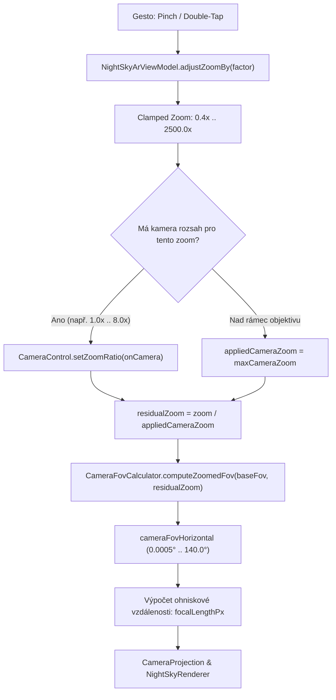
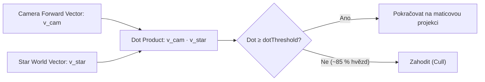
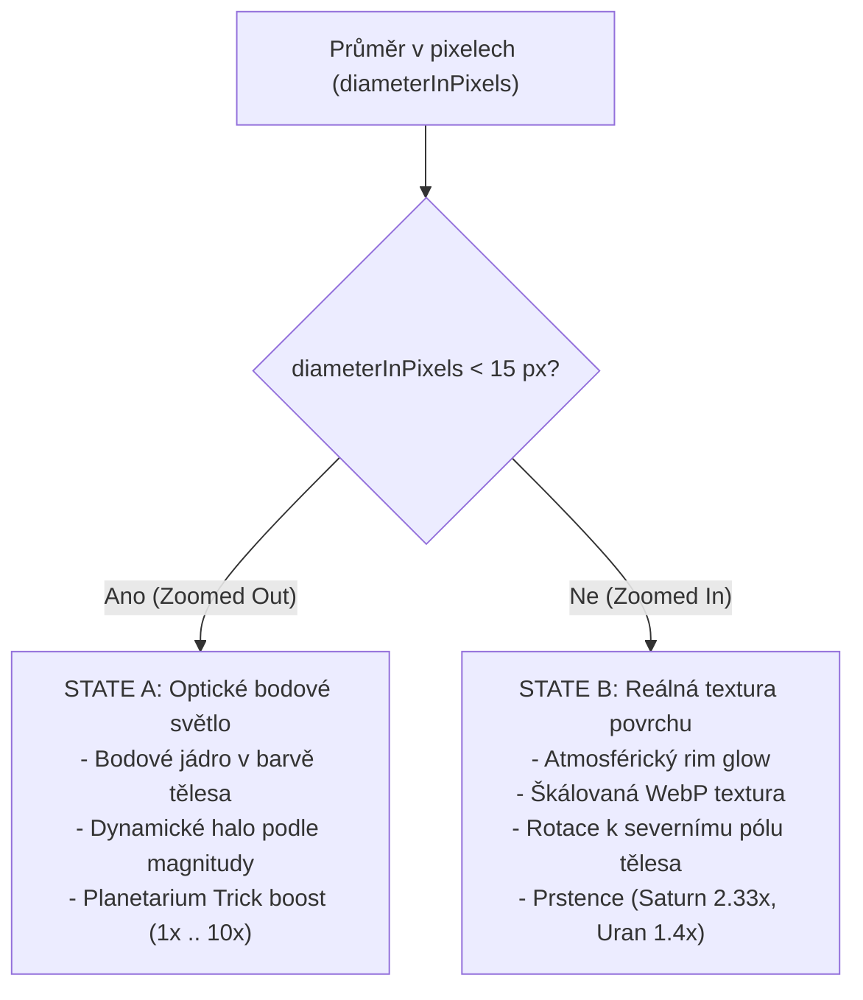
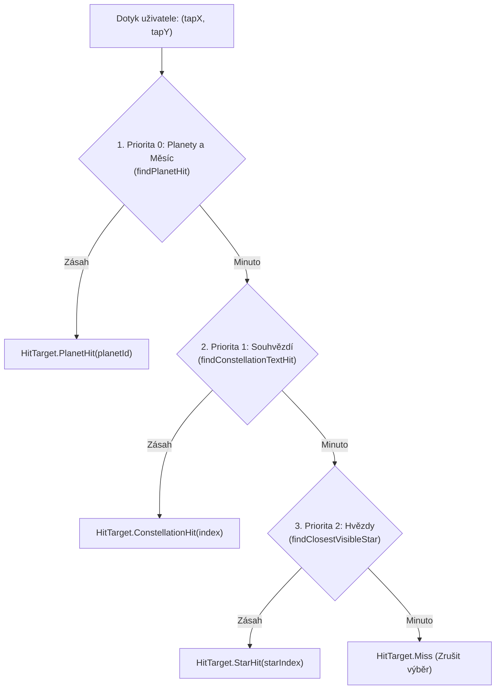

# Noční obloha v AR: Zoom, vykreslování hvězd a výběr těles (Caelis)

Tento dokument poskytuje kompletní technickou, matematickou a implementační specifikaci modulu **Noční obloha (Night Sky AR)** v aplikaci **Caelis**.

Dokument detailně rozebírá:
1. **Mechanismus zoomu a dynamické projekce** (propojení CameraX optiky, výpočet efektivního zorného pole FOV ze streamu, hybridní virtuální teleskopický zoom až 2500×).
2. **Vykreslování hvězd a těles na základě zoomu** (fyzikální model zisku apertury $M(z)$, vektorový frustum culling na 3D nebeské sféře, bodová rozptylová funkce PSF, atmosférická extinkce, hybridní dávkování přes Sprites & `drawPoints`, dvoustavový render planet a Měsíce).
3. **Výběr jednotlivých těles a interakce** (víceúrovňový $O(N)$ hit testing bez paměťových alokací, selekční nitkový kříž, radarový mimozáběrový indikátor, Material 3 Expressive detailní list a navádění kamery s S-křivkou přes nultý poledník).

---

## Obsah

1. [Architektura a princip nulových alokací (Zero Allocations at 60 FPS)](#1-architektura-a-princip-nulových-alokací-zero-allocations-at-60-fps)
2. [Mechanismus Zoomu a projekční geometrie](#2-mechanismus-zoomu-a-projekční-geometrie)
   - [Dvoustupňový hybridní zoom (Optický / Digitální CameraX vs. Virtuální astronomický)](#dvoustupňový-hybridní-zoom-optický--digitální-camerax-vs-virtuální-astronomický)
   - [Výpočet zorného pole (FOV) a ohniskové vzdálenosti v pixelech](#výpočet-zorného-pole-fov-a-ohniskové-vzdálenosti-v-pixelech)
   - [Transformace z rovníkových souřadnic (RA/Dec) do souřadnic obrazovky ($R^T$)](#transformace-z-rovníkových-souřadnic-radec-do-souřadnic-obrazovky-rt)
   - [Gesta ovládání zoomu (Pinch-to-zoom, Double-Tap)](#gesta-ovládání-zoomu-pinch-to-zoom-double-tap)
3. [Zobrazení hvězd a těles na základě Zoomu](#3-zobrazení-hvězd-a-těles-na-základě-zoomu)
   - [Fyzikální model limitní magnitudy (Telescope Aperture Gain)](#fyzikální-model-limitní-magnitudy-telescope-aperture-gain)
   - [3D Vektorový Frustum Culling na nebeské sféře](#3d-vektorový-frustum-culling-na-nebeské-sféře)
   - [Atmosférická extinkce u obzoru (Airmass Extinction)](#atmosférická-extinkce-u-obzoru-airmass-extinction)
   - [Bodová rozptylová funkce (PSF) a 6 renderovacích kbelíků (Buckets)](#bodová-rozptylová-funkce-psf-a-6-renderovacích-kbelíků-buckets)
   - [Dvoustavové vykreslování planet a Měsíce (State A vs. State B)](#dvoustavové-vykreslování-planet-a-měsíce-state-a-vs-state-b)
   - [Výjimky z ořezu (Force Render Table pro souhvězdí a selekci)](#výjimky-z-ořezu-force-render-table-pro-souhvězdí-a-selekci)
4. [Výběr jednotlivých těles (Hit Testing a Interakce)](#4-výběr-jednotlivých-těles-hit-testing-a-interakce)
   - [Prioritní hierarchie hit testování (Planety $\to$ Souhvězdí $\to$ Hvězdy)](#prioritní-hierarchie-hit-testování-planety-to-souhvězdí-to-hvězdy)
   - [Selekční nitkový kříž (Broken Crosshair Reticle)](#selekční-nitkový-kříž-broken-crosshair-reticle)
   - [Mimozáběrový radarový ukazatel (Off-screen Chevron)](#mimozáběrový-radarový-ukazatel-off-screen-chevron)
   - [Informační spodní list (`CelestialDetailSheetContent`)](#informační-spodní-list-celestialdetailsheetcontent)
   - [Plynulé navádění kamery s S-křivkou (`routeCameraToCoordinates`)](#plynulé-navádění-kamery-s-s-křivkou-routecameratocoordinates)
   - [Vyhledávací index bez diakritiky (`CelestialSearchIndex`)](#vyhledávací-index-bez-diakritiky-celestialsearchindex)
5. [Přehled klíčových souborů a tříd](#5-přehled-klíčových-souborů-a-tříd)

---

## 1. Architektura a princip nulových alokací (Zero Allocations at 60 FPS)

Vykreslování noční oblohy v rozšířené realitě klade extrémní nároky na výkon: zařízení musí v reálném čase (60 FPS, budget 16.6 ms na snímek) provádět senzorovou fúzi, projekci tisíců hvězd, vykreslování atmosférických shaderů (AGSL), linií a uměleckých ilustrací souhvězdí, a zároveň udržovat plynulou odezvu na gesta dotyku a zoomu.

Aby nedocházelo k zásekům způsobeným Garbage Collectorem (GC pauses), je architektura postavena na těchto pilířích:

1. **Předalokované primitivní buffery**: Veškeré souřadnice, mezivýpočty a body pro dávkové vykreslení jsou uloženy v polích pevné velikosti (`starScreenX`, `starScreenY`, `starInFront`, `bucketPoints`, `reticleLinesBuffer` v [`NightSkyRenderer`](file:///home/dazix/projects/caelis-mobile-app/app/src/main/java/com/dazix/caelis/ui/nightsky/NightSkyRenderer.kt)).
2. **Zero-Copy FlatBuffers katalog**: Hvězdný katalog Hipparcos/Yale Bright Star (`nightsky.bin`) je mapován přímo do paměti (`ByteBuffer`). Třídy [`Star`](file:///home/dazix/projects/caelis-mobile-app/app/src/main/java/com/dazix/caelis/data/nightsky/Star.java) a [`Constellation`](file:///home/dazix/projects/caelis-mobile-app/app/src/main/java/com/dazix/caelis/data/nightsky/Constellation.java) jsou znovupoužitelné struktury (flyweight pattern), které pouze posouvají interní ukazatel v binárním bufferu.
3. **Dvoustupňový výpočet vektorů (Tier 1 vs. Tier 2)**:
   - *Tier 1 (pouhým okem viditelné hvězdy, $\text{Mag} \le 6.0$)*: Vektory v souřadnicovém systému ENU (East-North-Up) jsou přepočteny okamžitě při změně hvězdného času (LST) nebo zeměpisné šířky za < 1 ms ([`updateStarWorldVectorsTier1`](file:///home/dazix/projects/caelis-mobile-app/app/src/main/java/com/dazix/caelis/ui/nightsky/NightSkyRenderer.kt#L1134-L1155)).
   - *Tier 2 (slabé teleskopické hvězdy)*: Vektory jsou počítány on-demand pouze tehdy, když hvězda projde dynamickým filtrem zoomu nebo je vynucena souhvězdím.

---

## 2. Mechanismus Zoomu a projekční geometrie

### Dvoustupňový hybridní zoom (Optický / Digitální CameraX vs. Virtuální astronomický)

Na rozdíl od standardních fotoaplikací umožňuje noční obloha v Caelis plynulé zvětšení od širokoúhlého náhledu ($0.4\times$) až po hluboký teleskopický zoom ($2500.0\times$).



#### Rozsah a konstanty
V [`NightSkyArViewModel`](file:///home/dazix/projects/caelis-mobile-app/app/src/main/java/com/dazix/caelis/ui/nightsky/NightSkyArViewModel.kt#L1424-L1426):
- `MIN_ZOOM = 0.4f`
- `MAX_SAFE_ZOOM = 2500.0f`

#### Dělba práce mezi kamerou a AR vrstvou
Metoda [`NightSkyArViewModel.applyZoom`](file:///home/dazix/projects/caelis-mobile-app/app/src/main/java/com/dazix/caelis/ui/nightsky/NightSkyArViewModel.kt#L1198-L1209) rozděluje celkový požadovaný poměr zoomu ($z$) na dvě složky:
1. **Hardwarový zoom kamery ($z_{\text{camera}}$)**:
   $$z_{\text{camera}} = \text{clamp}(z,\, \text{minCameraRatio},\, \text{maxCameraRatio})$$
   Hodnota je odeslána do CameraX přes `CameraControl.setZoomRatio(onCamera)`.
2. **Zbytkový virtuální zoom ($z_{\text{residual}}$)**:
   Pokud je hlášené základní FOV již měřeno z výřezu snímače (který hardwarový zoom kamery obsahuje), zbytkový zoom je:
   $$z_{\text{residual}} = \frac{z}{z_{\text{camera}}}$$
   Pokud měření streamu zoom neobsahuje, použije se plné $z$.

Tím je zajištěno, že:
- Při zoomu v rozsahu objektivu (např. 1× až 8×) zoomuje kamera i hvězdný překryv synchronně.
- Při hlubokém zoomu (např. 100×) kamera zůstává na svém maximu a hvězdný překryv pokračuje v plynulém astronomickém zvětšování bez deformací a desynchronizace.

---

### Výpočet zorného pole (FOV) a ohniskové vzdálenosti v pixelech

#### 1. Měření efektivního FOV ze streamu ([`CameraFovCalculator`](file:///home/dazix/projects/caelis-mobile-app/app/src/main/java/com/dazix/caelis/ar/CameraFovCalculator.kt))
Nominální ohnisková vzdálenost z `CameraCharacteristics` nezohledňuje ořez `PreviewView.ScaleType.FILL_CENTER` ani interní ořez snímače `SCALER_CROP_REGION`. Metoda [`CameraFovCalculator.computeStreamHorizontalFov`](file:///home/dazix/projects/caelis-mobile-app/app/src/main/java/com/dazix/caelis/ar/CameraFovCalculator.kt#L132-L217) počítá skutečné zorné pole v tangentech polovičních úhlů:
$$\tan(\theta_{\text{visible}}) = \tan(\theta_{\text{sensor}}) \cdot \text{cropFraction} \cdot \text{aspectCorrection}$$

#### 2. Přepočet zúženého FOV při zoomu
V [`CameraFovCalculator.computeZoomedFov`](file:///home/dazix/projects/caelis-mobile-app/app/src/main/java/com/dazix/caelis/ar/CameraFovCalculator.kt#L249-L257):
$$\text{FOV}_{\text{zoomed}} = \frac{\text{FOV}_{\text{base}}}{z_{\text{residual}}}$$
Výsledná hodnota `cameraFovHorizontal` se může pohybovat v rozsahu **0.0005° až 140.0°**.

#### 3. Efektivní ohnisková vzdálenost v pixelech ($f_{px}$)
Pro perspektivní pinhole projekci na obrazovku o šířce $W$:
$$f_{px} = \frac{W / 2}{\tan\left(\frac{\text{FOV}_H \cdot \pi}{360}\right)}$$

---

### Transformace z rovníkových souřadnic (RA/Dec) do souřadnic obrazovky ($R^T$)

Celý transformační řetězec z nebeského katalogu na pixely displeje probíhá v následujících krocích ([`CameraProjection.kt`](file:///home/dazix/projects/caelis-mobile-app/app/src/main/java/com/dazix/caelis/ar/CameraProjection.kt), [`NightSkyRenderer.kt`](file:///home/dazix/projects/caelis-mobile-app/app/src/main/java/com/dazix/caelis/ui/nightsky/NightSkyRenderer.kt)):

1. **Rovníkové souřadnice (RA, Dec) $\to$ Vektor na jednotkové sféře v systému ENU (East, North, Up)**:
   S využitím místního hvězdného času ($\theta_{\text{LST}}$) a zeměpisné šířky pozorovatele ($\phi$):
   $$\begin{aligned}
   H &= \theta_{\text{LST}} - \alpha \quad (\text{Hodinový úhel}) \\
   v_x &= -\cos(\delta) \sin(H) \quad (\text{East}) \\
   v_y &= \sin(\delta) \cos(\phi) - \cos(\delta) \cos(H) \sin(\phi) \quad (\text{North}) \\
   v_z &= \sin(\delta) \sin(\phi) + \cos(\delta) \cos(H) \cos(\phi) \quad (\text{Up})
   \end{aligned}$$

2. **Transformace ENU světových souřadnic do souřadnic zařízení ($R^T$)**:
   Matice orientace $R$ z `SensorManager` mapuje vektor zařízení do světa ($V_{\text{world}} = R \cdot V_{\text{dev}}$). Pro projekci světa do kamery je nutné použít ortogonální inverzi (transpozici $R^T$):
   $$V_{\text{dev}} = R^T \cdot V_{\text{world}}$$
   Rozepsáno po složkách pro $4 \times 4$ matici:
   $$\begin{aligned}
   x_{\text{dev}} &= R[0] \cdot v_x + R[4] \cdot v_y + R[8] \cdot v_z \\
   y_{\text{dev}} &= R[1] \cdot v_x + R[5] \cdot v_y + R[9] \cdot v_z \\
   z_{\text{dev}} &= R[2] \cdot v_x + R[6] \cdot v_y + R[10] \cdot v_z
   \end{aligned}$$

3. **Mapování podle rotace displeje (`displayRotation`)**:
   - `ROTATION_0` (přirozený portrait): $x_s = x_{\text{dev}}$, $y_s = y_{\text{dev}}$
   - `ROTATION_90` (landscape): $x_s = y_{\text{dev}}$, $y_s = -x_{\text{dev}}$
   - `ROTATION_180`: $x_s = -x_{\text{dev}}$, $y_s = -y_{\text{dev}}$
   - `ROTATION_270`: $x_s = -y_{\text{dev}}$, $y_s = x_{\text{dev}}$
   - Optická osa vpřed: $z_s = -z_{\text{dev}}$ (kladná hodnota znamená, že objekt je před kamerou).

4. **Perspektivní dělení a projekce na obrazovku**:
   Pokud $z_s > 0.001$:
   $$\begin{aligned}
   X_{\text{screen}} &= \frac{W}{2} + f_{px} \cdot \left(\frac{x_s}{z_s}\right) \\
   Y_{\text{screen}} &= \frac{H}{2} - f_{px} \cdot \left(\frac{y_s}{z_s}\right)
   \end{aligned}$$

---

### Gesta ovládání zoomu (Pinch-to-zoom, Double-Tap)

V [`NightSkyArScreen`](file:///home/dazix/projects/caelis-mobile-app/app/src/main/java/com/dazix/caelis/ui/nightsky/NightSkyArScreen.kt#L286-L348):
- **Pinch-to-zoom (`detectTransformGestures`)**: Plynule volá `viewModel.adjustZoomBy(zoom)`. Multiplikátor mění zoom exponenciálně pro přirozený pocit rychlosti při přibližování.
- **Double-Tap (`detectTapGestures`)**: Okamžitě resetuje zoom zpět na $1.0\times$ přes `viewModel.resetZoom()`.
- **Drag Pan**: Posun prstem v manuálním režimu převádí pixely na úhlový posun v azimutu a elevaci s ohledem na aktuální FOV (`factor = fovDeg / viewWidth`).

---

## 3. Zobrazení hvězd a těles na základě Zoomu

### Fyzikální model limitní magnitudy (Telescope Aperture Gain)

Při pohledu pouhým okem za ideálních podmínek vidí člověk hvězdy do magnitudy cca $+5.8\,\text{mag}$ až $+6.0\,\text{mag}$. Při použití dalekohledu (teleskopu) se sběrná plocha světla zvětšuje úměrně zvětšení a průměru objektivu.

V [`StarOptics.computeFaintestVisibleMagnitude`](file:///home/dazix/projects/caelis-mobile-app/app/src/main/java/com/dazix/caelis/domain/nightsky/StarOptics.kt#L31-L34) je implementován astronomický vzorec:
$$M(z) = M_0 + 2.5 \cdot \log_{10}(\text{clamp}(z,\, 0.2,\, 150.0))$$
kde $M_0 = 5.8\,\text{mag}$.

```
Zoom 0.5× (široký přehled):    M ≤ 5.05 mag (~1 500 nejjasnějších hvězd)
Zoom 1.0× (základní pohled):   M ≤ 5.80 mag (~5 000 hvězd pouhým okem)
Zoom 4.0× (binokulár):         M ≤ 7.30 mag (~15 000 hvězd)
Zoom 10.0× (malý teleskop):    M ≤ 8.30 mag (~40 000 hvězd)
Zoom 100.0× (velký teleskop):  M ≤ 10.80 mag (všechny hvězdy katalogu)
```

Tento mechanismus zabraňuje přeplnění obrazovky slabými hvězdami při širokém zorném poli a zároveň odkrývá bohatou strukturu hvězdných polí při detailním přiblížení.

---

### 3D Vektorový Frustum Culling na nebeské sféře

Pro minimalizaci výpočetní náročnosti provádí [`StarFrustumCulling`](file:///home/dazix/projects/caelis-mobile-app/app/src/main/java/com/dazix/caelis/domain/nightsky/StarFrustumCulling.kt) rychlé vektorové oříznutí v ENU prostoru ještě před aplikací transformační matice.



1. **Výpočet prahové hodnoty ([`computeFrustumDotThreshold`](file:///home/dazix/projects/caelis-mobile-app/app/src/main/java/com/dazix/caelis/domain/nightsky/StarFrustumCulling.kt#L24-L35))**:
   Z horizontálního FOV a poměru stran obrazovky se spočte maximální diagonální poloviční úhel $\theta_{\text{max}}$ s bezpečnostní rezervou $12^\circ$:
   $$\begin{aligned}
   \tan(\theta_H) &= \tan\left(\frac{\text{FOV}_H \cdot \pi}{360}\right) \\
   \tan(\theta_V) &= \tan(\theta_H) \cdot \frac{\text{Height}}{\text{Width}} \\
   \theta_{\text{diag}} &= \arctan\left(\sqrt{\tan^2(\theta_H) + \tan^2(\theta_V)}\right) + 12^\circ \\
   \text{dotThreshold} &= \cos(\theta_{\text{diag}})
   \end{aligned}$$

2. **Test hvězdy ([`isStarInFrustum`](file:///home/dazix/projects/caelis-mobile-app/app/src/main/java/com/dazix/caelis/domain/nightsky/StarFrustumCulling.kt#L49-L60))**:
   $$\vec{v}_{\text{cam}} \cdot \vec{v}_{\text{star}} = (-R[2]) \cdot v_x + (-R[6]) \cdot v_y + (-R[10]) \cdot v_z \ge \text{dotThreshold}$$

---

### Atmosférická extinkce u obzoru (Airmass Extinction)

Při pozorování hvězd nízko nad obzorem ($0^\circ \le h < 15^\circ$) prochází světlo mocnější vrstvou zemské atmosféry, což způsobuje jejich ztmavnutí.

V [`StarOptics.computeAirmassExtinction`](file:///home/dazix/projects/caelis-mobile-app/app/src/main/java/com/dazix/caelis/domain/nightsky/StarOptics.kt#L76-L82):
$$\Delta M = \left(1.0 - \frac{h}{10.0^\circ}\right) \cdot 1.5\,\text{mag}$$
$$M_{\text{effective}} = M_{\text{catalog}} + \Delta M$$
Hvězdy s výškou $h \le 0^\circ$ (pod obzorem) nebo $h \ge 15^\circ$ zůstávají beze změny. Pokud korigovaná magnituda $M_{\text{effective}}$ překročí limitní magnitudu, hvězda je vyřazena.

---

### Bodová rozptylová funkce (PSF) a 6 renderovacích kbelíků (Buckets)

Hvězdy jsou bodové zdroje světla; při optickém zvětšení se nezvětšují jako geometrické disky, ale mění se jejich difrakční bodová rozptylová funkce (Point Spread Function).

V [`StarOptics.computeOpticScale`](file:///home/dazix/projects/caelis-mobile-app/app/src/main/java/com/dazix/caelis/domain/nightsky/StarOptics.kt#L43-L45):
$$\text{opticScale} = \sqrt{\text{clamp}(z,\, 0.4,\, 10.0)}$$

Všechny viditelné hvězdy jsou v hot-loop smyčce rozřazeny do 6 kbelíků ([`computeBucketIndex`](file:///home/dazix/projects/caelis-mobile-app/app/src/main/java/com/dazix/caelis/domain/nightsky/StarOptics.kt#L57-L66)):

```
Bucket 0:  Mag < 1.0       (Nejjasnější hvězdy: Sirius, Vega, Betelgeuse, Rigel)
Bucket 1:  1.0 ≤ Mag < 2.0 (Hvězdy 1. velikosti: Polárka, Orionův pás, Velký vůz)
Bucket 2:  2.0 ≤ Mag < 3.0 (Výrazné hvězdy souhvězdí)
Bucket 3:  3.0 ≤ Mag < 4.0 (Středně jasné hvězdy)
Bucket 4:  4.0 ≤ Mag < 5.0 (Slabé hvězdy viditelné pouhým okem)
Bucket 5:  Mag ≥ 5.0       (Teleskopické hvězdy pozadí)
```

#### Hybridní vykreslovací průchod ([`NightSkyRenderer.kt`](file:///home/dazix/projects/caelis-mobile-app/app/src/main/java/com/dazix/caelis/ui/nightsky/NightSkyRenderer.kt#L1877-L1908)):
1. **Pass 1 – Sprite Glow (Buckety 2 downTo 0)**:
   Pro jasné hvězdy ($M < 3.0$) se vykreslí předrenderovaný bitmapový radiální gradient (`starSpriteBitmap`), který vytváří měkkou světelnou záři (halo). Průměr spritu je škálován přes `opticScale`.
2. **Pass 2 – Pinpoint Cores (Všech 6 bucketů)**:
   Ostrá jádra hvězd jsou vykreslena pomocí jednoho nativního volání `nativeCanvas.drawPoints(bucketPoints[b], 0, count * 2, corePaints[b])` pro každý kbelík. Tím je dosaženo vykreslení tisíců hvězd v pouhých **6 GPU draw callech**.

---

### Dvoustavové vykreslování planet a Měsíce (State A vs. State B)

Tělesa sluneční soustavy ([`PlanetaryEphemerisCalculator`](file:///home/dazix/projects/caelis-mobile-app/app/src/main/java/com/dazix/caelis/domain/nightsky/PlanetaryEphemerisCalculator.kt)) dynamicky mění svůj renderovací režim podle vypočteného průměru na obrazovce ([`NightSkyRenderer.kt`](file:///home/dazix/projects/caelis-mobile-app/app/src/main/java/com/dazix/caelis/ui/nightsky/NightSkyRenderer.kt#L1745-L1860)):



#### The Planetarium Trick
Úhlový průměr vzdálených planet je velmi malý (např. Neptun ~0.0006°, Jupiter ~0.013°). Při základním zoomu by byly subpixelové a neviditelné. Algoritmus proto aplikuje umělý boost faktor nepřímo úměrný úhlové velikosti (Měsíc je vyjmut):
$$\text{boostFactor} = \text{clamp}\left(\frac{0.013^\circ}{\text{angularDiameterDeg}},\, 1.0,\, 10.0\right)$$

---

### Výjimky z ořezu (Force Render Table pro souhvězdí a selekci)

Pole [`forceRenderStar`](file:///home/dazix/projects/caelis-mobile-app/app/src/main/java/com/dazix/caelis/ui/nightsky/NightSkyRenderer.kt#L1369-L1384) typu `BooleanArray(MAX_STARS)` zajišťuje, že:
- Hvězdy tvořící linie aktivně viditelných souhvězdí (s animovaným rozvinutím $\text{progress} > 0.001$) se **nikdy neoříznou** limitní magnitudou ani frustum cullingem.
- Aktuálně vybraná hvězda (`selectedStarIndex`) je vždy vykreslena.

---

## 4. Výběr jednotlivých těles (Hit Testing a Interakce)

### Prioritní hierarchie hit testování (Planety $\to$ Souhvězdí $\to$ Hvězdy)

Při klepnutí prstem na obrazovku provádí [`NightSkyRenderer.findHitAt`](file:///home/dazix/projects/caelis-mobile-app/app/src/main/java/com/dazix/caelis/ui/nightsky/NightSkyRenderer.kt#L1039-L1111) a [`StarHitTester`](file:///home/dazix/projects/caelis-mobile-app/app/src/main/java/com/dazix/caelis/domain/nightsky/StarHitTester.kt) vyhodnocení ve striktním prioritním pořadí:



#### 1. Priorita 0: Planety a Měsíc ([`StarHitTester.findPlanetHit`](file:///home/dazix/projects/caelis-mobile-app/app/src/main/java/com/dazix/caelis/domain/nightsky/StarHitTester.kt#L50-L93))
Planety a Měsíc mají nejvyšší prioritu, aby je uživatel mohl snadno vybrat i v hustém hvězdném poli.
Hit rádius je dynamicky počítán v [`computePlanetHitRadiusPx`](file:///home/dazix/projects/caelis-mobile-app/app/src/main/java/com/dazix/caelis/domain/nightsky/StarHitTester.kt#L20-L33):
$$R_{\text{hit}} = \max(120\,\text{px},\, 48\,\text{dp} \cdot \text{density},\, R_{\text{render}})$$

#### 2. Priorita 1: Souhvězdí a Asterismy ([`StarHitTester.findConstellationTextHit`](file:///home/dazix/projects/caelis-mobile-app/app/src/main/java/com/dazix/caelis/domain/nightsky/StarHitTester.kt#L223-L266))
Testuje eliptickou oblast kolem středu animovaného názvu souhvězdí:
$$\frac{(X_{\text{tap}} - X_{\text{centroid}})^2}{R_x^2} + \frac{(Y_{\text{tap}} - Y_{\text{centroid}})^2}{R_y^2} \le 1.0$$
kde $R_x = 75\,\text{dp} \cdot \text{density}$ a $R_y = 30\,\text{dp} \cdot \text{density}$.
*Podmínka*: Souhvězdí musí být alespoň z 30 % rozvinuté animací ($\text{progress} \ge 0.3$).

#### 3. Priorita 2: Hvězdy ([`StarHitTester.findClosestVisibleStar`](file:///home/dazix/projects/caelis-mobile-app/app/src/main/java/com/dazix/caelis/domain/nightsky/StarHitTester.kt#L280-L309))
Prochází pole předpočítaných souřadnic `starScreenX` a `starScreenY` pro hvězdy před kamerou ($z_{\text{camera}} > 0$). Hledá hvězdu s minimální kvadratickou vzdáleností do limitu $R_{\text{max}} = 48\,\text{dp} \cdot \text{density}$.

---

### Selekční nitkový kříž (Broken Crosshair Reticle)

Jakmile je vybrána hvězda nebo planeta, vykreslí se speciální astronomický zaměřovač ([`NightSkyRenderer.drawSelectionReticle`](file:///home/dazix/projects/caelis-mobile-app/app/src/main/java/com/dazix/caelis/ui/nightsky/NightSkyRenderer.kt#L1942-L2035)):
- **3 ramena (vlevo, vpravo, dole)**: Vnitřní poloměr $r_1 = 9.75\,\text{dp}$, vnější poloměr $r_2 = 18.0\,\text{dp}$.
- **Otevřený horní prostor**: Horní rameno je záměrně vynecháno; v prostoru nad středem ($Y - 12.5\,\text{dp}$) je centrovaně vykreslen název vybraného tělesa.

```
       [ Sirius ]
           ·
   ───           ───
          (·)
           │
           │
```

---

### Mimozáběrový radarový ukazatel (Off-screen Chevron)

Pokud se vybrané těleso dostane mimo displej nebo za záda pozorovatele ($z_s \le 0$), funkce [`NightSkyRenderer.drawOffscreenIndicator`](file:///home/dazix/projects/caelis-mobile-app/app/src/main/java/com/dazix/caelis/ui/nightsky/NightSkyRenderer.kt#L2043-L2095) spočítá průsečík směrového vektoru s hranou obrazovky a vykreslí rotovanou šipku (chevron) s odsazením $22\,\text{px}$ od okraje.

---

### Informační spodní list (`CelestialDetailSheetContent`)

Komponenta [`CelestialDetailSheetContent`](file:///home/dazix/projects/caelis-mobile-app/app/src/main/java/com/dazix/caelis/ui/nightsky/CelestialDetailBottomSheet.kt) poskytuje detailní astronomická data v souladu s aktivním tématem nočního vidění (Red / Amber / NVG Green):

- **Částečně rozbalený stav (Peek Header)**: Název tělesa, podtitul (typ objektu), tlačítko pro vycentrování kamery a zavírací křížek.
- **Plně rozbalený stav (Expanded Content)**:
  - *Hvězda*: Vizuální magnituda $V$, mateřské souhvězdí, vzdálenost ve světelných letech (ly) a rovníkové souřadnice (RA v hodinách/minutách/sekundách, Dec ve stupních/minutách/vteřinách).
  - *Planeta / Měsíc*: Vzdálenost (AU / km), zdánlivý úhlový průměr ($^{\prime\prime}$), magnituda $V$.
  - *Souhvězdí*: Nejjasnější hvězda, rodina souhvězdí a souřadnice centroidu.

---

### Plynulé navádění kamery s S-křivkou (`routeCameraToCoordinates`)

Při výběru tělesa z vyhledávače nebo stisku tlačítka zaměření v detailním listu provede [`NightSkyArViewModel.routeCameraToCoordinates`](file:///home/dazix/projects/caelis-mobile-app/app/src/main/java/com/dazix/caelis/ui/nightsky/NightSkyArViewModel.kt#L908-L964) plynulé otočení kamery:

1. **Zmrazení senzorů (State Injection)**:
   Aktuální orientace z živých senzorů je převedena na rovníkové souřadnice středu pohledu ($\alpha_0, \delta_0$) a senzorové sledování je pozastaveno.
2. **Korekce přes nultý poledník ([`getShortestAngularDistance`](file:///home/dazix/projects/caelis-mobile-app/app/src/main/java/com/dazix/caelis/domain/nightsky/CelestialSearchIndex.kt#L187-L193))**:
   Zajišťuje, že kamera rotuje nejkratší úhlovou cestou modulo $360^\circ$ (např. z $350^\circ$ na $10^\circ$ se pohne o $+20^\circ$ a nikoliv o $-340^\circ$).
3. **S-křivka FastOutSlowIn**:
   Během trvání animace ($800\,\text{ms}$) se používá kubická interpolace:
   $$t_{\text{smooth}} = 3\tau^2 - 2\tau^3 \quad (\tau = \text{elapsed} / \text{duration})$$
   $$\alpha(t) = \alpha_0 + \Delta\alpha \cdot t_{\text{smooth}}, \quad \delta(t) = \delta_0 + \Delta\delta \cdot t_{\text{smooth}}$$

---

### Vyhledávací index bez diakritiky (`CelestialSearchIndex`)

Modul [`CelestialSearchIndex`](file:///home/dazix/projects/caelis-mobile-app/app/src/main/java/com/dazix/caelis/domain/nightsky/CelestialSearchIndex.kt) vytváří paměťový index všech těles:
- Text je předem normalizován odstraněním diakritiky a převedením na malá písmena (`Normalizer.Form.NFD`).
- Index obsahuje jak české, tak mezinárodní (latinské/anglické) názvy (např. *Velká medvědice* / *Ursa Major*, *Polárka* / *Polaris*).
- Řazení výsledků upřednostňuje shodu na začátku primárního názvu před shodou uvnitř textu.

---

## 5. Přehled klíčových souborů a tříd

| Soubor / Třída | Umístění | Hlavní odpovědnost |
| :--- | :--- | :--- |
| [`StarOptics.kt`](file:///home/dazix/projects/caelis-mobile-app/app/src/main/java/com/dazix/caelis/domain/nightsky/StarOptics.kt) | `domain/nightsky` | Fyzikální model limitní magnitudy $M(z)$, difrakční PSF škálování, bucket indexace a atmosférická extinkce. |
| [`StarFrustumCulling.kt`](file:///home/dazix/projects/caelis-mobile-app/app/src/main/java/com/dazix/caelis/domain/nightsky/StarFrustumCulling.kt) | `domain/nightsky` | 3D vektorový ořez neviditelných hvězd na nebeské sféře před maticovou transformací. |
| [`StarHitTester.kt`](file:///home/dazix/projects/caelis-mobile-app/app/src/main/java/com/dazix/caelis/domain/nightsky/StarHitTester.kt) | `domain/nightsky` | Víceúrovňový 2D screen-space hit testing (planety $\to$ souhvězdí $\to$ hvězdy) s nulovými alokacemi. |
| [`PlanetaryEphemerisCalculator.kt`](file:///home/dazix/projects/caelis-mobile-app/app/src/main/java/com/dazix/caelis/domain/nightsky/PlanetaryEphemerisCalculator.kt) | `domain/nightsky` | Keplerovské elementy a efemeridy planet a Měsíce v epoše J2000.0. |
| [`CelestialSearchIndex.kt`](file:///home/dazix/projects/caelis-mobile-app/app/src/main/java/com/dazix/caelis/domain/nightsky/CelestialSearchIndex.kt) | `domain/nightsky` | Indexace a filtrování těles bez diakritiky a výpočet nejkratší úhlové vzdálenosti. |
| [`CameraFovCalculator.kt`](file:///home/dazix/projects/caelis-mobile-app/app/src/main/java/com/dazix/caelis/ar/CameraFovCalculator.kt) | `ar` | Výpočet horizontálního FOV ze streamu a přepočet zúženého FOV při zoomu. |
| [`CameraProjection.kt`](file:///home/dazix/projects/caelis-mobile-app/app/src/main/java/com/dazix/caelis/ar/CameraProjection.kt) | `ar` | Perspektivní projekce světových ENU vektorů do pixelů obrazovky pomocí $R^T$. |
| [`NightSkyRenderer.kt`](file:///home/dazix/projects/caelis-mobile-app/app/src/main/java/com/dazix/caelis/ui/nightsky/NightSkyRenderer.kt) | `ui/nightsky` | 60 FPS hybridní dávkový vykreslovač (Sprites + drawPoints), reticle, offscreen pointer a planety. |
| [`NightSkyArViewModel.kt`](file:///home/dazix/projects/caelis-mobile-app/app/src/main/java/com/dazix/caelis/ui/nightsky/NightSkyArViewModel.kt) | `ui/nightsky` | Správa stavu zoomu (0.4×–2500×), propojení na CameraX, výběr těles a animace navádění. |
| [`NightSkyArScreen.kt`](file:///home/dazix/projects/caelis-mobile-app/app/src/main/java/com/dazix/caelis/ui/nightsky/NightSkyArScreen.kt) | `ui/nightsky` | Compose rozhraní, gesta pinch-to-zoom, tap selection a propojení vrstev. |
| [`CelestialDetailBottomSheet.kt`](file:///home/dazix/projects/caelis-mobile-app/app/src/main/java/com/dazix/caelis/ui/nightsky/CelestialDetailBottomSheet.kt) | `ui/nightsky` | Material 3 Expressive panel s astrofyzikálními údaji vybraného objektu a podporou nočních režimů. |
