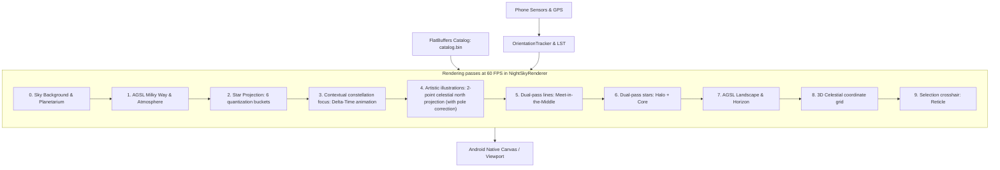

# Night Sky Rendering (Stars, Constellation Lines, and Artistic Illustrations)

This document details the complete mathematical, architectural, and rendering model for the night sky augmented reality (AR) view in the **Intervalometer** app.

---

## 1. Overall Architecture and Rendering Pipeline

Night sky rendering runs in real-time at **60 FPS** with **Zero Heap Allocations**. All transformation matrices, vectors, and graphics buffers (`Paint`, `Matrix`, `FloatArray`) are preallocated during the initialization phase of [`NightSkyRenderer.kt`](file:///home/dazix/projects/intervalometer/app/src/main/java/com/dazix/intervalometer/ui/nightsky/NightSkyRenderer.kt).



---

## 2. Astronomical Mathematics and Coordinate Transformations

### A. Local Sidereal Time (LST)
To convert equatorial coordinates (Right Ascension $\text{RA}$, Declination $\text{Dec}$) to a topocentric observation system, the exact local sidereal time $\text{LST}$ of the observer must be known. The calculation is based on the Meeus astronomical algorithm ([`SiderealTime.kt`](file:///home/dazix/projects/intervalometer/app/src/main/java/com/dazix/intervalometer/domain/nightsky/SiderealTime.kt)):

1. **Julian Date and Century ($T$)**:
   $$JD = \text{toJulianDate}(\text{UTC timestamp})$$
   $$T = \frac{JD - 2451545.0}{36525.0}$$
2. **Greenwich Mean Sidereal Time (GMST)**:
   $$\theta_0 = 280.46061837 + 360.98564736629 \cdot (JD - 2451545.0) + 0.000387933 \cdot T^2 - \frac{T^3}{38710000}$$
3. **Local Sidereal Time (LST)**:
   $$\text{LST} = (\theta_0 + \text{longitude}) \pmod{360^\circ}$$

---

### B. Conversion to Topocentric ENU Unit Vector
For each celestial object, the hour angle $\text{HA} = \text{LST} - \text{RA}$ is calculated.
The unit vector $V_{\text{world}} = [X, Y, Z]^T$ in the observer's local **ENU (East, North, Up)** coordinate system is calculated in [`EquatorialCoordinates.kt`](file:///home/dazix/projects/intervalometer/app/src/main/java/com/dazix/intervalometer/domain/nightsky/EquatorialCoordinates.kt):

$$\begin{aligned}
X_{\text{world}} &= \cos(\text{Dec}) \cdot \sin(\text{HA}) && \text{(East)} \\
Y_{\text{world}} &= \cos(\text{lat}) \cdot \sin(\text{Dec}) - \sin(\text{lat}) \cdot \cos(\text{Dec}) \cdot \cos(\text{HA}) && \text{(North)} \\
Z_{\text{world}} &= \sin(\text{lat}) \cdot \sin(\text{Dec}) + \cos(\text{lat}) \cdot \cos(\text{Dec}) \cdot \cos(\text{HA}) && \text{(Up/Zenith)}
\end{aligned}$$

---

### C. AR Transformation World $\to$ Device ($R^T$) and Perspective Projection
The Android `SensorManager` provides a rotation matrix $R$ that maps a vector from the device to the world ($V_{\text{world}} = R \cdot V_{\text{dev}}$). Transforming a point from the sky to the phone's screen requires orthogonal inversion (matrix transposition $R^T$):

$$V_{\text{dev}} = R^T \cdot V_{\text{world}}$$

$$\begin{aligned}
X_{\text{dev}} &= R[0] \cdot X + R[4] \cdot Y + R[8] \cdot Z \\
Y_{\text{dev}} &= R[1] \cdot X + R[5] \cdot Y + R[9] \cdot Z \\
Z_{\text{dev}} &= R[2] \cdot X + R[6] \cdot Y + R[10] \cdot Z
\end{aligned}$$

After accounting for the device's display rotation ($0^\circ, 90^\circ, 180^\circ, 270^\circ$), we obtain camera coordinates $(X_s, Y_s, Z_s = -Z_{\text{dev}})$. If $Z_s \le 0.001$, the object lies behind the camera and is discarded.

Projection onto the 2D screen with an effective focal length $f_{\text{pixels}}$ (accounting for the CameraX `FILL_CENTER` viewport crop):

$$X_{\text{screen}} = \frac{W}{2} + f_{\text{pixels}} \cdot \frac{X_s}{Z_s}, \qquad Y_{\text{screen}} = \frac{H}{2} - f_{\text{pixels}} \cdot \frac{Y_s}{Z_s}$$

where $f_{\text{pixels}} = \frac{W / 2}{\tan(\text{effectiveFOV}_H / 2)}$.

---

## 3. Star Rendering

The star catalog (`catalog.bin`) contains **8,946 authentic stars** from the HYG v4.1 database, loaded via FlatBuffers memory mapping.

```text
+-------------------------------------------------------------------+
|                        FlatBuffers Binary                         |
|  [Star 0: ra, dec, mag] [Star 1: ra, dec, mag] ... [Star 8945]    |
+-------------------------------------------------------------------+
                                  │ Direct ByteBuffer Read
                                  ▼
               ┌──────────────────────────────────────┐
               │    Telescopic Eye Zoom Filter        │
               │  mag <= 4.5 + 2.5 * log10(zoom)      │
               └──────────────────┬───────────────────┘
                                  │
         ┌────────────────────────┴────────────────────────┐
         ▼                                                 ▼
┌─────────────────────────────────┐               ┌─────────────────────────────────┐
│        Pass 1: Halos            │               │        Pass 2: Cores            │
│  Soft, blurred light halo       │               │  Sharp, point-like bright core  │
│   Canvas.drawPoints() in batch  │               │                                 │
└─────────────────────────────────┘               └─────────────────────────────────┘
```

### 1. Telescopic Eye Zoom (Dynamic Limiting Magnitude)
At the standard field of view (1.0x), stars visible to the naked eye ($mag \le 4.5$) are rendered. When zooming in via pinch-to-zoom, the renderer dynamically reveals fainter stars:
$$\text{faintestVisibleMag} = 4.5 + 2.5 \cdot \log_{10}(\text{zoomFactor})$$

### 2. Quantization into 6 Brightness Buckets (Batch `drawPoints`)
Instead of calling `drawCircle` for each star (which would cause ~9,000 draw calls per frame), stars are sorted into 6 preallocated arrays based on magnitude ($< 1.0, < 2.0, < 3.0, < 4.0, < 5.0, \ge 5.0$). Rendering occurs in just **6 batch calls**: `nativeCanvas.drawPoints(bucketPoints[b], 0, count * 2, paint)`.

### 3. Dual-Pass Optical Depth
* **Pass 1 (Halos)**: Renders a soft, diffuse glow around bright stars with half-opacity (`alpha = 140`) and a wider stroke.
* **Pass 2 (Cores)**: Renders sharp, bright center points (`alpha = 255`) with accurate color spectra.
* **Red Vision Mode**: When red night vision is enabled, a `PorterDuffColorFilter(Color.rgb(255, 23, 68), PorterDuff.Mode.SRC_IN)` is applied.

---

## 4. Constellation Lines and Contextual Focus

### A. Focus Detection and Smooth Delta-Time Animation
Each of the 88 constellations has a precomputed spherical center (centroid $\text{RA}_c, \text{Dec}_c$). If a constellation's center enters the screen's central circular focus field (radius $16^\circ$ FOV):
$$\Delta X^2 + \Delta Y^2 \le \text{focusRadiusPx}^2$$

The focus progress $p_c \in [0.0, 1.0]$ increases smoothly over time, independent of frame rate:
$$p_c(t + \Delta t) = \min(1.0, p_c(t) + \Delta t \cdot 2.0)$$
When looking away, the progress smoothly decreases back to zero at a rate of $1.5 \cdot \Delta t$.

### B. Forced Rendering of Constellation Stars
If a constellation is in focus ($p_c > 0.001$), all of its stars forming the line network are flagged in a structure: `forceRenderStar[i] = true`. This ensures that even faint stars making up the constellation figure (e.g., in Cancer or Pisces) remain visible without requiring optical zoom.

### C. "Meet-in-the-Middle" Effect for Lines
The lines connecting star $S_A$ and star $S_B$ animate from both sides towards the center as focus builds up:

```text
Unfocused (p = 0.0):    [Star A]                                       [Star B]
Focusing (p = 0.5):     [Star A] ──────►       gap       ◄────── [Star B]
Fully Focused (p=1.0):  [Star A] ─────────────────────────────── [Star B]
```

* If $p_c < 1.0$, a dynamic gap is calculated: $\text{gap} = (1.0 - p_c) \cdot 0.5$.
* The connection is drawn as two line segments: $S_A \to S_A + (1 - \text{gap})(S_B - S_A)$ and $S_B \to S_B + (1 - \text{gap})(S_A - S_B)$.
* At $p_c = 1.0$, a single continuous line segment $S_A \to S_B$ is drawn.
* Lines use a dual-pass approach (a soft outer halo for glow + a bright inner line).

---

## 5. Artistic Constellation Illustrations (Artistic Overlays)

The illustrations are official artworks from Stellarium, losslessly optimized into **WebP format with transparent backgrounds**.

```text
+-------------------------------------------------------------------+
|  1. Load from LRU Cache: LruCache<String, Bitmap>(16)             |
+-------------------------------------------------------------------+
                                  │
                                  ▼
+-------------------------------------------------------------------+
|  2. 2-Point Projection (Center + North along local meridian w/    |
|     pole protection)                                              |
|     Point 1: (RA_c, Dec_c)            ──► (cX, cY) on screen      |
|     Point 2: (RA_c, Dec_c +/- 1.0°)   ──► (nX, nY) on screen      |
+-------------------------------------------------------------------+
                                  │
                                  ▼
+-------------------------------------------------------------------+
|  3. Celestial Grid Angle Calculation:                             |
|     ΔX = nX - cX,  ΔY = nY - cY                                   |
|     θ_grid = atan2(ΔY, ΔX) (+ 180° if offset was towards South)   |
|     θ_north = θ_grid + 90°                                        |
|     θ_final = θ_north + artRotationDeg + debugRotationOffset      |
+-------------------------------------------------------------------+
                                  │
                                  ▼
+-------------------------------------------------------------------+
|  4. Zero-Allocation Transformation (artMatrix):                   |
|     artMatrix.postTranslate(-W/2, -H/2)                           |
|     artMatrix.postScale(finalScale, finalScale)                   |
|     artMatrix.postRotate(θ_final)                                 |
|     artMatrix.postTranslate(cX, cY)                               |
+-------------------------------------------------------------------+
                                  │
                                  ▼
+-------------------------------------------------------------------+
|  5. Draw: Canvas.drawBitmap(bitmap, artMatrix, artPaint)          |
|     artPaint.alpha = (56 * p)  [22% opacity with smooth fade-in]  |
+-------------------------------------------------------------------+
```

### 1. Asset Processing and Transparency
* All source PNG files have a black background ($L=0$) with luminous contours ($L > 0$).
* The conversion script maps lightness $L$ directly to the alpha channel $A$ and sets a pure white color $\text{RGB} = (255, 255, 255)$.
* Proportional downscaling (`thumbnail((512, 512))`) is done **without cropping**, precisely preserving the padding intended by the original positional coordinates files.

### 2. 2-Point Projection of Local Celestial North
To eliminate distortion and errors when tilting the phone:
1. **Base center projection:** Project the artwork's center $(\text{RA}_c, \text{Dec}_c) \to (cX, cY)$.
2. **North anchor point:** Project a reference point along the local meridian. Typically offset $1^\circ$ north: $(\text{RA}_c, \text{Dec}_c + 1^\circ) \to (nX, nY)$.
   **Gimbal Lock prevention:** If the center is close to a pole ($\text{Dec} > 88^\circ$), apply an inverse offset towards the south ($-1^\circ$) to prevent the vector from collapsing over the pole.
3. **Calculate local inclination on screen:** 
   $$\theta_{\text{grid}} = \text{atan2}(nY - cY, nX - cX)$$
   If a negative polar offset was used, flip the value by $180^\circ$. To align the celestial axis with the Android Canvas, $90^\circ$ is added:
   $$\theta_{\text{north}} = \theta_{\text{grid}} + 90^\circ$$
4. **Final artwork rotation:**
   $$\theta_{\text{final}} = \theta_{\text{north}} + \text{artRotationDeg} + \text{debugRotationOffset}$$

### 3. Scaling and Transparency
* On-screen width in pixels:
  $$\text{widthPx} = \text{radians}(\text{artWidthDeg}) \cdot f_{\text{pixels}}$$
  $$\text{scale} = \frac{\text{widthPx}}{\text{bitmap.width}}$$
* The `artPaint.alpha` transparency is tied to the focus progress $p_c$:
  $$\text{alpha} = (56 \cdot p_c) \pmod{256}$$
  At full focus, the artwork reaches a maximum opacity of 22% so it does not obscure the stars and constellation lines.
* In Red Vision mode, a multiplying color filter is applied: `PorterDuffColorFilter(Color.RED, PorterDuff.Mode.MULTIPLY)`.

---

## 6. Detailed Technical Implementation

This section contains a detailed breakdown of internal data structures, memory layout, and shaders.

### A. FlatBuffers Binary Schema (`catalog.bin`)
The catalog is serialized in the FlatBuffers binary format (`com.google.flatbuffers.Table`), allowing direct reading from a memory-mapped `ByteBuffer` without deserializing objects into the JVM heap.

#### 1. `Star` Structure (Inline Struct – 12 Bytes)
Each star is stored in a contiguous array of 12-byte structs:
```text
Offset (Bytes) | Data Type  | Meaning
---------------+------------+------------------------------------------
+0             | Float32    | Right Ascension RA (0.0 .. 360.0 degrees)
+4             | Float32    | Declination Dec (-90.0 .. +90.0 degrees)
+8             | Float32    | Visual magnitude Mag (-1.44 .. 14.0)
```
Reading a star at index $j$:
$$\text{offset} = \text{starsVectorOffset} + j \times 12$$
$$\text{ra} = \text{bb.getFloat}(\text{offset}), \quad \text{dec} = \text{bb.getFloat}(\text{offset} + 4), \quad \text{mag} = \text{bb.getFloat}(\text{offset} + 8)$$

#### 2. `Constellation` Table (Offset Table)
Each of the 88 constellations contains:
* `name`: IAU 3-letter abbreviation (e.g., `"Ori"`, `"UMa"`, `"Lac"`).
* `centroidRa`, `centroidDec`: Spherical centroid for focus detection.
* `lines`: Vector of star indices (pairs `[hipA_1, hipB_1, hipA_2, hipB_2, ...]`).
* `localizedName`: Localized constellation name (Czech / English).
* `brightestStar`: Brightest star name (e.g., `"Betelgeuse"`, `"Vega"`).
* `family`: Astronomical constellation family (e.g., `"Orion"`, `"Zodiac"`, `"Ursa Major"`).
* `artResourceName`: Name of the drawable asset (e.g., `"art_ori"`).
* `artCenterRa`, `artCenterDec`: Spherical center of the illustration in J2000.0 (in degrees).
* `artWidthDeg`: Angular width of the artwork on the sky in degrees.
* `artRotationDeg`: Default rotation angle of the artwork relative to celestial north.

---

### B. AGSL (Android Graphics Shading Language) Shading Pipeline

#### 1. Milky Way Shader (`MilkyWayShader`)
Performs inverse 3D spherical sampling of an equirectangular lossless texture (`milky_way_starless.webp`):
```glsl
uniform shader uTexture;
uniform mat3 uWorldToDevice;
uniform float2 uResolution;
uniform float uFocalLength;
uniform float uAlpha;

half4 main(float2 fragCoord) {
    // 1. Back-projection from 2D screen to 3D camera ray
    float3 rayDev = normalize(float3(
        fragCoord.x - uResolution.x * 0.5,
        -(fragCoord.y - uResolution.y * 0.5),
        uFocalLength
    ));
    
    // 2. Transformation of the camera ray to the galactic coordinate system
    float3 rayWorld = uWorldToDevice * rayDev;
    
    // 3. Spherical mapping to texture UVs (Equirectangular UV)
    float u = fract(atan(rayWorld.y, rayWorld.x) / (2.0 * 3.14159265) + 0.5);
    float v = clamp(asin(clamp(rayWorld.z, -1.0, 1.0)) / 3.14159265 + 0.5, 0.0, 1.0);
    
    // 4. Texture sampling, applying gamma correction and transparency
    half4 texColor = uTexture.eval(float2(u, v) * float2(4096.0, 2048.0));
    return half4(texColor.rgb, texColor.a * uAlpha);
}
```

#### 2. Atmospheric Shader (`AtmosphereShader`)
Simulates Rayleigh light scattering and the twilight transition:
* Calculates the camera's zenith angle of view.
* Applies a blue atmospheric gradient near the horizon based on the Sun's position below the horizon.
* In night mode, it suppresses scattering to maximize star contrast.

#### 3. Photorealistic Horizon Shader (`LandscapeShader`)
Renders a 360° panoramic terrain horizon:
* Handles clipping of stars that are located below the true mathematical horizon ($Z_{\text{world}} < 0$).
* Smooth tree silhouette transitions using alpha masking.

---

### C. Preallocated Memory Architecture (Zero GC Allocations)

All structures in [`NightSkyRenderer.kt`](file:///home/dazix/projects/intervalometer/app/src/main/java/com/dazix/intervalometer/ui/nightsky/NightSkyRenderer.kt) are preallocated in the constructor:

```kotlin
// 6 Quantization buckets for batch star rendering
val bucketPoints = Array(6) { FloatArray(10240 * 2) }
val bucketCounts = IntArray(6)

// On-screen star coordinates for lightning-fast line drawing
private val starScreenX = FloatArray(10240)
private val starScreenY = FloatArray(10240)
private val starInFront = BooleanArray(10240)
val forceRenderStar = BooleanArray(10240)

// Buffers for constellation lines (2048 segments * 8 floats = 16,384 elements)
private val constellationLinesBuffer = FloatArray(2048 * 8)

// Transformation objects for artworks and star sprites
val artMatrix = Matrix()
val artPaint = Paint(Paint.ANTI_ALIAS_FLAG)
private val tempArtCenterWorldVec = FloatArray(3)
private val tempArtTopWorldVec = FloatArray(3)
```

Thanks to this architecture, not a single object instantiation (`new` / heap allocation) occurs during rendering, preventing Garbage Collector triggers and ensuring smooth **60.0 FPS rendering without any stutter (Jank-Free Rendering)**.

---

## 7. Summary Table of Rendering Elements

| Element | Data Source | Rendering Method | Allocations per Frame |
| :--- | :--- | :--- | :--- |
| **Stars (8,946)** | `catalog.bin` (HYG v4.1) | 6 batch calls `drawPoints` (Halos + Cores) | **0 B** |
| **Constellation Lines** | `catalog.bin` (IAU 88) | `drawLines` with Meet-in-the-Middle gap | **0 B** |
| **Constellation Illustrations** | `res/drawable-nodpi/art_*.webp` | `drawBitmap` with 2-point pole-aware `artMatrix` | **0 B** |
| **Milky Way & Atmosphere** | `milky_way_starless.webp` + AGSL | AGSL Fragment Shader + 3D Dome UV | **0 B** |
| **Photorealistic Landscape** | `landscape_photorealistic.webp` | AGSL Horizon Shader with terrain clipping | **0 B** |
| **3D Celestial Grid** | PSA / Meeus Math Model | `drawLines` / `drawText` with azimuths and altitudes | **0 B** |
