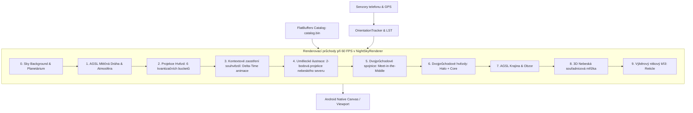

# Vykreslování Noční Oblohy (Hvězdy, Spojnice Souhvězdí a Umělecké Ilustrace)

Tento dokument detailně popisuje kompletní matematický, architektonický a renderovací model zobrazení noční oblohy v rozšířené realitě (AR) v aplikaci **Intervalometer**.

---

## 1. Celková Architektura a Renderovací Řetězec

Vykreslování noční oblohy probíhá v reálném čase při **60 FPS** s **nulovými alokacemi paměti na haldě (Zero Heap Allocations)**. Veškeré transformační matice, vektory a grafické buffery (`Paint`, `Matrix`, `FloatArray`) jsou předalokovány v inicializační fázi rendereru [`NightSkyRenderer.kt`](file:///home/dazix/projects/intervalometer/app/src/main/java/com/dazix/intervalometer/ui/nightsky/NightSkyRenderer.kt).



---

## 2. Astronomická Matematika a Transformace Souřadnic

### A. Hvězdný čas (LST – Local Sidereal Time)
Pro převod rovníkových souřadnic (Rektascenze $\text{RA}$, Deklinace $\text{Dec}$) do topocentrického pozorovacího systému je nutné znát přesný místní hvězdný čas $\text{LST}$ pozorovatele. Výpočet probíhá dle Meeusova astronomického algoritmu ([`SiderealTime.kt`](file:///home/dazix/projects/intervalometer/app/src/main/java/com/dazix/intervalometer/domain/nightsky/SiderealTime.kt)):

1. **Juliánské datum a století ($T$)**:
   $$JD = \text{toJulianDate}(\text{UTC timestamp})$$
   $$T = \frac{JD - 2451545.0}{36525.0}$$
2. **Greenwichský střední hvězdný čas (GMST)**:
   $$\theta_0 = 280.46061837 + 360.98564736629 \cdot (JD - 2451545.0) + 0.000387933 \cdot T^2 - \frac{T^3}{38710000}$$
3. **Místní hvězdný čas (LST)**:
   $$\text{LST} = (\theta_0 + \text{zeměpisná délka}) \pmod{360^\circ}$$

---

### B. Převod na Topocentrický ENU Jednotkový Vektor
Pro každý nebeský objekt se spočte hodinový úhel $\text{HA} = \text{LST} - \text{RA}$.
Jednotkový vektor $V_{\text{world}} = [X, Y, Z]^T$ v lokálním souřadném systému **ENU (East, North, Up)** pozorovatele se počítá v [`EquatorialCoordinates.kt`](file:///home/dazix/projects/intervalometer/app/src/main/java/com/dazix/intervalometer/domain/nightsky/EquatorialCoordinates.kt):

$$\begin{aligned}
X_{\text{world}} &= \cos(\text{Dec}) \cdot \sin(\text{HA}) && \text{(Východ / East)} \\
Y_{\text{world}} &= \cos(\text{lat}) \cdot \sin(\text{Dec}) - \sin(\text{lat}) \cdot \cos(\text{Dec}) \cdot \cos(\text{HA}) && \text{(Sever / North)} \\
Z_{\text{world}} &= \sin(\text{lat}) \cdot \sin(\text{Dec}) + \cos(\text{lat}) \cdot \cos(\text{Dec}) \cdot \cos(\text{HA}) && \text{(Zenit / Up)}
\end{aligned}$$

---

### C. AR Transformace Svět $\to$ Zařízení ($R^T$) a Perspektivní Projekce
Android `SensorManager` poskytuje rotační matici $R$, která mapuje vektor ze zařízení do světa ($V_{\text{world}} = R \cdot V_{\text{dev}}$). Transformace bodu z nebe na displej telefonu vyžaduje ortogonální inverzi (transpozici matice $R^T$):

$$V_{\text{dev}} = R^T \cdot V_{\text{world}}$$

$$\begin{aligned}
X_{\text{dev}} &= R[0] \cdot X + R[4] \cdot Y + R[8] \cdot Z \\
Y_{\text{dev}} &= R[1] \cdot X + R[5] \cdot Y + R[9] \cdot Z \\
Z_{\text{dev}} &= R[2] \cdot X + R[6] \cdot Y + R[10] \cdot Z
\end{aligned}$$

Po zohlednění rotace displeje zařízení ($0^\circ, 90^\circ, 180^\circ, 270^\circ$) získáme kamerové souřadnice $(X_s, Y_s, Z_s = -Z_{\text{dev}})$. Pokud je $Z_s \le 0.001$, objekt leží za kamerou a je zahozen.

Projekce na 2D obrazovku s efektivní ohniskovou vzdáleností $f_{\text{pixels}}$ (zohledňující ořez zorného pole CameraX `FILL_CENTER`):

$$X_{\text{screen}} = \frac{W}{2} + f_{\text{pixels}} \cdot \frac{X_s}{Z_s}, \qquad Y_{\text{screen}} = \frac{H}{2} - f_{\text{pixels}} \cdot \frac{Y_s}{Z_s}$$

kde $f_{\text{pixels}} = \frac{W / 2}{\tan(\text{effectiveFOV}_H / 2)}$.

---

## 3. Vykreslování Hvězd

Hvězdný katalog (`catalog.bin`) obsahuje **8 946 autentických hvězd** z databáze HYG v4.1 načtených přes FlatBuffers memory mapping.

```
+-------------------------------------------------------------------+
|                        FlatBuffers Binary                         |
|  [Star 0: ra, dec, mag] [Star 1: ra, dec, mag] ... [Star 8945]    |
+-------------------------------------------------------------------+
                                  │ Direct ByteBuffer Read
                                  ▼
               ┌──────────────────────────────────────┐
               │    Teleskopický Oční Zoom Filtr      │
               │  mag <= 4.5 + 2.5 * log10(zoom)      │
               └──────────────────┬───────────────────┘
                                  │
         ┌────────────────────────┴────────────────────────┐
         ▼                                                 ▼
┌─────────────────────────────────┐               ┌─────────────────────────────────┐
│        Průchod 1: Halos         │               │        Průchod 2: Cores         │
│  Měkké rozostřené světelné halo │               │  Ostré bodové jádro s vysokým   │
│   Canvas.drawPoints() v dávce   │               │             jasem               │
└─────────────────────────────────┘               └─────────────────────────────────┘
```

### 1. Teleskopický Oční Zoom (Dynamic Limiting Magnitude)
Při standardním zorném poli (1.0x) jsou vykresleny hvězdy viditelné pouhým okem ($mag \le 4.5$). Při přiblížení gestem pinch-to-zoom renderer dynamicky odhaluje slabší hvězdy:
$$\text{faintestVisibleMag} = 4.5 + 2.5 \cdot \log_{10}(\text{zoomFactor})$$

### 2. Kvantizace do 6 Bucketů Jasnosti (Batch `drawPoints`)
Místo volání `drawCircle` pro každou hvězdu (což by způsobilo 9 000 draw calls na snímek) jsou hvězdy roztříděny do 6 předalokovaných polí podle magnitudy ($< 1.0, < 2.0, < 3.0, < 4.0, < 5.0, \ge 5.0$). Vykreslení probíhá v pouhých **6 dávkových voláních** `nativeCanvas.drawPoints(bucketPoints[b], 0, count * 2, paint)`.

### 3. Dvojprůchodová Optická Hloubka
- **Průchod 1 (Halos)**: Vykreslí měkkou difuzní záři kolem jasných hvězd s polovičním krytím (`alpha = 140`) a širším štětcem.
- **Průchod 2 (Cores)**: Vykreslí ostré, jasné středové body (`alpha = 255`) s přesným barevným spektrem.
- **Red Vision Mode**: Při zapnutém červeném nočním vidění se aplikuje `PorterDuffColorFilter(Color.rgb(255, 23, 68), PorterDuff.Mode.SRC_IN)`.

---

## 4. Vykreslování Spojnic Souhvězdí a Kontextové Zaostření

### A. Detekce Zaostření a Plynulá Delta-Time Animace
Každé z 88 souhvězdí má předpočítaný sférický střed (centroid $\text{RA}_c, \text{Dec}_c$). Pokud se střed souhvězdí dostane do kruhového zorného pole zaostření středu obrazovky (poloměr $16^\circ$ FOV):
$$\Delta X^2 + \Delta Y^2 \le \text{focusRadiusPx}^2$$

Progres zaostření $p_c \in [0.0, 1.0]$ narůstá plynule s časem nezávisle na snímkové frekvenci:
$$p_c(t + \Delta t) = \min(1.0, p_c(t) + \Delta t \cdot 2.0)$$
Při odvrácení pohledu progres plynule klesá zpět k nule rychlostí $1.5 \cdot \Delta t$.

### B. Vynucené Vykreslení Hvězd Souhvězdí
Pokud je souhvězdí v zaostření ($p_c > 0.001$), všechny jeho hvězdy v síti spojnic jsou označeny ve struktuře `forceRenderStar[i] = true`. To zajistí, že i slabší hvězdy tvořící obrazec souhvězdí (např. v souhvězdí Raka či Ryb) zůstanou viditelné i bez nutnosti optického zoomu.

### C. Efekt "Meet-in-the-Middle" pro Spojnice
Spojnice mezi hvězdami $S_A$ a $S_B$ se při náběhu zaostření animují z obou stran směrem ke středu:

```
Nezaměřeno (p = 0.0):   [Star A]                                       [Star B]
Zaostřování (p = 0.5):  [Star A] ──────►       gap       ◄────── [Star B]
Plné zaostření (p=1.0): [Star A] ─────────────────────────────── [Star B]
```

- Pokud $p_c < 1.0$, spočte se dynamická mezera $\text{gap} = (1.0 - p_c) \cdot 0.5$.
- Spojnice se vykreslí jako dvě úsečky: $S_A \to S_A + (1 - \text{gap})(S_B - S_A)$ a $S_B \to S_B + (1 - \text{gap})(S_A - S_B)$.
- Při $p_c = 1.0$ se vykreslí jediná plná úsečka $S_A \to S_B$.
- Spojnice mají dvojitý průchod (jemné vnější halo s rozptylem + jasná vnitřní linka).

---

## 5. Umělecké Ilustrace Souhvězdí (Artistic Overlays)

Ilustrace jsou oficiální kresby ze Stellaria, bezztrátově optimalizované do formátu **WebP s průhledným pozadím**.

```
+-------------------------------------------------------------------+
|  1. Načtení z LRU Cache: LruCache<String, Bitmap>(16)             |
+-------------------------------------------------------------------+
                                  │
                                  ▼
+-------------------------------------------------------------------+
|  2. Projekce 2 Bodů (Střed + Sever podél lokálního poledníku)     |
|     Point 1: (RA_c, Dec_c)        ──► (cX, cY) na obrazovce       |
|     Point 2: (RA_c, Dec_c + 1.0°) ──► (nX, nY) na obrazovce       |
+-------------------------------------------------------------------+
                                  │
                                  ▼
+-------------------------------------------------------------------+
|  3. Výpočet Úhlu Nebeské Mřížky:                                  |
|     ΔX = nX - cX,  ΔY = nY - cY                                   |
|     θ_north = atan2(ΔY, ΔX) + 90°                                 |
|     θ_final = θ_north + artRotationDeg                            |
+-------------------------------------------------------------------+
                                  │
                                  ▼
+-------------------------------------------------------------------+
|  4. Zero-Allocation Transformace (artMatrix):                     |
|     artMatrix.postTranslate(-W/2, -H/2)                           |
|     artMatrix.postScale(finalScale, finalScale)                   |
|     artMatrix.postRotate(θ_final)                                 |
|     artMatrix.postTranslate(cX, cY)                               |
+-------------------------------------------------------------------+
                                  │
                                  ▼
+-------------------------------------------------------------------+
|  5. Vykreslení: Canvas.drawBitmap(bitmap, artMatrix, artPaint)    |
|     artPaint.alpha = (56 * p)  [22% krytí s plynulým náběhem]     |
+-------------------------------------------------------------------+
```

### 1. Zpracování Assetů a Průhlednost
- Všechny zdrojové PNG soubory mají černé pozadí ($L=0$) a světelné kontury ($L > 0$).
- Konverzní skript [`data_pipeline/prepare_constellation_art.py`](file:///home/dazix/projects/intervalometer/data_pipeline/prepare_constellation_art.py) mapuje světlost $L$ přímo na alfa kanál $A$ a nastavuje čistě bílou barvu $\text{RGB} = (255, 255, 255)$.
- Proporcionální zmenšení (`thumbnail((512, 512))`) probíhá **bez ořezu**, čímž se přesně zachovává polstrování pro souřadnice v `constellationsart.fab`.

### 2. 2-Bodová Projekce Lokálního Nebeského Severu
Pro eliminaci zkreslení a chyb při naklánění telefonu:
1. Spočte se projekce středu kresby $(\text{RA}_c, \text{Dec}_c) \to (cX, cY)$.
2. Spočte se projekce kotevního bodu $1^\circ$ severně podél poledníku $(\text{RA}_c, \text{Dec}_c + 1^\circ) \to (nX, nY)$.
3. Úhel sklonu nebeského poledníku na 2D obrazovce:
   $$\theta_{\text{north}} = \text{atan2}(nY - cY, nX - cX) + 90^\circ$$
4. Celková rotace ilustrace:
   $$\theta_{\text{final}} = \theta_{\text{north}} + \text{artRotationDeg} + \text{debugRotationOffset}$$

### 3. Škálování a Průhlednost
- Šířka na obrazovce v pixelech:
  $$\text{widthPx} = \text{radians}(\text{artWidthDeg}) \cdot f_{\text{pixels}}$$
  $$\text{scale} = \frac{\text{widthPx}}{\text{bitmap.width}}$$
- Průhlednost `artPaint.alpha` je navázána na progres zaostření $p_c$:
  $$\text{alpha} = (56 \cdot p_c) \pmod{256}$$
  Při plném zaostření dosahuje kresba maximálního krytí 22 %, aby nepřekrývala hvězdy a čáry souhvězdí.
- V režimu Red Vision se aplikuje násobící barevný filtr `PorterDuffColorFilter(Color.RED, PorterDuff.Mode.MULTIPLY)`.

---

## 6. Souhrnná Tabulka Renderovacích Prvků

| Prvek | Zdroj Dat | Metoda Vykreslení | Počet Alokací na Snímek |
| :--- | :--- | :--- | :--- |
| **Hvězdy (8 946)** | `catalog.bin` (HYG v4.1) | 6 dávkových volání `drawPoints` (Halos + Cores) | **0 B** |
| **Spojnice Souhvězdí** | `catalog.bin` (IAU 88) | `drawLines` s Meet-in-the-Middle mezerou | **0 B** |
| **Ilustrace Souhvězdí** | `res/drawable-nodpi/art_*.webp` | `drawBitmap` s 2-bodovou `artMatrix` | **0 B** |
| **Mléčná Dráha & Atmosféra** | `milky_way_starless.webp` + AGSL | AGSL Fragment Shader + 3D Dome UV | **0 B** |
| **Fotorealistická Krajina** | `landscape_photorealistic.webp` | AGSL Horizon Shader s ořezem terénu | **0 B** |
| **3D Nebeská Mřížka** | Matematický model PSA / Meeus | `drawLines` / `drawText` s azimuty a výškami | **0 B** |
