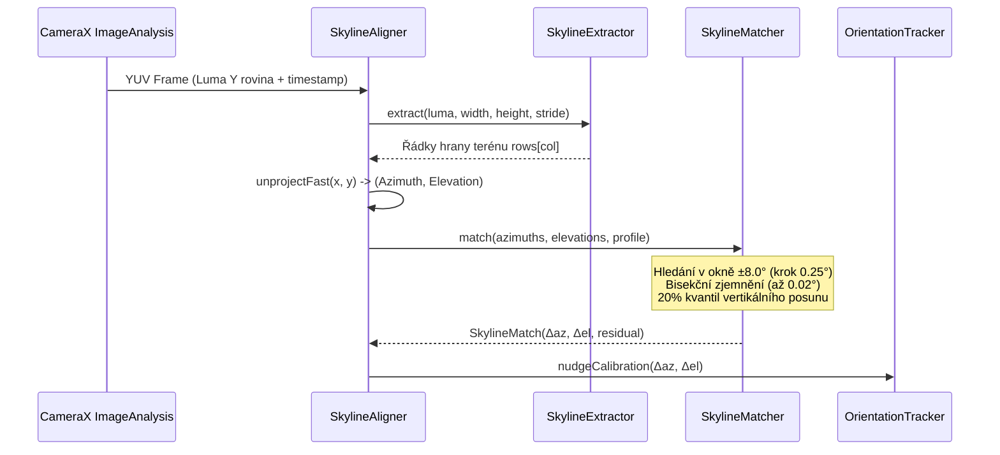

# Trajektorie Slunce, Měsíce a reálný horizont v AR (Caelis)

Tento dokument poskytuje kompletní technickou, matematickou a implementační specifikaci výpočtu, kalibrace a zobrazení **trajektorií Slunce a Měsíce** a jejich interakce s **reálným terénním horizontem** v rozšířené realitě (Augmented Reality – AR) aplikace **Caelis**.

Dokument pokrývá celou pipeline: od astronomických modelů (PSA, Jean Meeus) a topocentrických korekcí, přes geodetické protnutí s digitálním modelem terénu (DEM), optiku kamery a měření FOV ze streamu, senzorovou fúzi s časovou synchronizací SLERP, až po manuální a automatickou optickou kalibraci kompasu a zero-allocation vykreslování na GPU/Canvas při 60 FPS.

---

## Obsah

1. [Architektura a přehled subsystému](#1-architektura-a-přehled-subsystému)
2. [Matematika a výpočet polohy a trajektorie Slunce](#2-matematika-a-výpočet-polohy-a-trajektorie-slunce)
   - [Juliánské datum a ephemeris Slunce (PSA / Meeus)](#juliánské-datum-a-ephemeris-slunce-psa--meeus)
   - [Hvězdný čas a převod do horizontální soustavy](#hvězdný-čas-a-převod-do-horizontální-soustavy)
   - [Atmosférická refrakce](#atmosférická-refrakce)
   - [Celodenní trajektorie a časové bubliny (`SolarTrajectoryPlanner`)](#celodenní-trajektorie-a-časové-bubliny-solartrajectoryplanner)
   - [Astronomické události dne (`SolarDayTimesCalculator`)](#astronomické-události-dne-solardaytimescalculator)
3. [Matematika a výpočet polohy a trajektorie Měsíce](#3-matematika-a-výpočet-polohy-a-trajektorie-měsíce)
   - [Periodické členy délky, šířky a vzdálenosti Měsíce](#periodické-členy-délky-šířky-a-vzdálenosti-měsíce)
   - [Topocentrická paralaxa pozorovatele](#topocentrická-paralaxa-pozorovatele)
   - [Fáze Měsíce a osvětlení disku](#fáze-měsíce-a-osvětlení-disku)
   - [24hodinový průchod centrovaný na kulminaci (`LunarTrajectoryPlanner`)](#24hodinový-průchod-centrovaný-na-kulminaci-lunartrajectoryplanner)
   - [Výpočet východu, západu a kulminace Měsíce (`LunarDayTimesCalculator`)](#výpočet-východu-západu-a-kulminace-měsíce-lunardaytimescalculator)
4. [Interakce s reálným terénním horizontem (`TerrainRiseSetCalculator`)](#4-interakce-s-reálným-terénním-horizontem-terrainrisesetcalculator)
   - [Model terénního profilu (`HorizonProfile`)](#model-terénního-profilu-horizonprofile)
   - [Detekce a bisekční zjemnění kontaktů s terénem](#detekce-a-bisekční-zjemnění-kontaktů-s-terénem)
   - [Vícenásobné východy/západy a celodenní zastínění](#vícenásobné-východyzápady-a-celodenní-zastínění)
   - [Časový posun vůči astronomickému horizontu](#časový-posun-vůči-astronomickému-horizontu)
5. [Optika kamery, zorné pole (FOV) a projekční geometrie](#5-optika-kamery-zorné-pole-fov-a-projekční-geometrie)
   - [Transformace souřadnic ENU do souřadnic kamery ($R^T$)](#transformace-souřadnic-enu-do-souřadnic-kamery-rt)
   - [Perspektivní projekce na Sky Dome (`CameraProjection`)](#perspektivní-projekce-na-sky-dome-cameraprojection)
   - [Zpětná projekce ze souřadnic obrazovky (`unprojectFast`)](#zpětná-projekce-ze-souřadnic-obrazovky-unprojectfast)
   - [Měření efektivního FOV ze streamu (`CameraFovCalculator`)](#měření-efektivního-fov-ze-streamu-camerafovcalculator)
   - [Korekce ořezu `FILL_CENTER` na protáhlých displejích](#korekce-ořezu-fill_center-na-protáhlých-displejích)
6. [Senzorová fúze, orientace a stabilizace (`OrientationTracker`)](#6-senzorová-fúze-orientace-a-stabilizace-orientationtracker)
   - [Vypnutí OIS/EIS v CameraX pro stabilní prostorový zámek](#vypnutí-oiseis-v-camerax-pro-stabilní-prostorový-zámek)
   - [Časová synchronizace senzorů a expozice snímku (SLERP)](#časová-synchronizace-senzorů-a-expozice-snímku-slerp)
   - [Adaptivní vyhlazování kvaternionů](#adaptivní-vyhlazování-kvaternionů)
   - [Přednásobení rotace světového rámce (True North & Calibration)](#přednásobení-rotace-světového-rámce-true-north--calibration)
7. [Kalibrace kompasu a zarovnání horizontu](#7-kalibrace-kompasu-a-zarovnání-horizontu)
   - [Jednotná kalibrace pro celé zařízení](#jednotná-kalibrace-pro-celé-zařízení)
   - [Manuální kalibrace tažením prstu a jemné doladění](#manuální-kalibrace-tažením-prstu-a-jemné-doladění)
   - [Automatické optické zarovnání s kamerou (`SkylineAligner`)](#automatické-optické-zarovnání-s-kamerou-skylinealigner)
   - [Detekce hrany krajiny (`SkylineExtractor`)](#detekce-hrany-krajiny-skylineextractor)
   - [Křížová korelace a kvantilový posun (`SkylineMatcher`)](#křížová-korelace-a-kvantilový-posun-skylinematcher)
   - [5 stupňů ochrany proti falešným shodám](#5-stupňů-ochrany-proti-falešným-shodám)
8. [Vykreslovací pipeline v reálném čase (AR Canvas)](#8-vykreslovací-pipeline-v-reálném-čase-ar-canvas)
   - [Zero-allocation renderovací smyčka (`SkyDomeRenderer`)](#zero-allocation-renderovací-smyčka-skydomerenderer)
   - [Hierarchie vykreslovaných vrstev (Z-Index)](#hierarchie-vykreslovaných-vrstev-z-index)
   - [Utlumení trajektorie pod úrovní skutečného terénu](#utlumení-trajektorie-pod-úrovní-skutečného-terénu)
   - [Směrové mimozáběrové radarové ukazatele](#směrové-mimozáběrové-radarové-ukazatele)
   - [Barevné palety a režim nočního vidění (Red / Amber Vision)](#barevné-palety-a-režim-nočního-vidění-red--amber-vision)
9. [Uživatelské rozhraní, HUD a polní ergonomie](#9-uživatelské-rozhraní-hud-a-polní-ergonomie)
10. [Testovací strategie a ověřování invariantů](#10-testovací-strategie-a-ověřování-invariantů)

---

## 1. Architektura a přehled subsystému

Pro fotografy krajiny, časosběrů (time-lapse) a astrofotografy je naprosto zásadní znát přesnou polohu Slunce a Měsíce v reálném čase a v kontextu okolního terénu. Astronomické tabulky udávají východ a západ těles vůči ideálnímu matematickému horizontu ($0^\circ$ elevace na dokonalé kouli). Pokud se však fotograf nachází v horském údolí nebo pod hřebenem, Slunce zapadne za skutečný hřeben i o několik desítek minut dříve, než udává kalendář.

Subsystém **Sun & Moon AR** v aplikaci Caelis poskytuje:
1. **3D prostorově uzamčenou vizualizaci** trajektorií Slunce a Měsíce promítanou přímo na obraz z fotoaparátu.
2. **Skutečné časy východů a západů za reálným terénem** z 1 arc-second (~30 m) modelu reliéfu.
3. **Optické a senzorové zarovnání**, které eliminuje chyby magnetometru způsobené kovem stativu či odchylkami kompasu.

```
┌────────────────────────────────────────────────────────────────────────────────────────┐
│                          SUBSYSTÉM SUN & MOON AR A HORIZONTU                           │
├─────────────────────────┬─────────────────────────────┬────────────────────────────────┤
│  1. Doménové výpočty    │  2. Senzory, Optika a AR    │  3. UI a Renderovací jádro     │
│  (Pure Kotlin)          │  (Android / Camera2 / NDK)  │  (Jetpack Compose & Canvas)    │
│                         │                             │                                │
│  - SolarPosition (PSA)  │  - Transponovaná matice R^T │  - 60 FPS Zero-Allocation      │
│  - LunarPosition (Meeus)│  - Crop-aware FOV streamu   │    SkyDomeRenderer             │
│  - Trajectory Planners  │  - Sensor SLERP sync        │  - Ztlumení zakrytých oblouků  │
│  - TerrainRiseSet       │  - SkylineAligner           │  - Mimozáběrové radary         │
│  - HorizonProfile       │  - OrientationTracker       │  - Dvouřádkový telemetrický HUD│
└─────────────────────────┴─────────────────────────────┴────────────────────────────────┘
```

### Přehled vrstev a modulů v projektu

Architektura striktně dodržuje pravidlo oddělení doménové logiky od frameworku Android:

```mermaid
flowchart TD
    subgraph Domain_Layer ["domain/solar/ & domain/horizon/ (Pure Kotlin, 0 Android deps)"]
        SPC[SolarPositionCalculator<br/><i>PSA / Meeus &lt; 0.01°</i>]
        LPC[LunarPositionCalculator<br/><i>Meeus Lunární teorie + Paralaxa</i>]
        STP[SolarTrajectoryPlanner<br/><i>720 vzorků / 24 h + Bubliny</i>]
        LTP[LunarTrajectoryPlanner<br/><i>24h průchod kolem kulminace</i>]
        SDTC[SolarDayTimesCalculator<br/><i>Pravé poledne, Zlatá hodinka</i>]
        LDTC[LunarDayTimesCalculator<br/><i>Kulminace, Fáze, Osvětlení</i>]
        TRSC[TerrainRiseSetCalculator<br/><i>1s bisekce křížení s terénem</i>]
        HP[HorizonProfile<br/><i>1440 vzorků (krok 0.25°)</i>]
        SM[SkylineMatcher<br/><i>Křížová korelace & 20% kvantil</i>]
        SE[SkylineExtractor<br/><i>Luma gradient detekce hran</i>]
    end

    subgraph AR_Layer ["ar/ (Geometrie, Senzory, Optika)"]
        CP[CameraProjection<br/><i>R^T projekce & unprojectFast</i>]
        CFC[CameraFovCalculator<br/><i>Měření FOV ze streamu & FILL_CENTER</i>]
        OT[OrientationTracker<br/><i>SLERP fúze, True-North & Nudge</i>]
        SDR[SkyDomeRenderer<br/><i>Zero-allocation 3D celestial canvas</i>]
        SA[SkylineAligner<br/><i>CameraX ImageAnalysis frame bridge</i>]
    end

    subgraph UI_Layer ["ui/solar/ & data/"]
        VM[SunArViewModel<br/><i>StateFlow orchestrátor</i>]
        UI[SunArScreen<br/><i>CameraPreview + AR Canvas + HUD</i>]
        SS[SettingsStore<br/><i>ar_azimuth_offset & ar_elevation_offset</i>]
        HR[HorizonRepository<br/><i>Singleton profilu terénu</i>]
    end

    SPC --> STP
    SPC --> SDTC
    LPC --> LTP
    LPC --> LDTC
    STP --> TRSC
    LTP --> TRSC
    HP --> TRSC

    CP --> SDR
    HP --> SDR
    HP --> SM
    SE --> SM
    SA --> SE
    SA --> CP
    SA --> SM

    VM --> STP
    VM --> LTP
    VM --> TRSC
    VM --> OT
    VM --> SA
    VM --> SS
    VM --> HR

    OT --> UI
    CFC --> UI
    SDR --> UI
    UI --> VM
```

---

## 2. Matematika a výpočet polohy a trajektorie Slunce

Třída [`SolarPositionCalculator`](../app/src/main/java/com/dazix/caelis/domain/solar/SolarPositionCalculator.kt) implementuje vysoce přesný algoritmus výpočtu horizontálních souřadnic Slunce založený na standardu **NOAA Solar Position Algorithm** a publikaci Jean Meeus: *Astronomical Algorithms*. Přesnost metody je lepší než $0.01^\circ$.

### Juliánské datum a ephemeris Slunce (PSA / Meeus)

Pro daný časový okamžik $t$ (ve formátu UTC `Instant`) a pozorovatele na zeměpisné šířce $\varphi$ a délce $\lambda$:

1. **Juliánské datum ($JD$) a Juliánská století ($T$):**
   $$JD = 2440587.5 + \frac{\text{epochSeconds}}{86400.0}$$
   $$T = \frac{JD - 2451545.0}{36525.0}$$
   kde $2451545.0$ odpovídá standardní astronomické epoše **J2000.0** (1. ledna 2000, 12:00 TT).

2. **Geometrická střední délka Slunce ($L_0$):**
   $$L_0 = 280.46646^\circ + 36000.76983^\circ \cdot T + 0.0003032^\circ \cdot T^2 \pmod{360^\circ}$$

3. **Střední anomálie Slunce ($M$):**
   $$M = 357.52911^\circ + 35999.05029^\circ \cdot T - 0.0001537^\circ \cdot T^2 \pmod{360^\circ}$$

4. **Rovnice středu ($C$) a pravá délka ($L_{\text{true}}$):**
   $$C = (1.914602^\circ - 0.004817^\circ T - 0.000014^\circ T^2) \sin(M) + (0.019993^\circ - 0.000101^\circ T) \sin(2M) + 0.000289^\circ \sin(3M)$$
   $$L_{\text{true}} = L_0 + C$$

5. **Zdánlivá délka Slunce ($\lambda$):**
   Vlivem nutace zemské osy a aberace světla se zavádí korekce podle délky výstupného uzlu dráhy Měsíce $\Omega = 125.04^\circ - 1934.136^\circ \cdot T$:
   $$\lambda = L_{\text{true}} - 0.00569^\circ - 0.00478^\circ \sin(\Omega)$$

6. **Sklon ekliptiky ($\varepsilon$):**
   Střední sklon ekliptiky $\varepsilon_0$ a korigovaný sklon $\varepsilon$:
   $$\varepsilon_0 = 23^\circ 26' 21.448'' - 46.8150'' \cdot T - 0.00059'' \cdot T^2 + 0.001813'' \cdot T^3$$
   $$\varepsilon = \varepsilon_0 + 0.00256^\circ \cos(\Omega)$$

7. **Rovníkové souřadnice (Deklinace $\delta$ a Rektascenze $\alpha_{\text{RA}}$):**
   $$\sin \delta = \sin \varepsilon \sin \lambda \implies \delta = \arcsin(\sin \delta)$$
   $$\alpha_{\text{RA}} = \operatorname{atan2}(\cos \varepsilon \sin \lambda, \; \cos \lambda)$$

### Hvězdný čas a převod do horizontální soustavy

Pro převod z geocentrických rovníkových souřadnic $(\alpha_{\text{RA}}, \delta)$ do lokálních horizontálních souřadnic (Azimut $A$, Elevace $h$):

1. **Greenwichský střední hvězdný čas (GMST) a Místní hvězdný čas (LST):**
   $$\text{GMST} = 280.46061837^\circ + 360.98564736629^\circ \cdot (JD - 2451545.0) + 0.000387933^\circ \cdot T^2 - \frac{T^3}{38710000}$$
   $$\text{LST} = \text{GMST} + \lambda_{\text{observer}}$$

2. **Místní hodinový úhel ($H$):**
   $$H = \text{LST} - \alpha_{\text{RA}} \quad (\text{normalizováno do } [-180^\circ, +180^\circ])$$

3. **Geometrická elevace ($h_{\text{geo}}$):**
   $$\sin h_{\text{geo}} = \sin \varphi \sin \delta + \cos \varphi \cos \delta \cos H$$
   $$h_{\text{geo}} = \arcsin(\sin h_{\text{geo}})$$

4. **Astronomický azimut ($A$):**
   Měřeno po směru hodinových ručiček od severu ($0^\circ = \text{Sever}, 90^\circ = \text{Východ}, 180^\circ = \text{Jih}, 270^\circ = \text{Západ}$):
   $$y_{\text{az}} = -\sin H \cos \delta$$
   $$x_{\text{az}} = \cos \varphi \sin \delta - \sin \varphi \cos \delta \cos H$$
   $$A = \operatorname{atan2}(y_{\text{az}}, x_{\text{az}}) \pmod{360^\circ}$$

### Atmosférická refrakce

Světlo ze Slunce se při průchodu atmosférou ohýbá směrem dolů, což způsobuje, že těleso na obzoru vidíme výše, než kde se geometricky nachází. Caelis používá Saemundssonovu aproximaci (1986):

Pro $h_{\text{geo}} \in [-0.8333^\circ, 85.0^\circ]$:
$$R_{\text{arcmin}} = \frac{1.02}{\tan\left( \left( h_{\text{geo}} + \frac{10.3}{h_{\text{geo}} + 5.11} \right) \cdot \frac{\pi}{180^\circ} \right)}$$
$$h_{\text{apparent}} = h_{\text{geo}} + \max\left(0, \frac{R_{\text{arcmin}}}{60.0}\right)$$

Pro elevace $h_{\text{geo}} \ge 85^\circ$ je refrakce zanedbatelná ($< 0.001^\circ$) a vynechává se kvůli zamezení numerické nestabilitě v zenitu ($\tan 90^\circ$).

---

### Celodenní trajektorie a časové bubliny (`SolarTrajectoryPlanner`)

Třída [`SolarTrajectoryPlanner`](../app/src/main/java/com/dazix/caelis/domain/solar/SolarTrajectoryPlanner.kt) generuje 3D prostorový oblouk pro zvolený kalendářní den:

1. **Vzorkování polygonu trajektorie:**
   - Den (1440 minut) je vzorkován s krokem $\Delta t = 2\text{ minuty}$ (celkem 720 diskrétních vrcholů).
   - Trajektorie se vykresluje plynule od $+90^\circ$ dolů až do $-15^\circ$ pod obzor, což umožňuje přesné rámování západů v terénu a kompozici v době soumraku.
2. **Časové bubliny (`BubbleInterval`):**
   - Po dráze jsou rozmístěny časové visačky s nastavitelným krokem (15 min, 30 min, 1 h, 2 h).
3. **Význačné značky (Markers):**
   - Samostatně vypočtené body pro **Východ Slunce** (Sunrise 🌅), **Západ Slunce** (Sunset 🌇) a **Pravé sluneční poledne** (Solar Noon ☀️).

```
                      Trajektorie Slunce v AR pohledu
                                 (Pravé poledne 12:48)
                                        [12:00]
                                  /                 \
                          [10:00]                     [14:00]
                         /                                   \
                 [08:00]                                       [16:00]
                 /                                                   \
  🌅 Východ (06:12)                                               🌇 Západ (19:24)
─────────────────▲───────────────────────────────────────────────────▲───────────────── 0° Horizont
                 \                                                   /
                  [04:00] (Pod obzorem až do -15°)          [20:00] /
```

---

### Astronomické události dne (`SolarDayTimesCalculator`)

Třída [`SolarDayTimesCalculator`](../app/src/main/java/com/dazix/caelis/domain/solar/SolarDayTimes.kt) provádí robustní výpočet klíčových milníků dne:

1. **Pravé sluneční poledne (Meridian Transit):**
   - Odhadne přibližný čas podle zeměpisné délky ($t_{\text{approx}} = 12:00\text{ UTC} - \lambda \cdot 240\text{ s/}^\circ$).
   - Prohledá 4hodinové okno $[t_{\text{approx}} - 2\text{h}, t_{\text{approx}} + 2\text{h}]$ s krokem 5 minut a najde maximum elevace.
   - Následně **ternárním vyhledáváním** (ternary search) zjemní okamžik kulminace na přesnost **1 sekundy**.
2. **Východ a západ Slunce:**
   - Standardní astronomický práh: $h_{\text{target}} = -0.8333^\circ$ (odpovídá $-50'$, složených z $34'$ atmosférické refrakce a $16'$ úhlového poloměru slunečního disku).
   - Intervaly $[00:00, \text{Noon}]$ (pro východ) a $[\text{Noon}, 24:00]$ (pro západ) jsou vzorkovány po 5 minutách pro nalezení změny znaménka a následně zjemněny bisekčním půlením intervalu na 1 sekundu.
3. **Zlatá hodinka (Golden Hour):**
   - Definována přechodem elevace Slunce v rozmezí **$-4.0^\circ \le h \le +6.0^\circ$**.
   - Spočteny přesné časy pro ranní i večerní okno.
4. **Polární den a polární noc:**
   - Pokud ani při kulminaci $h_{\text{noon}} \le -0.8333^\circ$, nastává polární noc (`isPolarNight = true`).
   - Pokud ani v nejnižším bodě neklesne pod horizont, nastává polární den (`isPolarDay = true`).

---

## 3. Matematika a výpočet polohy a trajektorie Měsíce

Měsíc se pohybuje po výrazně složitější dráze ovlivňované gravitačními perturbacemi Slunce i planet. Třída [`LunarPositionCalculator`](../app/src/main/java/com/dazix/caelis/domain/solar/LunarPositionCalculator.kt) implementuje zkrácenou teorii Jean Meeus: *Astronomical Algorithms (kapitola 45)*.

### Periodické členy délky, šířky a vzdálenosti Měsíce

1. **Fundamentální argumenty (ve stupních):**
   - Střední délka Měsíce: $L' = 218.3164477^\circ + 481267.88123421^\circ \cdot T - 0.0015786^\circ \cdot T^2$
   - Střední elongace Měsíce: $D = 297.8501921^\circ + 445267.1114034^\circ \cdot T - 0.0018819^\circ \cdot T^2$
   - Střední anomálie Slunce: $M = 357.5291092^\circ + 35999.0502909^\circ \cdot T - 0.0001536^\circ \cdot T^2$
   - Střední anomálie Měsíce: $M' = 134.9633964^\circ + 477198.8675055^\circ \cdot T + 0.0087414^\circ \cdot T^2$
   - Argument šířky Měsíce: $F = 93.2720950^\circ + 483202.0175233^\circ \cdot T - 0.0036539^\circ \cdot T^2$

2. **Periodické poruchy v ekliptikální délce ($\Sigma_l$) a šířce ($\Sigma_b$):**
   Algoritmus sčítá **23 dominantních goniometrických členů** v délce a **14 členů** v šířce:
   $$\Delta \lambda = 6.288774^\circ \sin(M') + 1.274027^\circ \sin(2D - M') + 0.658314^\circ \sin(2D) + \dots$$
   $$\beta = 5.128122^\circ \sin(F) + 0.280602^\circ \sin(M' + F) + 0.277693^\circ \sin(M' - F) + \dots$$

3. **Geocentrická vzdálenost Měsíce ($d_{\text{km}}$):**
   $$d_{\text{km}} = 385000.56 - 20905.355 \cos(M') - 3699.111 \cos(2D - M') - 2955.968 \cos(2D) - \dots$$

### Topocentrická paralaxa pozorovatele

Vzhledem k malé vzdálenosti Měsíce od Země ($\approx 384\,400\text{ km}$) způsobuje poloha pozorovatele na povrchu Země vůči jejímu středu zdánlivý posun polohy Měsíce na obloze až o **$1.0^\circ$** (tzv. topocentrická paralaxa).

```
                 Měsíc 
                /     \
               /       \
              /         \ Topocentrický směr
             /           \
  Geocentrický            \
  směr      /              ▼
           /          Pozorovatel (povrch Země, výška h)
          ▼          /
        Střed Země ──
```

1. **Redukovaná šířka a geocentrický poloměr pozorovatele:**
   Pro geodetickou šířku $\varphi$ a nadmořskou výšku $h$:
   $$u = \arctan(0.99664719 \cdot \tan \varphi)$$
   $$\rho \sin \varphi' = 0.99664719 \cdot \sin u + \frac{h}{6378137.0} \cdot \sin \varphi$$
   $$\rho \cos \varphi' = \cos u + \frac{h}{6378137.0} \cdot \cos \varphi$$

2. **Horizontální paralaxa ($\pi_{\text{moon}}$):**
   $$\sin \pi_{\text{moon}} = \frac{6378.14}{d_{\text{km}}}$$

3. **Korekce hodinového úhlu a deklinace:**
   $$\Delta \alpha = \operatorname{atan2}\left(-\rho \cos \varphi' \sin \pi_{\text{moon}} \sin H_{\text{geo}}, \; \cos \delta_{\text{geo}} - \rho \cos \varphi' \sin \pi_{\text{moon}} \cos H_{\text{geo}}\right)$$
   $$H_{\text{topo}} = H_{\text{geo}} - \Delta \alpha$$
   $$\delta_{\text{topo}} = \operatorname{atan2}\left((\sin \delta_{\text{geo}} - \rho \sin \varphi' \sin \pi_{\text{moon}}) \cos \Delta \alpha, \; \cos \delta_{\text{geo}} - \rho \cos \varphi' \sin \pi_{\text{moon}} \cos H_{\text{geo}}\right)$$

Výsledné topocentrické souřadnice $(H_{\text{topo}}, \delta_{\text{topo}})$ se následně převedou do azimutu a elevace a doplní o atmosférickou refrakci.

---

### Fáze Měsíce a osvětlení disku

Fázový úhel $\Phi$ a frakce osvětleného disku $k \in [0.0, 1.0]$:
$$\Phi = 180^\circ - D \pmod{360^\circ}$$
$$k = \frac{1 + \cos(\Phi)}{2}$$

| Elongace $D$ | Název fáze | Glyf | Osvětlení $k$ |
| :--- | :--- | :---: | :--- |
| **$337.5^\circ - 22.5^\circ$** | **Nov** (New Moon) | 🌑 | $0\,\%$ |
| **$22.5^\circ - 67.5^\circ$** | **Dorůstající srpek** (Waxing Crescent) | 🌒 | $1 - 49\,\%$ |
| **$67.5^\circ - 112.5^\circ$** | **První čtvrť** (First Quarter) | 🌓 | $50\,\%$ |
| **$112.5^\circ - 157.5^\circ$** | **Dorůstající měsíc** (Waxing Gibbous) | 🌔 | $51 - 99\,\%$ |
| **$157.5^\circ - 202.5^\circ$** | **Úplněk** (Full Moon) | 🌕 | $100\,\%$ |
| **$202.5^\circ - 247.5^\circ$** | **Couvající měsíc** (Waning Gibbous) | 🌖 | $99 - 51\,\%$ |
| **$247.5^\circ - 292.5^\circ$** | **Poslední čtvrť** (Last Quarter) | 🌗 | $50\,\%$ |
| **$292.5^\circ - 337.5^\circ$** | **Ubývající srpek** (Waning Crescent) | 🌘 | $49 - 1\,\%$ |

---

### 24hodinový průchod centrovaný na kulminaci (`LunarTrajectoryPlanner`)

> [!IMPORTANT]
> **Problém půlnoční diskontinuity u Měsíce:**
> Měsíc oběhne oblohu za cca 24 hodin a 50 minut (lunární den). Pokud by se trajektorie vzorkovala striktně od 00:00 do 24:00 kalendářního dne, došlo by při půlnoci k prudkému skoku a roztržení oblouku uprostřed noci, kdy je Měsíc nejlépe viditelný.

Třída [`LunarTrajectoryPlanner`](../app/src/main/java/com/dazix/caelis/domain/solar/LunarTrajectoryPlanner.kt) tento problém řeší vzorkováním **24hodinového intervalu centrovaného na čas kulminace (meridian transit)**:
$$t_{\text{start}} = t_{\text{transit}} - 12\text{ hodin}, \quad t_{\text{end}} = t_{\text{transit}} + 12\text{ hodin}$$

Díky tomu oba koncové body křivky leží hluboko pod obzorem v lunárním nadiru ($\approx -60^\circ$ elevace) a celý viditelný průchod nad obzorem (Východ $\to$ Kulminace $\to$ Západ) je **100% spojitý, hladký a bez trhlin**.

### Výpočet východu, západu a kulminace Měsíce (`LunarDayTimesCalculator`)

Třída [`LunarDayTimesCalculator`](../app/src/main/java/com/dazix/caelis/domain/solar/LunarDayTimes.kt):
1. Prohledá kalendářní den po 5 minutách a lokalizuje vrchol kulminace (transit). Zpřesní jej na 1 sekundu.
2. Z kulminace prohledává časovou osu **směrem vzad (až o 14 hodin)** pro nalezení přesného okamžiku **východu Měsíce** (Moonrise) patřícího k tomuto průchodu.
3. Z kulminace prohledává osu **směrem vpřed (až o 14 hodin)** pro nalezení **západu Měsíce** (Moonset).
4. Přechod horizontu je bisekčně zjemněn na 1 sekundu.

---

## 4. Interakce s reálným terénním horizontem (`TerrainRiseSetCalculator`)

Skutečný fotografický západ Slunce v horském terénu nenastává v okamžiku dosažení matematického horizontu ($0^\circ$), ale v okamžiku, kdy sluneční disk klesne za siluetu okolního horského masivu.

```
      Úhel elevace
           ▲
           │          Astronomická trajektorie Slunce
           │              \
           │               \      Reálný západ za terén (18:42, Δt = -25 min)
           │                \     ▼
           │  Profil terénu  ─────┐
           │                     │ \
           │                     │  \   Astronomický západ (19:07)
           │                     │   \  ▼
      ─────┼─────────────────────┴───────\──────────────► Čas
          0°│                              \ (Matematický horizont)
```

### Model terénního profilu (`HorizonProfile`)

Třída [`HorizonProfile`](../app/src/main/java/com/dazix/caelis/domain/horizon/HorizonProfile.kt) uchovává kompletní 360° siluetu okolní krajiny v homogenní síti **1440 vzorků** (rozlišení $0.25^\circ$ na vzorek).

- Výpočet hodnoty v libovolném azimutu $\alpha$:
  $$\text{index} = \frac{\alpha \bmod 360^\circ}{0.25^\circ}, \quad f = \text{index} - \lfloor \text{index} \rfloor$$
  $$\theta_{\text{profile}}(\alpha) = (1 - f) \cdot \theta[\lfloor \text{index} \rfloor] + f \cdot \theta[(\lfloor \text{index} \rfloor + 1) \bmod 1440]$$
- **Podmínka zakrytí tělesa terénem:**
  $$\text{isOccluded}(\alpha, \theta) \iff \theta_{\text{apparent}} < \theta_{\text{profile}}(\alpha)$$

> [!IMPORTANT]
> **Proč se porovnává apparentní elevace?**
> Terénní profil vypočtený ray-marchingem z výškových dat SRTM/Skadi již v sobě obsahuje atmosférickou refrakci efektivním poloměrem Země ($R_{\text{eff}} = R_{\text{earth}} / (1 - k)$ pro $k = 0.13$). Porovnání proti geometrické elevaci by refrakci započítalo na jedné straně a na druhé nikoliv.

---

### Detekce a bisekční zjemnění kontaktů s terénem

Třída [`TerrainRiseSetCalculator`](../app/src/main/java/com/dazix/caelis/domain/solar/TerrainRiseSetCalculator.kt) zpracovává body trajektorie:

1. **Hrubá detekce přechodu:**
   Prochází sousední body trajektorie $P_i, P_{i+1}$ (vzorkované po 2 minutách) a detekuje změnu logického stavu $\text{isAbove}(P_i) \neq \text{isAbove}(P_{i+1})$.
2. **Bisekční zjemnění (`refine`):**
   Interval $[t_{\text{low}}, t_{\text{high}}]$ o délce 120 s je binárním půlením zjemněn na úroveň **1 sekundy** (`REFINEMENT_SECONDS = 1L`):
   ```kotlin
   while (Duration.between(low, high).seconds > 1L) {
       val middle = low.plusSeconds(Duration.between(low, high).seconds / 2)
       val midAbove = isAbove(computePosition(middle, location), profile)
       if (midAbove == startAbove) low = middle else high = middle
   }
   ```
3. **Vícenásobné východy a západy:**
   Pokud Slunce zapadne za horský štít, vynoří se v horském sedle a následně definitivně zapadne, algoritmus zachová **všechny události dne**. Redukce na jediný západ by byla v terénu klamavá.
4. **Celodenní zastínění (`isSunHiddenAllDay`):**
   Detekuje situaci, kdy Slunce po celý den nepřekročí terénní profil (např. v hlubokých severních roklích v zimě). V UI se zobrazí explicitní stav namísto zavádějícího "východ nenalezen".
5. **Časový posun (`delayFromAstronomical`):**
   Vypočítá přesný rozdíl mezi reálným západem a astronomickým západem z almanachu:
   $$\Delta t = t_{\text{terrain}} - t_{\text{astronomical}}$$
   Tato hodnota je v UI prezentována fotografovi (např. *„Západ o 25 minut dříve kvůli hřebenu“*).

---

## 5. Optika kamery, zorné pole (FOV) a projekční geometrie

Zobrazení nebeských těles na displeji mobilního telefonu vyžaduje precizní matematickou transformaci ze sférických souřadnic oblohy do 2D souřadnic obrazovky.

```
  Světové souřadnice ENU             Souřadnice zařízení             Obrazovka kamery (2D)
  (Azimut, Elevace) ───► [ V_world ] ────( R^T )────► [ V_dev ] ───( DisplayRotation )───► [ (x, y) v px ]
```

### Transformace souřadnic ENU do souřadnic kamery ($R^T$)

1. **Směrový vektor na jednotkové nebeské sféře (World ENU – East, North, Up):**
   Pro azimut $\alpha$ a elevaci $\theta$:
   $$V_{\text{world}} = \begin{bmatrix} \sin \alpha \cos \theta \\ \cos \alpha \cos \theta \\ \sin \theta \end{bmatrix} = \begin{bmatrix} V_{\text{East}} \\ V_{\text{North}} \\ V_{\text{Up}} \end{bmatrix}$$

2. **Matice rotace ze `SensorManager` a inverzní transformace ($R^T$):**
   Matice rotace $R$ z Android senzorů transformuje vektory ze souřadnic zařízení do souřadnic světa:
   $$V_{\text{world}} = R \cdot V_{\text{dev}}$$
   Jelikož je matice rotace ortonormální ($R^{-1} = R^T$), převod ze světa do zařízení je dán **transpozicí matice $R$**:
   $$V_{\text{dev}} = R^T \cdot V_{\text{world}}$$

   Rozepsáno pro prvky $4 \times 4$ matice:
   $$x_{\text{dev}} = R[0] V_x + R[4] V_y + R[8] V_z$$
   $$y_{\text{dev}} = R[1] V_x + R[5] V_y + R[9] V_z$$
   $$z_{\text{dev}} = R[2] V_x + R[6] V_y + R[10] V_z$$

> [!CAUTION]
> Přímé násobení řádků matice $R$ namísto sloupců (vynechání transpozice) invertuje pohyb kamery a rozbíjí prostorové uzamčení scény.

3. **Mapování na rotaci displeje (`DisplayGeometry`):**
   Optická osa zadní kamery míří ve směru $-Z_{\text{dev}}$, proto $z_s = -z_{\text{dev}}$. Mapování os $X$ a $Y$:
   - `ROTATION_0` (na výšku / Portrait): $x_s = x_{\text{dev}}, \; y_s = y_{\text{dev}}$
   - `ROTATION_90` (na šířku / Landscape): $x_s = y_{\text{dev}}, \; y_s = -x_{\text{dev}}$
   - `ROTATION_180`: $x_s = -x_{\text{dev}}, \; y_s = -y_{\text{dev}}$
   - `ROTATION_270`: $x_s = -y_{\text{dev}}, \; y_s = x_{\text{dev}}$

---

### Perspektivní projekce na Sky Dome (`CameraProjection`)

Bod leží před kamerou, pokud $z_s > 0.001$.

1. **Ohnisková vzdálenost v pixelech ($f_{\text{px}}$):**
   Z efektivního horizontálního zorného pole $\text{FOV}_H$ a šířky viewportu $W$:
   $$f_{\text{px}} = \frac{W / 2}{\tan\left( \frac{\text{FOV}_H}{2} \cdot \frac{\pi}{180^\circ} \right)}$$

2. **Projekce na obrazovku $(x_{\text{screen}}, y_{\text{screen}})$:**
   $$x_{\text{screen}} = \frac{W}{2} + f_{\text{px}} \cdot \left( \frac{x_s}{z_s} \right)$$
   $$y_{\text{screen}} = \frac{H}{2} - f_{\text{px}} \cdot \left( \frac{y_s}{z_s} \right)$$

---

### Zpětná projekce ze souřadnic obrazovky (`unprojectFast`)

Pro automatické optické zarovnání je nutné převést bod detekovaný na obrazovce kamery $(x_{\text{screen}}, y_{\text{screen}})$ zpět na nebeský azimut $\alpha$ a elevaci $\theta$. Metoda `CameraProjection.unprojectFast`:

1. Odstranění perspektivního dělení při $z_s = 1.0$:
   $$x_s = \frac{x_{\text{screen}} - W/2}{f_{\text{px}}}, \quad y_s = -\frac{y_{\text{screen}} - H/2}{f_{\text{px}}}, \quad z_s = 1.0$$
2. Zpětná rotace displeje do souřadnic zařízení $(x_{\text{dev}}, y_{\text{dev}}, z_{\text{dev}})$.
3. Převod ze zařízení do světa pomocí přímé matice $R$ ($V_{\text{world}} = R \cdot V_{\text{dev}}$):
   $$V_x = R[0] x_{\text{dev}} + R[1] y_{\text{dev}} + R[2] z_{\text{dev}}$$
   $$V_y = R[4] x_{\text{dev}} + R[5] y_{\text{dev}} + R[6] z_{\text{dev}}$$
   $$V_z = R[8] x_{\text{dev}} + R[9] y_{\text{dev}} + R[10] z_{\text{dev}}$$
4. Výpočet azimutu a elevace:
   $$\alpha = \operatorname{atan2}(V_x, V_y) \pmod{360^\circ}$$
   $$\theta = \arcsin\left( \frac{V_z}{\sqrt{V_x^2 + V_y^2 + V_z^2}} \right)$$

---

### Měření efektivního FOV ze streamu (`CameraFovCalculator`)

Výpočet zorného pole z fyzických rozměrů čočky (`SENSOR_INFO_PHYSICAL_SIZE` a ohniskové vzdálenosti) na moderních telefonech selhává:
- Senzor má fyzický poměr stran obvykle 4:3.
- Obrazovka telefonu má poměr 20:9 nebo 19.5:9.
- `PreviewView.ScaleType.FILL_CENTER` vyplňuje výšku a ořezává levý a pravý okraj senzoru.
- CameraX navíc ze snímače vyčítá pouze výřez `SCALER_CROP_REGION`.

Na telefonu Pixel 7 Pro vedlo odvození z geometrie čočky k chybnému FOV **$36.7^\circ$**, zatímco reálný obraz odpovídal **$31.7^\circ$** (odchylka 14 %, která stlačovala celý AR překryv ke středu).

Metoda [`computeStreamHorizontalFov`](../app/src/main/java/com/dazix/caelis/ar/CameraFovCalculator.kt) počítá skutečný FOV přímo z capture metadat:
1. Počítá frakce ořezu aktivního pole:
   $$\text{cropFraction}_{\text{short}} = \frac{\text{cropShort}}{\text{activeShort}}, \quad \text{cropFraction}_{\text{long}} = \frac{\text{cropLong}}{\text{activeLong}}$$
2. Pracuje v tangentách polovičních úhlů, které přesně odpovídají škálování na rovině snímače:
   $$\tan_{\text{long}} = \tan_{\text{rawLong}} \cdot \text{cropFraction}_{\text{long}}$$
   $$\tan_{\text{short}} = \tan_{\text{rawShort}} \cdot \text{cropFraction}_{\text{short}}$$
3. Zohledňuje poměr stran bufferu streamu a ořez `FILL_CENTER` na displeji.

---

## 6. Senzorová fúze, orientace a stabilizace (`OrientationTracker`)

Pro stabilní zobrazení v rozšířené realitě kombinuje třída [`OrientationTracker`](../app/src/main/java/com/dazix/caelis/ar/OrientationTracker.kt) hardwarové senzory rotace (`TYPE_ROTATION_VECTOR`, `TYPE_GEOMAGNETIC_ROTATION_VECTOR`).

### Vypnutí OIS/EIS v CameraX pro stabilní prostorový zámek

Při zapnuté optické stabilizaci obrazu (OIS) elektromagnetické aktuátory fyzicky pohybují čočkou uvnitř modulu nezávisle na těle telefonu. Při zapnuté elektronické stabilizaci (EIS) dochází k deformaci obrazu v reálném čase. V obou případech se obraz kamery desynchronizuje s daty IMU.

Caelis přes `Camera2Interop` explicitně vynucuje:
```kotlin
Camera2Interop.Extender(previewBuilder)
    .setCaptureRequestOption(CaptureRequest.LENS_OPTICAL_STABILIZATION_MODE, CaptureRequest.LENS_OPTICAL_STABILIZATION_MODE_OFF)
    .setCaptureRequestOption(CaptureRequest.CONTROL_VIDEO_STABILIZATION_MODE, CaptureRequest.CONTROL_VIDEO_STABILIZATION_MODE_OFF)
```

---

### Časová synchronizace senzorů a expozice snímku (SLERP)

Kamerové snímky přicházejí do analýzy se zpožděním 30–80 ms po fyzické expozici čipu. Použití okamžité polohy senzorů v okamžiku doručení rámce způsobuje při pohybu rukou plovoucí drift.

Caelis využívá kruhový zásobník [`SensorTimestampRingBuffer`](../app/src/main/java/com/dazix/caelis/ar/SensorTimestampRingBuffer.kt) o velikosti 128 vzorků. Pro přesný čas expozice snímku `imageInfo.timestamp` vyhledá dva ohraničující vzorky $q_1(t_1)$ a $q_2(t_2)$ a provede **sférickou lineární interpolaci kvaternionů (SLERP)**:

$$u = \frac{t_{\text{frame}} - t_1}{t_2 - t_1}$$
$$\operatorname{SLERP}(q_1, q_2, u) = \frac{\sin((1 - u)\Omega)}{\sin \Omega} q_1 + \frac{\sin(u\Omega)}{\sin \Omega} q_2$$
kde $\cos \Omega = q_1 \cdot q_2$.

Interpolovaný jednotkový kvaterninon je následně převeden na 100% ortonormální matici rotace:
```kotlin
QuaternionSlerp.quaternionToRotationMatrix(syncQInterp, syncRawMatrix)
```

---

### Adaptivní vyhlazování kvaternionů

Při klidném držení telefonu v ruce je žádoucí vysoké filtrování pro eliminaci třesu ruky. Při rychlém švenkování je naopak nutná okamžitá odezva bez zpoždění.

Caelis počítá úhlovou změnu $\Delta \theta = 2 \arccos(|q_{\text{smoothed}} \cdot q_{\text{raw}}|)$ a adaptivně mění koeficient filtru $\alpha \in [0.30, 0.85]$:
$$t = \operatorname{clamp}\left( \frac{\Delta \theta - 0.002}{0.025 - 0.002}, 0.0, 1.0 \right)$$
$$\alpha = \alpha_{\text{stationary}} + t \cdot (\alpha_{\text{moving}} - \alpha_{\text{stationary}})$$

---

### Přednásobení rotace světového rámce (True North & Calibration)

Senzory zařízení měří orientaci vůči magnetickému severu. Aby byl světový souřadný systém zarovnán se skutečným zeměpisným severem (True North) a uživatelskou kalibrací, provádí se rotace **světového rámce kolem osy $Z$ (Up)** a lokální osy kamery $X$ (Right):

$$R_{\text{true}} = R_z(\delta_{\text{geomag}} + \Delta_{\text{azimuth}}) \cdot R_x(\Delta_{\text{pitch}}) \cdot R_{\text{sensor}}$$

Vektor optické osy kamery ve skutečných světových souřadnicích je dán sloupci matice:
$$V_{\text{cam\_forward}} = \begin{bmatrix} -R_{\text{true}}[2] \\ -R_{\text{true}}[6] \\ -R_{\text{true}}[10] \end{bmatrix} = \begin{bmatrix} \text{East} \\ \text{North} \\ \text{Up} \end{bmatrix}$$

---

## 7. Kalibrace kompasu a zarovnání horizontu

Mobilní magnetometry trpí odchylkami vlivem kovových konstrukcí stativů, magnetických pouzder i vnitřního rušení telefonu. Caelis obsahuje dvoustupňový systém kalibrace.

### Jednotná kalibrace pro celé zařízení

> [!IMPORTANT]
> **Jeden kompas na jeden telefon:**
> Kalibrace je globální vlastností telefonu v daném místě. Hodnoty `ar_azimuth_offset` a `ar_elevation_offset` jsou uloženy v `DataStore` a sdíleny mezi **Sun AR** i **Night Sky AR**. Zarovnání podle horského hřebene za dne zaručí, že v noci budou přesně sedět i souhvězdí a Mléčná dráha.

### Manuální kalibrace tažením prstu a jemné doladění

- **Tažení po hledáčku (`onPanGesture`):**
  Posun prstu po displeji v Sun AR nepauzuje senzory, ale **přímo upravuje standing kalibraci** (`nudgeCalibrationBy`). Uživatel tažením posouvá zelenou siluetu terénu na reálný horizont, zatímco senzory dál plynule reagují na otáčení telefonu.
- **Bezpečnostní limity:**
  Kalibrace je striktně omezena na rozsah **$\pm 20^\circ$ v azimutu i elevaci**. Zabraňuje se tím nechtěnému protočení scény o 180° při neopatrném švihu prstem.
- **Tlačítka v panelu:**
  K dispozici jsou tlačítka pro jemný krok ($0.1^\circ$) a hrubý krok ($0.5^\circ$) v obou osách.

---

### Automatické optické zarovnání s kamerou (`SkylineAligner`)

Automatické optické zarovnání porovnává obraz z kamery s 3D matematickým modelem terénu:



1. **Detekce hrany krajiny (`SkylineExtractor`):**
   - Čte přímo jasovou rovinu $Y$ (žádná konverze do RGB ani alokace bitmap).
   - Využívá klouzavé okno 12 řádků nad a pod testovaným bodem s $O(1)$ složitostí na pixel.
   - Detekuje přechod ze světlé oblohy na tmavý terén s prahem kontrastu $\Delta Y \ge 18$.
2. **Křížová korelace (`SkylineMatcher`):**
   - Hrubé vzorkování v rozsahu $\pm 8.0^\circ$ s krokem $0.25^\circ$.
   - Jemné bisekční půlení kolem nejlepšího minima až na krok **$0.02^\circ$**.
3. **Vertikální posun z 20% kvantilu (Quantile Offset):**
   $$\Delta \theta = \operatorname{Quantile}_{0.20}\left( \theta_{\text{camera}}[i] - \theta_{\text{profile}}(\alpha[i] + \Delta \alpha) \right)$$
   > [!NOTE]
   > Stromy, lesy a budovy stojí **nad** holým zemským povrchem (bare-earth DEM). Použití průměru nebo mediánu by do kalibrace započítalo průměrnou výšku stromů. 20% kvantil váže kalibraci na skutečný terén.

---

### 5 stupňů ochrany proti falešným shodám

Algoritmus raději odmítne provést kalibraci, než aby použil chybnou hodnotu:
1. **Minimální počet sloupců:** Alespoň 24 sloupců s platně detekovanou hranou.
2. **Členitost terénu:** Výškový rozkmit profilu v záběru alespoň $0.4^\circ$ (odmítnutí na rovině).
3. **Poměr reliéfu:** Pozorovaný reliéf musí dosahovat alespoň $50\,\%$ reliéfu modelu.
4. **Výraznost minima:** Minimum reziduí musí být o $30\,\%$ hlubší než průměr všech testovaných posunů ($R_{\min} \le 0.7 \cdot R_{\text{avg}}$).
5. **Absolutní reziduum:** Výsledná odchylka fitu musí být $R \le 0.5^\circ$ (cca úhlový průměr Slunce).

---

## 8. Vykreslovací pipeline v reálném čase (AR Canvas)

Vykreslování probíhá na vrstvě Jetpack Compose `Canvas` přímo nad kamerovým náhledem `CameraPreview`.

```
┌────────────────────────────────────────────────────────────────────────┐
│                   VRSTVY VYKRESLOVÁNÍ (Z-INDEX)                        │
├────────────────────────────────────────────────────────────────────────┤
│  1. 3D nebeská síť (Horizont 0°, rovnoběžky -30°..+75°, poledníky)     │
│  2. Reálná silueta terénu (HorizonProfile polyline se stínovým lemem)  │
│  3. Trajektorie Slunce (zlatý oblouk) a Měsíce (azurový oblouk)        │
│  4. Časové bubliny (15m/30m/1h/2h) a značky východu/západu/poledne     │
│  5. Živé ikony Slunce a Měsíce (s fázovým glyfem) / Mimozáběrové radary│
│  6. Telemetrický HUD a ovládací prvky                                  │
└────────────────────────────────────────────────────────────────────────┘
```

### Zero-allocation renderovací smyčka (`SkyDomeRenderer`)

Pro udržení plynulých 60 FPS bez zasekávání způsobeného Garbage Collectorem (GC) třída [`SkyDomeRenderer`](../app/src/main/java/com/dazix/caelis/ar/SkyDomeRenderer.kt) pre-alokuje veškeré paměťové buffery:
- `silhouetteBuffer = FloatArray(1440 * 3)`
- `pathBuffer = FloatArray(1440 * 3)`
- `horizonBuffer = FloatArray(180 * 3)`
- `altitudeGridBuffer = FloatArray(72 * 3)`
- `meridianBuffer = FloatArray(36 * 3)`

Metoda `CameraProjection.projectFast` zapisuje trojice $(x, y, z_s)$ přímo do těchto polí bez vytváření instancí objektů.

---

### Utlumení trajektorie pod úrovní skutečného terénu

Když oblouk trajektorie prochází za horským hřebenem:
- Standardní část: Zlatá barva (`#FFFFB300`), šířka čáry `2.0 dp`, podkladový černý lem `3.2 dp`.
- Zakrytá část za terénem: Poloprůhledná barva (`alpha = 0.3`), šířka čáry `1.4 dp`, černý lem je vynechán.

Fotograf tak na první pohled přesně vidí, kterou část zlaté hodinky mu zakryje kopec.

```kotlin
val occluded = horizonProfile.isOccluded(pt1.azimuth, pt1.elevation) &&
               horizonProfile.isOccluded(pt2.azimuth, pt2.elevation)

drawLine(
    color = if (occluded) solarColor.copy(alpha = 0.3f) else solarColor,
    strokeWidth = if (occluded) 1.4.dp.toPx() else 2.0.dp.toPx(),
)
```

---

### Směrové mimozáběrové radarové ukazatele

Pokud se Slunce nebo Měsíc nachází mimo zorné pole kamery (např. za zády pozorovatele nebo hluboko pod nohama):
1. Vypočte se směrový úhel $\theta_{\text{bearing}} = \operatorname{atan2}(x_s, y_s)$ v rovině obrazovky.
2. Na okraji displeje se vykreslí navigační štítek se směrovou šipkou a údajem o elevaci (např. `☀️ -27°` v noci).

---

### Barevné palety a režim nočního vidění (Red / Amber Vision)

| Prvek | Denní režim | Red Vision (Astro) | Amber Vision |
| :--- | :---: | :---: | :---: |
| **Trajektorie Slunce** | `#FFFFB300` (Zlatá) | `#FFFF1744` | `#FFFFB300` |
| **Trajektorie Měsíce** | `#80DEEA` (Azurová) | `#FFFF1744` | `#FFFFB300` |
| **Matematický horizont (0°)** | `#DD4DD0E1` (Tyrkys) | `#D32F2F` | `#FF8F00` |
| **Skutečný terénní horizont** | `#8BC34A` (Světle zelená)| `#FFFF1744` | `#FFFFB300` |
| **Podkladový lem siluety** | `#99000000` (Černá 60%) | `#99000000` | `#99000000` |

---

## 9. Uživatelské rozhraní, HUD a polní ergonomie

Obrazovka [`SunArScreen`](../app/src/main/java/com/dazix/caelis/ui/solar/SunArScreen.kt) je navržena pro snadné ovládání v terénu:

```
┌────────────────────────────────────────────────────────────────────────┐
│ [←] GPS: 50.08°N 14.43°E (Fix)        • ⛰ 100%   AZ: 184°  FOV: 56° [i]│
├────────────────────────────────────────────────────────────────────────┤
│                                                                        │
│                              ☀️                                        │
│                        /                                               │
│                 [16:00]                                                │
│                 /                                                      │
│    ════════════▲════════════ (Zelená silueta terénu)                   │
│  ─────────────/──────────────────────────────────────── 0° Horizont    │
│                                                                        │
├────────────────────────────────────────────────────────────────────────┤
│ ┌────────────────────────────────────────────────────────────────────┐ │
│ │ ☀️ Východ: 06:12 (Terén: 06:12)    🌇 Západ: 19:24 (Terén: 18:42)  │ │
│ │ 🌙 Východ: 14:20                  🌘 Fáze: Dorůstající (74 %)      │ │
│ │ Kalibrace: Azimuth -1.2° | Elevation +0.4°    [Auto-Align] [Reset] │ │
│ └────────────────────────────────────────────────────────────────────┘ │
│ [ < ]  Dnes (15. září 2026)  [ > ]           [ 15m | 30m | 1h | 2h ]   │
└────────────────────────────────────────────────────────────────────────┘
```

1. **Dvouřádkový telemetrický HUD:**
   - Řádek 1: Stav GPS fixu, souřadnice, čip stavu stahování a výpočtu terénu (`• ⛰ 100%`).
   - Řádek 2: Živý azimut středu záběru a aktuálně naměřený FOV objektivu.
2. **Výsuvný informační panel dne (`SunMoonTimesInfoCard`):**
   - Přehledné časy zlaté hodinky, modré hodinky, astronomických a reálných terénních západů/východů.
   - Ovladače kalibrace kompasu s indikací přesnosti magnetometru a tlačítkem jednodotykového automatického optického zarovnání.
3. **Krokování data a intervalu:**
   - Možnost plánovat kompozici na libovolné datum v budoucnosti (letní/zimní slunovraty, novoluní a úplňky).

---

## 10. Testovací strategie a ověřování invariantů

Celá matematická a doménová část je kryta sadou deterministických unit testů spustitelných na JVM za méně než 5 sekund.

### Spuštění testů domény Solar & Horizon:
```bash
scripts/run_tests.sh solar
```

### Klíčové testovací třídy

1. [`SolarPositionCalculatorTest`](../app/src/test/java/com/dazix/caelis/domain/solar/SolarPositionCalculatorTest.kt):
   - Ověření polohy Slunce vůči referenčním tabulkám NOAA a USNO na různých rovnoběžkách.
   - Test stability refrakce poblíž horizontu a v zenitu.
2. [`LunarPositionCalculatorTest`](../app/src/test/java/com/dazix/caelis/domain/solar/LunarPositionCalculatorTest.kt):
   - Test topocentrické paralaxy a výpočtu fází Měsíce.
3. [`TerrainRiseSetCalculatorTest`](../app/src/test/java/com/dazix/caelis/domain/solar/TerrainRiseSetCalculatorTest.kt):
   - Test bisekční konvergence kontaktů na 1 sekundu na syntetických terénních profilech.
   - Test vícenásobných přechodů a polárního zastínění.
4. [`CameraProjectionTest`](../app/src/test/java/com/dazix/caelis/ar/CameraProjectionTest.kt):
   - Ověření transponované matice $R^T$ a vzájemné inverze `projectFast` a `unprojectFast`.
5. [`CameraFovCalculatorTest`](../app/src/test/java/com/dazix/caelis/ar/CameraFovCalculatorTest.kt):
   - Ověření výpočtu FOV ze streamu s korekcí `FILL_CENTER` ořezu.
6. [`SkylineMatcherTest`](../app/src/test/java/com/dazix/caelis/domain/horizon/SkylineMatcherTest.kt):
   - Test optického zarovnání a 5 stupňů ochrany proti falešným shodám.

---

## 11. Shrnutí klíčových invariantů

| Invariant | Proč existuje a co chrání |
| :--- | :--- |
| **Projekce je $R^T$ (Transpozice)** | Matice ze `SensorManager` převádí zařízení $\to$ svět. Projekce světa na displej vyžaduje ortogonální inverzi $R^T$. Přímé násobení obrací směr pohybu. |
| **Měřený FOV ze streamu** | Geometrické odvození z čočky nadhodnocovalo FOV o 14 % (36.7° vs 31.7°). FOV se počítá z `SCALER_CROP_REGION` a `FILL_CENTER`. |
| **Jedna kalibrace pro telefon** | `ar_azimuth_offset` a `ar_elevation_offset` jsou sdíleny mezi Sun AR a Night Sky AR. Denní zarovnání podle hřebene kalibruje noční hvězdy. |
| **Tažení je kalibrace, nikoliv pan** | Pohyb prstem po hledáčku Sun AR posouvá kalibraci (`nudgeCalibrationBy`) a nechává senzory běžet. |
| **Limit kalibrace $\pm 20^\circ$** | Zabraňuje náhodnému otočení scény o 180° při neopatrném švihu prstem. |
| **OIS / EIS vypnuto v AR** | Fyzický pohyb optiky nebo video deformace desynchronizuje obraz z kamery s daty z IMU. |
| **SLERP synchronizace expozice** | Zpoždění snímku o desítky ms vyžaduje vyhledání orientace v přesném čase `imageInfo.timestamp`. |
| **20% kvantil pro vertikální posun** | Stromy a budovy stojí nad holým modelem terénu. Medián by započítal výšku lesa do kalibrace kompasu. |
| **Apparentní elevace při křížení** | Terénní profil má refrakci započtenou v efektivním poloměru Země ($k = 0.13$). Porovnání proti geometrické elevaci by refrakci zdvojilo. |
| **Lunární trajektorie centrovaná na kulminaci** | Zabraňuje roztržení oblouku Měsíce o půlnoci. Viditelný oblouk nad obzorem je 100% spojitý. |
| **Zero allocations na render smyčce** | Pre-alokovaná pole a `projectFast` zaručují stálých 60 FPS bez GC lagů. |
