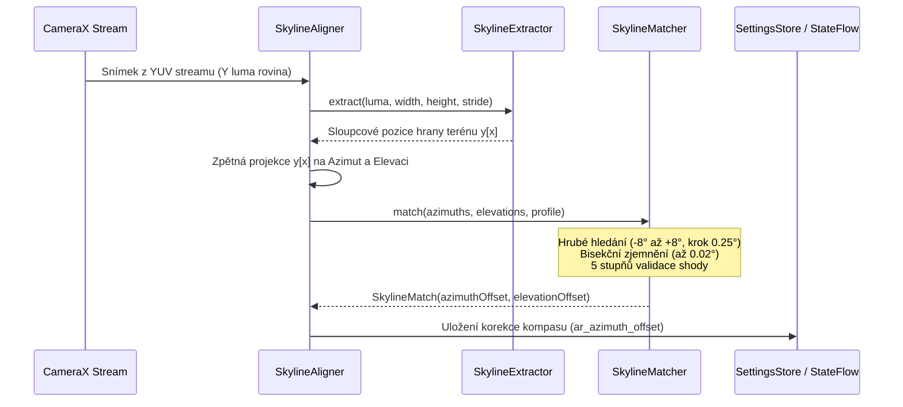
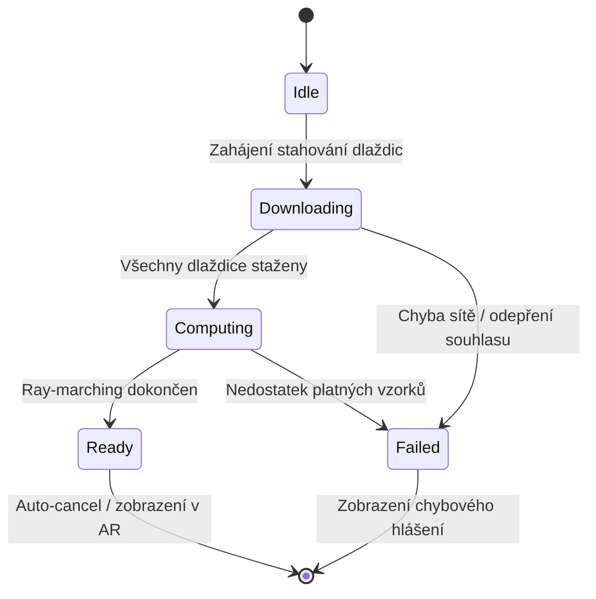

# Subsystém terénního horizontu v aplikaci Caelis

Tento dokument poskytuje vyčerpávající technickou a matematickou dokumentaci k subsystému **terénního horizontu** v aplikaci **Caelis**. Popisuje veškeré vrstvy od síťového stahování a dekódování binárních výškových dat (DEM), přes geodetický ray-marching s refrakcí a zakřivením Země, automatické zarovnání obrazu z kamery pomocí křížové korelace, až po hardwarové vykreslování v rozšířené realitě (AR) a AGSL shaderech.

---

## Obsah

1. [Přehled a architektura subsystému](#1-přehled-a-architektura-subsystému)
2. [Výšková data (DEM) a formát SRTM / HGT](#2-výšková-data-dem-a-formát-srtm--hgt)
3. [Síťová bezpečnost, stahování a správa cache](#3-síťová-bezpečnost-stahování-a-správa-cache)
4. [Matematické základy a výpočet Ray-Marchingu](#4-matematické-základy-a-výpočet-ray-marchingu)
5. [Analytický odhad dosahu (`HorizonRangeEstimator`)](#5-analytický-odhad-dosahu-horizonrangeestimator)
6. [Automatické zarovnání s kamerou (`SkylineExtractor` & `SkylineMatcher`)](#6-automatické-zarovnání-s-kamerou-skylineextractor--skylinematcher)
7. [Východy a západy těles za skutečným terénem (`TerrainRiseSetCalculator`)](#7-východy-a-západy-těles-za-skutečným-terénem-terrainrisesetcalculator)
8. [Vykreslovací pipeline v Rozšířené Realitě (AR)](#8-vykreslovací-pipeline-v-rozšířené-realitě-ar)
9. [Systémová oznámení a stavová lišta (`TerrainNotifications`)](#9-systémová-oznámení-a-stavová-lišta-terrainnotifications)
10. [Testovací strategie a ověřování invariantů](#10-testovací-strategie-a-ověřování-invariantů)

---

## 1. Přehled a architektura subsystému

Pro fotografy časosběrů a astrofotografy je matematický astronomický horizont ($0^\circ$ elevace) často zavádějící. Pokud se fotograf nachází v údolí obklopeném horami, Slunce zapadne za horský hřeben i o několik desítek minut dříve, než udává astronomický kalendář. Podobně v noci hvězdy a Mléčná dráha mizí za siluetou skutečného terénu.

Subsystém terénního horizontu řeší tento problém poskytnutím **skutečné siluety krajiny** v 360stupňovém zorném poli pozorovatele.

```
┌──────────────────────────────────────────────────────────────────────────┐
│                     SUBSYSTÉM TERÉNNÍHO HORIZONTU                        │
├──────────────────────┬──────────────────────┬────────────────────────────┤
│  Zdroje dat (DEM)    │  Výpočetní jádro     │  Prezentační vrstva (AR)   │
│                      │                      │                            │
│  - AWS Open Data     │  - Ray-marching      │  - Sun & Moon AR:          │
│    (Tilezen/Skadi)   │    (1440 azimutů)    │    3D vektorová polyline   │
│  - Ruční import HGT  │  - Efektivní rádius  │  - Night Sky AR:           │
│  - mmap cache        │    s refrakcí k=0.13 │    AGSL GPU Shader (1440x1)│
│  - Trvalé profily    │  - Automatický odhad │  - Auto-alignment kamery   │
│    (5.8 kB na disk)  │    dosahu (relief)   │    (křížová korelace)      │
└──────────────────────┴──────────────────────┴────────────────────────────┘
```

### Přehled vrstev a modulů v projektu

Architektura striktně odděluje čistou doménovou matematiku od frameworku Android:

```mermaid
flowchart TD
    subgraph Data_Layer ["data/horizon/ & notify/"]
        DTD[DemTileDownloader<br/><i>Jediné síťové volání</i>]
        DTC[DemTileCache<br/><i>mmap paměťová cache</i>]
        DTI[DemTileImporter<br/><i>Ruční import .hgt</i>]
        HPC[HorizonProfileCodec<br/><i>5.8 kB profil na disk</i>]
        HR[HorizonRepository<br/><i>Procesní singleton</i>]
        TN[TerrainNotifications<br/><i>Tiché oznámení v liště</i>]
    end

    subgraph Domain_Layer ["domain/horizon/ & domain/solar/ (Pure Kotlin)"]
        HT[HgtTile / ElevationGrid]
        Calc[HorizonProfileCalculator<br/><i>Geodetický ray-marching</i>]
        Prof[HorizonProfile<br/><i>1440 vzorků (0.25°)</i>]
        HRE[HorizonRangeEstimator<br/><i>Analytický odhad dosahu</i>]
        Extr[SkylineExtractor<br/><i>Luma detekce hran</i>]
        Match[SkylineMatcher<br/><i>Robustní křížová korelace</i>]
        TRSC[TerrainRiseSetCalculator<br/><i>Bisekční výpočet kontaktů</i>]
    end

    subgraph AR_UI_Layer ["ar/ & ui/"]
        Aligner[SkylineAligner<br/><i>CameraX frame grabber</i>]
        Proj[CameraProjection & FOV]
        SunAR[SunArScreen<br/><i>3D Polyline s tlumicím efektem</i>]
        NightAR[LandscapeShader & NightSkyRenderer<br/><i>AGSL Shader s NEAREST texturou</i>]
    end

    DTD -->|stahuje .hgt.gz| DTC
    DTI -->|kopíruje .hgt| DTC
    DTC -->|ShortBuffer mmap| HT
    HT --> Calc
    Calc --> Prof
    Prof --> HPC
    HR --> DTC
    HR --> Calc
    HR --> TN
    
    Prof --> TRSC
    Prof --> Match
    Extr --> Match
    Aligner --> Extr
    
    Prof --> SunAR
    Prof --> NightAR
    Proj --> SunAR
    Proj --> NightAR
```

---

## 2. Výšková data (DEM) a formát SRTM / HGT

Pro výpočet siluety terénu se využívá digitální model reliéfu (**Digital Elevation Model - DEM**) ve formátu **SRTM `.hgt`** (Shuttle Radar Topography Mission / ViewfinderPanoramas / Skadi).

### Specifikace souborového formátu `.hgt`

- **Geografická jednotka:** Každý soubor pokrývá čtverec $1^\circ \times 1^\circ$ zemského povrchu.
- **Pojmenování souborů:** Název odpovídá souřadnicím **jihozápadního (dolního levého) rohu** dlaždice. Například pro souřadnice $49.5^\circ\text{ N}, 16.2^\circ\text{ E}$ se použije dlaždice `N49E016.hgt`.
- **Uspořádání mřížky:** Čtvercová matice výškových bodů (posts) s orientací od **severu k jihu** (řádek 0 je nejsevernější) a od **západu k východu** (sloupec 0 je nejzápadnější).
- **Rozlišení sítě:**
  - **1 arc-second (SRTM-1 / Skadi):** $3601 \times 3601$ bodů. Krok sítě je $\frac{1}{3600}^\circ \approx 30\text{ m}$. Velikost souboru je $3601 \times 3601 \times 2 = 25\,934\,402\text{ B} \approx 25.93\text{ MB}$.
  - **3 arc-seconds (SRTM-3):** $1201 \times 1201$ bodů. Krok sítě je $\frac{1}{1200}^\circ \approx 90\text{ m}$. Velikost souboru je $1201 \times 1201 \times 2 = 2\,884\,802\text{ B} \approx 2.88\text{ MB}$.
- **Datový typ:** Každý vzorek je **16bitové znaménkové celé číslo v big-endian kódování** (`signed short`, 2 bajty), které udává nadmořskou výšku v metrech.
- **Překryv sousedních dlaždic:** Sousední dlaždice sdílejí hraniční řádek a sloupec. Z toho důvodu je na $1^\circ$ přesně $N - 1$ intervalů, nikoliv $N$.

### Reprezentace v paměti (`ShortBuffer`)

Dlaždice se nenačítají jako pole bajtů na haldu (heap) JVM, protože načtení 4 až 9 dlaždic by vyžadovalo přes 100–230 MB RAM a vedlo k pádům aplikace na paměť (OOM). Namísto toho třída [`HgtTile`](../app/src/main/java/com/dazix/caelis/domain/horizon/HgtTile.kt) mapuje soubor přímo z disku do virtuální paměti:

```kotlin
val buffer = stream.channel
    .map(FileChannel.MapMode.READ_ONLY, 0, file.length())
    .order(ByteOrder.BIG_ENDIAN)
    .asShortBuffer()
```

### Ošetření chybějících dat (Void Samples)

V místech strmých horských údolí, ledovců nebo vodních ploch radar SRTM nezachytil odraz a zapisuje speciální hodnotu **`-32768` (`0x8000`)**.

> [!IMPORTANT]
> Hodnota void vzorku se **nikdy nesmí interpretovat jako 0 m nad mořem**. V horském údolí by nulová nadmořská výška vytvořila falešný hluboký zářez do obzoru. Kód převádí `-32768` striktně na `null`.

### Bilineární interpolace s renormalizací (`blendCorners`)

Při dotazu na výšku v libovolných zeměpisných souřadnicích se provádí bilineární interpolace 4 okolních bodů mřížky. Pokud některý z bodů obsahuje hodnotu `null`, váhy zbývajících platných bodů se renormalizují:

```kotlin
internal fun blendCorners(
    v00: Double?, v10: Double?, v01: Double?, v11: Double?,
    fracRow: Double, fracCol: Double
): Double? {
    var weighted = 0.0
    var weight = 0.0
    fun add(value: Double?, w: Double) {
        if (value != null && w > 0.0) {
            weighted += value * w
            weight += w
        }
    }
    add(v00, (1.0 - fracRow) * (1.0 - fracCol))
    add(v01, (1.0 - fracRow) * fracCol)
    add(v10, fracRow * (1.0 - fracCol))
    add(v11, fracRow * fracCol)
    return if (weight <= 0.0) null else weighted / weight
}
```

---

## 3. Síťová bezpečnost, stahování a správa cache

Aplikace Caelis funguje v režimu maximálního soukromí a bezpečnosti, což je klíčové, protože drží systémové oprávnění přístupnosti (`AccessibilityService`).

```
┌────────────────────────────────────────────────────────────────────────┐
│                      SÍŤOVÉ ZÁRUKY A IZOLACE                           │
├────────────────────────────────────────────────────────────────────────┤
│ 1. Jediný soubor přistupující k síti: DemTileDownloader.kt             │
│ 2. Vynuceno architektonickým unit testem NetworkIsolationTest          │
│ 3. Dotaz na síť obsahuje pouze jméno dlaždice (např. N49E016.hgt.gz)   │
│ 4. Žádné cookies, identifikační hlavičky, poloha přesnější než 1°      │
│ 5. Souhlas uživatele (Consent) je ověřován při každém volání           │
│ 6. Odstranění INTERNET z manifestu aplikaci nerozbije (ruční import)   │
└────────────────────────────────────────────────────────────────────────┘
```

### Síťový stahovač (`DemTileDownloader`)

- **Zdroj dat:** AWS Open Data program (Tilezen Skadi repozitář na `https://s3.amazonaws.com/elevation-tiles-prod/skadi/{lat_prefix}/{tile}.hgt.gz`).
- **Dekomprese za běhu:** Soubory jsou stahovány komprimované v GZIP formátu (~8–12 MB) a dekomprimovány přímo do výstupního streamu přes `GZIPInputStream` bez alokace rozbaleného 26MB pole v paměti.
- **Dynamické ověření souhlasu:** Funkce `download` přijímá funkční odkaz `suspend () -> Boolean`. Pokud uživatel vypne síťová data v nastavení, další stahování okamžitě selže výjimkou `NotPermittedException`.

### Správa cache (`DemTileCache`)

- **Umístění cache:** Soubory dlaždic jsou ukládány do `cacheDir/dem/`. Jedná se o dočasná data, která může systém Android při nedostatku místa kdykoliv smazat.
- **Atomický zápis:** Soubor se stahuje do dočasného souboru `{tile}.part`. Po dokončení stahování se ověří jeho celistvost metodou `HgtTile.isPlausibleGridLength(length)`. Teprve po úspěšném ověření dojde k atomickému přejmenování na cílový soubor.
- **Ochrana aktivní pracovní sady (Working Set Protection):** Limit cache je nastaven na 260 MB (cca 10 dlaždic). Metoda `trim(protect: Set<DemTileKey>)` při promazávání nejstarších dlaždic **nikdy nesmaže dlaždice, které jsou právě potřeba pro aktuální výpočet**.

```
┌───────────────────────────────────────────────────────────────────────┐
│                       ARTEFAKT VS. CACHE                              │
├───────────────────────────────────┬───────────────────────────────────┤
│  Profil horizontu (Artefakt)      │  Výškové dlaždice (Cache)         │
│  - Složka: filesDir/horizons/     │  - Složka: cacheDir/dem/          │
│  - Velikost: 5.8 kB               │  - Velikost: až 26 MB na dlaždici │
│  - Trvalé uložení                 │  - Systém může kdykoliv smazat    │
│  - Umožňuje 100% offline provoz   │  - Slouží pouze jako mezipaměť    │
└───────────────────────────────────┴───────────────────────────────────┘
```

---

## 4. Matematické základy a výpočet Ray-Marchingu

Výpočet terénního profilu provádí třída [`HorizonProfileCalculator`](../app/src/main/java/com/dazix/caelis/domain/horizon/HorizonProfileCalculator.kt). Pro pozorovatele na dané zeměpisné šířce $\varphi$ a délce $\lambda$ provádí paprskové vzorkování (ray-marching) do všech 1440 směrů azimutu.

```
                          Zdánlivý úhel elevace θ
                                 ▲
                                /|  
                               / |  h_terrain
                              /  |
                             /   |
                            /    |
    Pozorovatel (h_eye) ────     │
        \                        │
         \                       │ drop(d) = d² / (2 R_eff)
          \                      │
           ──────────────────────▼
             Vzdálenost d podél sféry
```

### Fyzikální a geodetické konstanty

1. **Poloměr Země:** $R_{\text{earth}} = 6\,371\,000\text{ m}$.
2. **Standardní atmosférický refrakční koeficient:** $k = 0.13$.
   Světelné paprsky se v atmosféře vlivem hustotního gradientu vzduchu ohýbají směrem k zemskému povrchu. V geodézii a astronomii se tento jev modeluje pomocí **efektivního poloměru Země**:
   $$R_{\text{eff}} = \frac{R_{\text{earth}}}{1 - k} = \frac{6\,371\,000}{1 - 0.13} \approx 7\,322\,988.5\text{ m}$$

### Geometrický pokles horizontu (Dip of the Horizon)

Z vyvýšeného bodu klesá teoretický mořský horizont pod astronomickou rovinu o úhel:
$$\theta_{\text{dip}} = -\sqrt{\frac{2 \cdot h_{\text{eye}}}{R_{\text{eff}}}} \cdot \frac{180^\circ}{\pi}$$
kde $h_{\text{eye}} = h_{\text{ground}} + h_{\text{eye\_offset}}$ je nadmořská výška očí pozorovatele.

### Výškový pokles zakřivením a refrakcí

Ve vzdálenosti $d$ podél zemského povrchu klesá terén vlivem zakřivení a refrakce o výšku:
$$\text{drop}(d) = \frac{d^2}{2 \cdot R_{\text{eff}}}$$

### Zdánlivý úhel elevace

Zdánlivý výškový úhel terénního bodu s nadmořskou výškou $h_{\text{terrain}}$ ve vzdálenosti $d$ je dán vztahem:
$$\theta(d) = \arctan\left( \frac{h_{\text{terrain}} - h_{\text{eye}} - \text{drop}(d)}{d} \right) \cdot \frac{180^\circ}{\pi}$$

Pro každý z 1440 azimutů hledá algoritmus maximum:
$$\theta_{\max}(\alpha) = \max \left( \theta_{\text{dip}}, \max_{d} \theta(d) \right)$$

### Adaptivní krokování vzdálenosti (Distance Ladder)

Konstantní krok vzorkování podél paprsku (např. 30 m až do 60 km) by znamenal 2000 vzorků na každý z 1440 azimutů (téměř 3 miliony dotazů na DEM mřížku). Pro optimalizaci využívá Caelis adaptivní žebřík vzdáleností:

| Vzdálenost $d$ | Krok $\Delta d$ | Účel |
| :--- | :--- | :--- |
| **$0 - 5\text{ km}$** | **$30\text{ m}$** | Zachycení blízkých terénních hran a hřebenů |
| **$5 - 20\text{ km}$** | **$60\text{ m}$** | Střední terénní útvary |
| **$20 - 60\text{ km}$** | **$120\text{ m}$** | Vzdálené horské masivy |

Celkový počet kroků na jeden paprsek klesá z 2000 na pouhých cca 750 vzorků, což zkracuje dobu výpočtu pod 0.5 sekundy na moderním telefonu.

### Výpočetní optimalizace: Předčasné ukončení paprsku (Ceiling Test)

Žádný bod na Zemi nepřevyšuje nadmořskou výšku $H_{\max} = 9\,000\text{ m}$. Pro každý krok paprsku lze spočítat teoretický maximální možný úhel elevace, jaký by mohl terén v dané vzdálenosti dosáhnout:
$$\theta_{\text{ceiling}}(d) = \arctan\left( \frac{H_{\max} - h_{\text{eye}} - \text{drop}(d)}{d} \right) \cdot \frac{180^\circ}{\pi}$$
Pokud v průběhu pochodu paprsku hodnota $\theta_{\text{ceiling}}(d) \le \theta_{\text{best}}$, paprsek se **okamžitě ukončí**, protože žádný další bod podél tohoto směru již nemůže stávající horizont překonat.

```
                      Ray-Marching algoritmus (na jeden azimut)
                                         │
                                         ▼
                            best_altitude = floorAltitude
                                         │
                         ┌───────────────┴───────────────┐
                         ▼                               │
              Krok na další vzdálenost d                 │
                         │                               │
                         ▼                               │
            ceiling <= best_altitude? ───► [ANO] ────────┼──► Konec paprsku
                         │ [NE]                          │
                         ▼                               │
            Získání výšky h_terrain z DEM                │
                         │                               │
                         ▼                               │
           Spočtení úhlu theta(d)                        │
                         │                               │
                         ▼                               │
           theta(d) > best_altitude? ────► [ANO] ──► best_altitude = theta(d)
                         │ [NE]                          │
                         ▼                               │
           Dosažen maxRangeMeters? ──────► [ANO] ────────┘
                         │ [NE]
                         └───────────────► Další krok
```

### Výpočet souřadnic bodu podél geodetické křivky

Pro výpočet zeměpisné šířky $\varphi_2$ a délky $\lambda_2$ ve vzdálenosti $d$ a azimutu $\alpha$ se používá sférická trigonometrie s úhlovou vzdáleností $\delta = \frac{d}{R_{\text{earth}}}$:

$$\sin \varphi_2 = \sin \varphi_1 \cos \delta + \cos \varphi_1 \sin \delta \cos \alpha$$
$$\varphi_2 = \arcsin(\sin \varphi_2)$$
$$\Delta \lambda = \operatorname{atan2}(\sin \alpha \sin \delta \cos \varphi_1, \; \cos \delta - \sin \varphi_1 \sin \varphi_2)$$
$$\lambda_2 = \lambda_1 + \Delta \lambda$$

---

## 5. Analytický odhad dosahu (`HorizonRangeEstimator`)

Aby uživatel nemusel ručně hádat optimální poloměr hledání horizontu (a zbytečně nestahoval až 9 okolních dlaždic), modul [`HorizonRangeEstimator`](../app/src/main/java/com/dazix/caelis/domain/horizon/HorizonRangeEstimator.kt) počítá fyzikální dosah terénu přímo z primární dlaždice pozorovatele.

### Matematické odvození dosahu hřebene

Mějme nejvyšší bod v okolí o výšce $h$ nad okem pozorovatele ($h = H_{\text{peak}} - h_{\text{eye}}$) a stávající zjištěný úhel horizontu $\theta$. Hledáme vzdálenost $d$, ve které by vrchol této výšky vlivem zakřivení klesl přesně na úroveň úhlu $\theta$:

$$\frac{h - \frac{d^2}{2 R_{\text{eff}}}}{d} = \tan \theta$$

Úpravou získáme kvadratickou rovnici pro $d$:
$$d^2 + 2 R_{\text{eff}} \tan \theta \cdot d - 2 R_{\text{eff}} h = 0$$

Kladný kořen kvadratické rovnice dává přesný analytický dosah:
$$d = R_{\text{eff}} \left( \sqrt{\tan^2 \theta + \frac{2 h}{R_{\text{eff}}}} - \tan \theta \right)$$

Pokud se pozorovatel nachází na dně hlubokého údolí a horizont je tvořen blízkým hřebenem s elevací $+10^\circ$, vzdálenost $d$ vyjde např. pouhých $12\text{ km}$. Aplikace díky tomu ví, že není třeba stahovat žádné sousední dlaždice.

> [!TIP]
> Podrobný technický rozbor odvození, subsamplingu reliéfu a dvoufázového toku stahování dat naleznete v samostatném dokumentu [Automatická volba dosahu výpočtu a stahování dat](auto-range-estimation.md).

---

## 6. Automatické zarovnání s kamerou (`SkylineExtractor` & `SkylineMatcher`)

Magnetometry v mobilních telefonech trpí odchylkami vlivem magnetické deklinace, kovových konstrukcí a vnitřního rušení. Caelis obsahuje automatické optické zarovnání, které porovnává skutečný obraz z kamery s vypočteným 3D modelem terénu.



### 1. Extrakce hrany terénu (`SkylineExtractor`)

- Čte výhradně **Y (luma) rovinu** obrazového bufferu (jasová složka, žádná konverze do RGB ani bitmapová alokace).
- Využívá klouzavé průměrovací okno o velikosti 12 řádků nad a pod testovaným bodem. Posun o jeden řádek dolů vyžaduje pouze 4 čtení z pole ($O(1)$ na pixel).
- Hledá maximální pokles jasu shora dolů (světlá obloha $\to$ tmavý terén). Hrana je akceptována pouze při kontrastním skoku $\Delta Y \ge 18$ (z rozsahu 0–255).

### 2. Křížová korelace a fitování (`SkylineMatcher`)

Fitování hledá horizontální úhlový posun $\Delta \alpha$ a vertikální posun $\Delta \theta$, které minimalizují odchylku mezi pozorovanými body a profilem:

1. **Hrubé vzorkování:** Testuje posuny azimutu v rozsahu $\pm 8.0^\circ$ s krokem $0.25^\circ$.
2. **Jemné bisekční zjemnění:** Kolem nejlepšího kandidáta půlí krok až na $0.02^\circ$.
3. **Vertikální posun z kvantilu (Quantile Offset):** Vertikální posun se nepočítá z průměru ani mediánu, ale z **20% kvantilu** výškových rozdílů:
   $$\Delta \theta = \operatorname{Quantile}_{0.20} \left( \theta_{\text{camera}}[i] - \theta_{\text{profile}}(\alpha[i] + \Delta \alpha) \right)$$
   > [!NOTE]
   > Stromy, vegetace a budovy stojí **nad** holým terénním modelem (bare-earth DEM). Použití mediánu by započítalo průměrnou výšku lesa do kalibrace. Nízký kvantil váže kalibraci na skutečný terén.

### 5 úrovní ochrany proti falešné shodě (False Positive Rejection)

Algoritmus raději odmítne provést kalibraci, než aby použil chybnou hodnotu:
1. **Minimální počet sloupců:** Alespoň 24 sloupců s detekovanou hranou.
2. **Minimální členitost terénu:** Profil v zorném poli musí mít výškový rozkmit alespoň $0.4^\circ$ (zabraňuje pokusu o azimutální zarovnání na rovině nebo na moři).
3. **Minimální poměr reliéfu:** Pozorovaný reliéf musí dosahovat alespoň $50\,\%$ reliéfu modelu.
4. **Výraznost minima reziduí:** Minimum reziduí musí být alespoň o $30\,\%$ hlubší než průměr všech testovaných posunů ($R_{\min} \le 0.7 \cdot R_{\text{avg}}$), což eliminuje ploché linie mraků či střech.
5. **Absolutní práh přesnosti:** Výsledné mediánové reziduum musí být $R \le 0.5^\circ$ (cca úhlový průměr slunečního disku).

---

## 7. Východy a západy těles za skutečným terénem (`TerrainRiseSetCalculator`)

Modul [`TerrainRiseSetCalculator`](../app/src/main/java/com/dazix/caelis/domain/solar/TerrainRiseSetCalculator.kt) porovnává vypočtené astronomické trajektorie Slunce a Měsíce s profilem terénu.

```
      Úhel elevace
           ▲
           │          Astronomická dráha Slunce
           │              \
           │               \      Reálný západ za terén (18:42)
           │                \     ▼
           │  Terénní profil ─────┐
           │                     │ \
           │                     │  \   Astronomický západ (19:07)
           │                     │   \  ▼
      ─────┼─────────────────────┴───────\──────────────► Čas
          0°│                              \ (Astronomický horizont)
```

### Algoritmus výpočtu

1. **Detekce křížení:** Prochází body trajektorie vzorkované po 2 minutách a detekuje změnu znaménka relace:
   $$\Delta(t) = \theta_{\text{apparent}}(t) - \theta_{\text{profile}}(\alpha(t))$$
2. **Bisekční zjemnění:** Interval křížení $[t_1, t_2]$ je půlením zjemněn na přesnost **1 sekundy**.
3. **Vícenásobné události:** Algoritmus vrací kompletní seznam všech východů a západů v průběhu dne (např. pokud Slunce zapadne za horskou špičku, znovu se objeví v sedle a následně zapadne definitivně).
4. **Celodenní zastínění (`isSunHiddenAllDay`):** Detekuje případ, kdy se Slunce během celého dne nedostane nad terénní profil (např. v hlubokých severních roklích v zimě).

---

## 8. Vykreslovací pipeline v Rozšířené Realitě (AR)

### 1. Sun & Moon AR (3D Vektorová projekce)

- **Transformace souřadnic:** Pro převod ze světového souřadného systému ENU (East-North-Up) do souřadného systému kamery se používá **transponovaná matice rotace $R^T$** ze `SensorManager`:
  $$V_{\text{camera}} = R^T \cdot V_{\text{world}}$$
- **Korekce True-North a kalibrace:** Matice rotace je přednásobena rotací kolem osy Z (nahoru) o magnetickou deklinaci $\delta$ a uživatelský posun $\Delta$:
  $$R_{\text{true}} = R_z(\delta + \Delta) \cdot R_{\text{sensor}}$$
- **Výpočet zorného pole (FOV):** FOV je měřen přímo z CameraX streamu s korekcí oříznutí `FILL_CENTER` podle poměru stran displeje:
  $$\text{effectiveFovH} = 2 \arctan\left( \tan\left( \frac{\text{rawFovH}}{2} \right) \cdot \frac{\text{aspect}_{\text{viewport}}}{\text{aspect}_{\text{sensor}}} \right)$$
- **Vykreslení:** Spojitá 3D polyline křivka vykreslená na `Canvas` s vizuálním utlumením (dimming) trajektorie Slunce a Měsíce pod úrovní terénu.

### 2. Night Sky AR (AGSL Hardware Ray-Casting Shader)

V nočním režimu vykresluje terén hardwarový shader [`LandscapeShader`](../app/src/main/java/com/dazix/caelis/ui/nightsky/LandscapeShader.kt) běžící na GPU při 60 FPS s nulovými GC alokacemi.

#### Kódování profilu do 16-bitové textury ($1440 \times 1$)

1440 vzorků elevace v rozsahu $[-128^\circ, +128^\circ]$ je zakódováno do dvou 8bitových kanálů (R a G) textury o rozměrech $1440 \times 1$:
$$N = \left\lfloor \frac{\theta + 128.0}{256.0} \cdot 65535.0 \right\rceil$$
$$R = \left\lfloor \frac{N}{256} \right\rfloor, \quad G = N \pmod{256}$$

#### Dekódování a carry-safe interpolace v AGSL shaderu

```c
// AGSL Shader kód v LandscapeShader.kt
float decodeElevation(half4 texel) {
    float n = texel.r * 255.0 * 256.0 + texel.g * 255.0;
    return (n / 65535.0) * 256.0 - 128.0;
}

float terrainElevationAt(float texel) {
    float i0 = floor(texel);
    float f = texel - i0;
    float x0 = mod(i0, 1440.0) + 0.5;
    float x1 = mod(i0 + 1.0, 1440.0) + 0.5;
    float e0 = decodeElevation(horizonProfile.eval(float2(x0, 0.5)));
    float e1 = decodeElevation(horizonProfile.eval(float2(x1, 0.5)));
    return mix(e0, e1, f);
}
```

> [!IMPORTANT]
> **Proč vzorkování `NEAREST` a ruční interpolace v shaderu?**
> Hardwarové lineární filtrování GPU by interpolovalo přímo bajty kanálů R a G. Při přechodu přes hranici přenosu (např. z $R=1, G=255$ na $R=2, G=0$) by hardwarové zprůměrování dalo $R=1.5, G=127.5$, což se dekóduje na zcela nesmyslnou výšku. Vzorkování `NEAREST` a interpolace až po dekódování zajišťují absolutní numerickou přesnost.

#### Fázové sladění souřadnic textury

- **Proužek profilu terénu:** Texel 0 odpovídá přesně severu ($\theta = 0^\circ$).
- **Panoramatická textura:** Sever je umístěn uprostřed obrázku ($u = 0.5$).
Shader používá nezávislé mapování souřadnic, což zabraňuje otočení horizontu o $180^\circ$.

---

## 9. Systémová oznámení a stavová lišta (`TerrainNotifications`)

Stahování dlaždic a výpočet horizontu může trvat desítky sekund a probíhá často v terénu, kdy uživatel schová telefon do kapsy. Stav operace je proto indikován systémovým oznámením třídy [`TerrainNotifications`](../app/src/main/java/com/dazix/caelis/notify/TerrainNotifications.kt).

```
┌────────────────────────────────────────────────────────────────────────┐
│                   STAVOVÁ LIŠTA A OZNÁMENÍ                             │
├────────────────────────────────────────────────────────────────────────┤
│  Kanál: terrain_download                                               │
│  Priorita: NotificationManager.IMPORTANCE_DEFAULT                      │
│  Zvuk a vibrace: setSound(null, null), enableVibration(false)          │
│                                                                        │
│  Výsledek na Androidu 13+ (API 33+):                                   │
│  1. Ikona hory je trvale viditelná ve stavové liště vedle hodin        │
│  2. Notifikace v roletce ukazuje přesný progress bar a název dlaždice  │
│  3. Telefon nevydává žádný zvuk ani nevibruje                          │
│  4. Probíhající operace (ongoing) nelze omylem odmáznout gestem        │
└────────────────────────────────────────────────────────────────────────┘
```

### Stavy notifikace (`HorizonState`)



- **Jednorázová žádost o oprávnění:** Oprávnění `POST_NOTIFICATIONS` na Androidu 13+ je vyžádáno pouze jednou při prvním spuštění a uloženo v DataStore (`notification_permission_prompted`). Aplikace uživatele neobtěžuje opakovanými dialogy.

---

## 10. Testovací strategie a ověřování invariantů

Subsystém terénního horizontu je kryt rozsáhlou sadou unit testů bez závislostí na Android frameworku.

### Spouštění doménových testů

Během vývoje se spouští pouze cílená doménová sada:
```bash
scripts/run_tests.sh solar
```
Tato sada provede **179 testů** za méně než 5 sekund.

### Klíčové testovací třídy

1. [`HorizonProfileCalculatorTest`](../app/src/test/java/com/dazix/caelis/domain/horizon/HorizonProfileCalculatorTest.kt):
   - Ověření ray-marchingu na syntetických terénech (izolovaný kužel, dokonale plochá rovina, schodovitý zlom).
   - Test geometrického poklesu horizontu a refrakce $k = 0.13$.
   - Test invariantu povinné dlaždice pozorovatele (`MIN_USABLE_SAMPLES`).
2. [`HorizonRangeEstimatorTest`](../app/src/test/java/com/dazix/caelis/domain/horizon/HorizonRangeEstimatorTest.kt):
   - Analytické ověření kvadratického vzorce dosahu terénního reliéfu.
3. [`SkylineMatcherTest`](../app/src/test/java/com/dazix/caelis/domain/horizon/SkylineMatcherTest.kt):
   - Test konvergence křížové korelace na reálných datech hory Ještěd.
   - Test odmítnutí falešných shod (plochý horizont, mraky, nízký kontrast).
   - Ověření 20% kvantilu vertikálního offsetu.
4. [`NetworkIsolationTest`](../app/src/test/java/com/dazix/caelis/domain/horizon/NetworkIsolationTest.kt):
   - Statická analýza procházející veškeré zdrojové kódy v `app/src/main`. Zajišťuje, že `DemTileDownloader.kt` je jediným souborem otevírajícím síťové spojení.
5. [`NightSkyHorizonOrientationTest`](../app/src/test/java/com/dazix/caelis/ui/nightsky/NightSkyHorizonOrientationTest.kt):
   - Renderovací test shaderu ověřující orientaci terénního proužku vůči všem 4 světovým stranám.

---

## 11. Shrnutí a reference

Subsystém terénního horizontu v Caelis kombinuje přísnou bezpečnost a soukromí, pokročilou geodetickou matematiku a vysoce optimalizované hardwarové vykreslování v AR. Výsledkem je spolehlivý nástroj, který fotografům umožňuje s naprostou jistotou plánovat kompozice východů a západů nebeských těles přímo v terénu.
